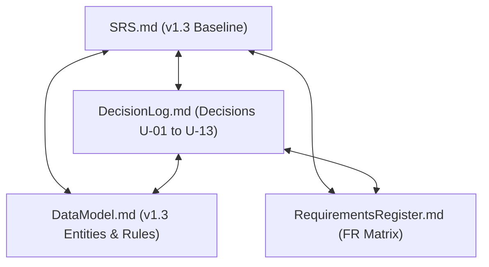

# IPMS Documentation Audit & Correction Report

**Date:** 2026-11-15  
**Role:** Senior Business Analyst & Software Requirements Engineer  
**Scope:** Post-UI/UX Decision Consolidation (Decisions U-01 through U-13)  
**Target Documents:** `SRS.md` (v1.3), `DecisionLog.md`, `RequirementsRegister.md`, `DataModel.md` (v1.3)

---

## Executive Summary

Following the consolidation of approved UI/UX decisions U-01 through U-13, a focused audit was conducted across the IPMS specification suite to eliminate unapproved assumptions, premature implementation details, and cross-document inconsistencies. All requirements now strictly adhere to IEEE 29148 precision, authoritative project baselines, and security standards (NFR-009) without inventing business decisions on behalf of stakeholders.

---

## 1. List of Corrections Made

### Area 1: Excess-Delivery Workflow Formalization
* **Four-Step Workflow Standardization**: Formalized and synchronized the sequential excess delivery lifecycle across FR-007, §4.3, §4.3.1, §6.1, §7.1, §7.2, §9 (Appendix A), `DecisionLog.md`, `RequirementsRegister.md`, and `DataModel.md`:
  1. **Step 1 (Clerk Request)**: Inventory Clerk records physical counts exceeding approved quantities and invokes `POST /requisitions/:id/excess-request` (Status: `FinanceApproved` $\to$ `ExcessPendingManager`). Stock is **not** altered.
  2. **Step 2 (Manager Operational Review)**: Manager reviews operational justification and invokes `PATCH /requisitions/:id/excess-authorize` (Status: `ExcessPendingManager` $\to$ `ExcessPendingFinance`).
  3. **Step 3 (Finance Commitment Review)**: Finance Officer reviews budget and financial commitment and invokes `PATCH /requisitions/:id/excess-authorize` (Status: `ExcessPendingFinance` $\to$ `ExcessApproved`).
  4. **Step 4 (Clerk Goods Receipt)**: Inventory Clerk completes physical goods receipt via `PATCH /requisitions/:id/receive` (Status: `ExcessApproved` $\to$ `Received`), executing an atomic stock increment for the authorized quantities.
* **Removal of Invented Rejection Behavior**: Completely excised unapproved fallback/rejection transitions (such as transitioning `ExcessPendingManager` or `ExcessPendingFinance` directly to `Rejected`) from the state machine diagram (§7.1) and transition matrix (§7.2). Rejection handling for excess requests is now explicitly identified as an **Unresolved Business Decision** (UD-01).
* **Audit Events & Status Enums**: Added `EXCESS_REQUESTED`, `EXCESS_MANAGER_APPROVED`, and `EXCESS_FINANCE_APPROVED` to `timeline.eventType` in §4.3.1, and ensured `ExcessApproved` is defined across all status enumerations.

### Area 2: Admin-Assisted Password Recovery & Privacy Compliance
* **Removal of Insecure Console Logging**: Removed all occurrences specifying that Admin-generated temporary passwords are logged to standard output/console (`FR-029`, §4.3, §6.1, Appendix A, `RequirementsRegister.md`, and `DataModel.md`).
* **Security & Privacy Alignment**: Explicitly cited **NFR-009** (Logging & Privacy), mandating that authentication secrets must never appear in application logs or standard streams. The endpoint `PATCH /users/:id/reset-password` response payload was updated to return a safe acknowledgment (`{ "message": "Password reset successfully initiated." }`). The credential handoff mechanism is marked as an unresolved implementation detail (UD-02).

### Area 3: Approval Quantity Modification Scope
* **Removal of "Reduction-Only" Constraint**: Stripped unapproved phrasing limiting reviewer modifications strictly to downward adjustments/reductions in FR-005, FR-006, §6.1 Rule 4, §7.2, `DecisionLog.md` (U-04), `RequirementsRegister.md`, and `DataModel.md`.
* **Decision U-04 Fidelity**: Reverted the requirement strictly to the approved text: reviewers modify quantities using a dedicated "Approve with Changes" dialog with automatic total recalculation $\sum(\text{approvedQty} \times \text{snapshotUnitPrice})$. Whether upper bounds permit exceeding requested quantities is documented as an open ambiguity (UD-03).

### Area 4: Notification Destination Context & Deep Linking
* **Deterministic Navigation Resolution**: Verified and documented in FR-017, §4.3, §4.3.1, `DecisionLog.md` (U-10), and `DataModel.md` that destination routing and targeted entity highlighting are achieved deterministically without redundant schema additions:
  - `entityType` defines the route (`/requisitions/:id` or `/items`).
  - `entityId` targets the specific record identifier.
  - `type` defines the target section to highlight (`ApprovalResult` highlights the approval section; `LowStockAlert` opens the catalog item drawer highlighting stock level; `RequisitionUpdate` highlights the status/goods receipt section).

### Area 5: Google Sheets Export Defaults Separation
* **Segregation of Approved vs. Implementation Defaults**: Updated FR-011 and `DecisionLog.md` (U-12) to isolate the approved core decision (Quick Export bypassing modal vs. Custom Export presenting column/filter options) from preliminary editing defaults.
* The preselected column list (`SKU`, `Name`, `Quantity`, `Unit Price`, `Reorder Threshold`) and scope (active items only) are explicitly designated as provisional implementation defaults pending Product Owner validation (UD-04).

### Area 6: Supporting Documentation Synchronization
* **DataModel.md**: Updated Requisition status enum to include `ExcessApproved`, added the 4-step excess receipt sequence, removed reduction-only limitations from approval rules, removed credential logging references, and brought the document to active baseline v1.3.
* **RequirementsRegister.md**: Synchronized FR-001, FR-003, FR-004, FR-005, FR-006, FR-007, FR-011, FR-017, FR-021, FR-024, FR-029, and FR-030 with SRS v1.3 and recorded open ambiguities.
* **docs/README.md**: Updated document registry baselines to reflect `SRS.md` v1.3 and `DataModel.md` v1.3.

---

## 2. List of Unresolved Decisions Requiring Approval

The following items are isolated and flagged for Product Owner review:

| Ref # | Decision Subject | Context & Current Documented Posture | Options for Product Owner Resolution |
| :--- | :--- | :--- | :--- |
| **UD-01** | **Excess Delivery Rejection Handling** | FR-007 & §7.2 define 4 positive steps (`ExcessPendingManager` $\to$ `ExcessPendingFinance` $\to$ `ExcessApproved` $\to$ `Received`). The workflow if Manager or Finance rejects the excess is undefined. | **Option A**: Return status to `FinanceApproved` allowing Clerk to receive only the originally approved quantity (treating excess as dockside refusal). **Option B**: Transition requisition to `Rejected`, requiring a full resubmission cycle. **Option C**: Create a dedicated `ExcessRejected` status requiring administrative intervention. |
| **UD-02** | **Admin-Assisted Password Delivery Mechanism** | In accordance with NFR-009, temporary passwords cannot be logged to stdout/console. The secure delivery mechanism must be defined. | **Option A**: Display a one-time generated temporary password directly in the Admin's browser modal upon confirmation (Admin communicates it out-of-band to user). **Option B**: Admin action triggers an automated email containing an encrypted temporary password or reset link. **Option C**: Admin generates a time-bound single-use activation code. |
| **UD-03** | **Approval Quantity Modification Bounds** | Decision U-04 approves the "Approve with Changes" dialog. Current text does not impose ceiling limits. | **Option A**: Restrict modifications strictly downward ($1 \le \text{approvedQty} \le \text{requestedQty}$). **Option B**: Allow upward modifications ($\text{approvedQty} > \text{requestedQty}$) subject to organizational budget limits. **Option C**: Allow upward changes only by Finance Officers, but restrict Managers to reductions. |
| **UD-04** | **Google Sheets Quick Export Defaults** | Decision U-12 approved Quick Export vs. Custom Export. Default column set and scope are currently draft assumptions. | **Option A**: Confirm defaults: Active items only, standard columns (`SKU`, `Name`, `Quantity`, `Unit Price`, `Reorder Threshold`). **Option B**: Export all catalog columns including `Location`, `Description`, and `Status`. **Option C**: Mirror the active filters and visible columns currently applied in the catalog data grid. |

---

## 3. Cross-Document Consistency Report

A full cross-reference audit across the document repository confirms structural and semantic alignment:

| Check Item | `SRS.md` v1.3 | `DecisionLog.md` | `RequirementsRegister.md` | `DataModel.md` v1.3 | Consistency Status |
| :--- | :--- | :--- | :--- | :--- | :--- |
| **Excess Delivery** | 4-step flow; rejection marked as UD-01 | 4-step flow in U-05.2; rejection marked unresolved | FR-007 notes 4-step flow & UD-01 | Enum includes `ExcessApproved`; 4 steps detailed; rejection open | **100% Aligned** |
| **Password Reset** | Dual paths; NFR-009 enforced; handoff is UD-02 | Dual paths in U-13; console logging revoked | FR-029 notes dual paths, NFR-009, & UD-02 | Dual paths noted; console logging removed; NFR-009 cited | **100% Aligned** |
| **Quantity Modification** | Dialog noted; reduction-only removed; UD-03 | U-04 dialog documented; bounds marked ambiguous | FR-005 & FR-006 note dialog & UD-03 | Rules 2 & 3 note dialog & UD-03 ambiguity | **100% Aligned** |
| **Notification Context** | Deterministic resolution (§4.3, §4.3.1) | U-10 documents deterministic derivation | FR-017 documents deep linking & derivation | Business rule defines derivation from `entityType`/`id`/`type` | **100% Aligned** |
| **Sheets Export** | Quick vs Custom; defaults marked draft (UD-04) | U-12 separates core decision from draft defaults | FR-011 notes Quick/Custom & draft defaults | N/A (DataModel strictly covers DB persistence) | **100% Aligned** |
| **Requisition Lifecycle** | Immediate submit; no draft; statuses synchronized | U-01 immediate submit; no draft state | FR-004 & FR-024 reflect immediate submit & no draft | Status enum & Step 1 reflect immediate submit & no draft | **100% Aligned** |
| **Item Presentation** | Right-side drawer (FR-003, §3.2) | U-02 Right-side detail drawer | FR-003 notes drawer presentation | DataModel notes catalog browsing & soft deletion | **100% Aligned** |

---

## 4. Final Readiness Assessment for SAD Creation

### **Verdict: Ready for SAD with documented limitations**

### Justification & Boundary Analysis
1. **Core Navigation & Screen Layouts (Unblocked)**:
   - Screen structure, data views, and interaction patterns are 100% stable across all 13 approved UI/UX decisions (Immediate requisition creation modal, Item Catalog right-side drawer, Goods Receipt verification interface, Quick/Custom Export dialog, Requisition tabbed filters, and Role-tailored Dashboard activity feeds).
   - Architectural layout for the Screen Architecture Document (SAD) can proceed immediately without waiting for resolution on the open questions.
2. **Impact of Documented Limitations on SAD**:
   - **UD-01 (Excess Rejection)**: Affects the final notification banner/status chip if an excess request is turned down; does not alter the Goods Receipt input form, the 4-step approval action buttons, or the authorization dialog.
   - **UD-02 (Admin Password Handoff)**: Affects only the feedback panel within the User Management modal (e.g., one-time password modal vs. confirmation alert).
   - **UD-03 (Quantity Modification Bounds)**: Affects the client-side validation rule on the "Approve with Changes" number input (whether `max="requestedQty"` is enforced); the dialog layout and recalculation UX remain identical.
   - **UD-04 (Quick Export Defaults)**: Affects only the backend export query parameters; the Custom Export configuration dialog and Quick Export toolbar button UX remain identical.
