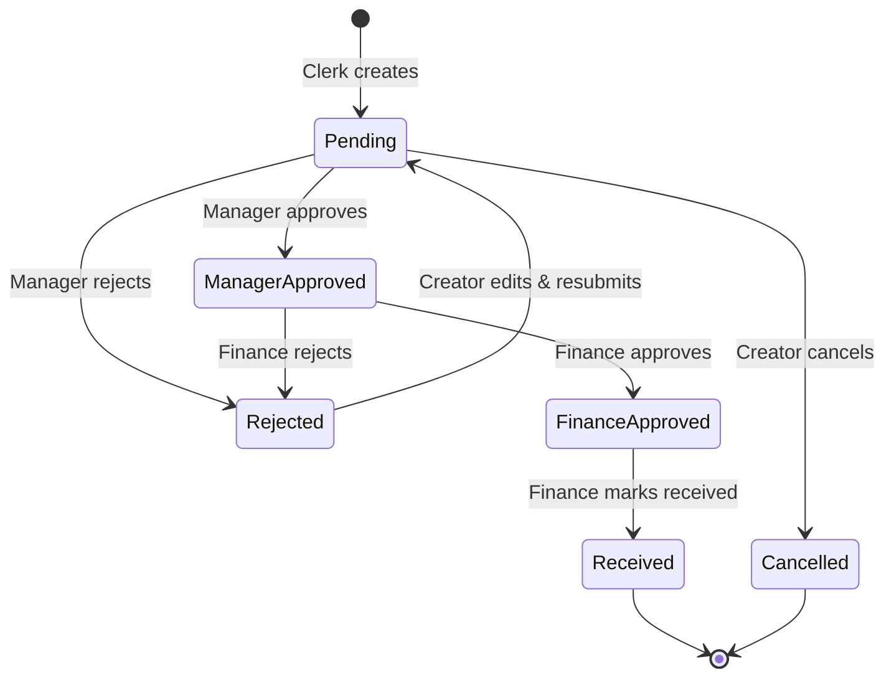

# Software Requirements Specification (SRS)

*Version 1.2 – Draft*
*Revised on 2026-11-14*

### Revision History
| Version | Date | Changes |
|---------|------|---------|
| 1.0 | 2026-11-13 | Initial draft. |
| 1.1 | 2026-11-14 | Comprehensive revision addressing first and second independent audits. Added FR‑023–FR‑030. Corrected RBAC matrix, SSE spec, NFRs, DataModel, and Requirements Register. See `SRS_Draft_Review.md` for full audit trail. |
| 1.2 | 2026-11-14 | Third‑round audit fixes: changed export endpoint to POST (REV3‑004); added concurrency guard for status transitions (REV3‑010); added Admin self‑deactivation guard (REV3‑009); added `dashboard.updated` SSE event (REV3‑008); added Out of Scope section, document conventions, NFR verification methods, separation‑of‑duties acknowledgment, role shorthand definitions, and `unitPrice` snapshot rule. |

---

## 1. Introduction
### 1.1 Purpose
The purpose of this document is to specify the functional and non‑functional requirements for the **Inventory & Procurement Management System (IPMS)**. The SRS serves as the definitive reference for designers, developers, testers, and stakeholders throughout the product life‑cycle.

### 1.2 Scope
The system enables multiple user roles to manage inventory items, create purchase requisitions, execute a two‑step approval workflow (Manager → Finance), receive goods, generate low‑stock alerts, view a real‑time dashboard, and export inventory data to a Google Sheet. Optional forecasting and visual analytics may be added after the MVP is delivered.

The MVP covers the **internal requisition and approval workflow**. Supplier‑facing procurement (purchase order generation, supplier management, delivery tracking) is out of scope — see §2.6.

### 1.3 Definitions, Acronyms, Abbreviations
| Term | Definition |
|------|------------|
| **MVP** | Minimum Viable Product – the set of mandatory features to be delivered within the agreed implementation time‑box. |
| **SSE** | Server‑Sent Events – a unidirectional push mechanism for real‑time updates from the back‑end to the front‑end. |
| **JWT** | JSON Web Token – used for authentication (access token + refresh token). |
| **CRUD** | Create, Read, Update, Delete operations. |
| **SMA** | Simple Moving Average – lightweight demand‑forecasting algorithm (optional). |
| **NFR** | Non‑functional requirement. |
| **FR** | Functional requirement. |
| **Clerk** | Shorthand for "Inventory Clerk" throughout this document. |
| **Finance** | Shorthand for "Finance Officer" throughout this document. |

### 1.4 References
- Project Brief – `docs/ProjectBrief.md`
- Data Model & Business Rules – `docs/DataModel.md`
- Functional Requirements Register – `docs/RequirementsRegister.md`
- Design Decision Log – `docs/DecisionLog.md`
- ISO/IEC/IEEE 29148 – Systems and software engineering – Life cycle processes – Requirements engineering.

### 1.5 Document Conventions
This document uses **plain language** for requirement statements rather than the formal IEEE 29148 keyword convention (`shall`, `should`, `may`). All functional requirements in §3 marked as **Mandatory** carry the same force as an IEEE "shall" statement — they must be implemented and verified. Requirements marked **(Optional)** or **(Good‑to‑have)** correspond to IEEE "may."

Acceptance criteria use imperative mood for clarity (e.g., "Registration succeeds…") and serve as the basis for test‑case derivation.

---

## 2. Overall Description
### 2.1 Product Perspective
IPMS is a **stand‑alone** web application consisting of a React + TypeScript single‑page application (SPA) communicating with a NestJS RESTful API. PostgreSQL stores persistent data. Prisma is used as the ORM for type‑safe schema management and migrations. External services used for the MVP are:
- **SendGrid** (mock email – console log via an `EmailService` interface with a `ConsoleEmailService` implementation, allowing future replacement).
- **Google Sheets API** (read/write export via service‑account).
- **GitHub Actions** for CI/CD (development‑process artifact, not a system requirement).

### 2.2 Product Functions (high‑level)
1. **User Management** – registration, login, role‑based access control, user deactivation, admin password reset.
2. **Item Catalog** – CRUD for inventory items with per‑SKU low‑stock threshold and manual stock adjustment.
3. **Requisition Workflow** – creation, two‑step approval (with partial approval), rejection with re‑submission, cancellation, receipt, stock adjustment.
4. **Alerting** – low‑stock notifications (in‑app toast + mock email) and a persistent notification history.
5. **Real‑time Dashboard** – totals, low‑stock count, recent requisitions, refreshed via SSE.
6. **Export** – inventory export to Google Sheet (fallback CSV on failure).

### 2.3 User Classes & Characteristics
| Role | Primary Capabilities |
|------|----------------------|
| **Admin** | Manage users & roles (assign, deactivate, reset password), full CRUD on items, view all requisitions and audit logs. Admin does **not** participate in the approval workflow (approve/reject/receive). |
| **Inventory Clerk** | View items, create requisitions, cancel own pending requisitions, adjust stock manually (increase or decrease). |
| **Manager** | Approve/reject requisitions (first level), receive low‑stock alerts. |
| **Finance Officer** | Approve/reject second level, mark requisitions as Received, trigger stock increment, export to Google Sheet, receive low‑stock alerts. |

### 2.4 Operating Environment
- **Frontend**: Modern browsers (Chrome, Edge, Firefox, Safari) on Windows, macOS, Linux, and mobile devices.
- **Backend**: Node.js 20+, NestJS 10, PostgreSQL 15, Prisma ORM.
- **Deployment**: Docker containers; optional `docker‑compose.yml` for local development.

### 2.5 Design Constraints & Assumptions
- All mandatory features must be completed within **4 weeks**.
- No real email delivery; SendGrid calls are mocked (console log) to avoid credential exposure.
- Low‑stock threshold is **per‑SKU** (Decision D‑004).
- Real‑time updates are implemented via **SSE** (Decision D‑005). **This supersedes the 5‑second polling approach described in the original Project Brief; the decision is documented in `docs/DecisionLog.md` and approved by the product owner.**
- Two‑step approval workflow is **mandatory** (industry‑standard) – Decision D‑002.
- Forecasting and interactive charts are **optional/good‑to‑have** and may be deferred.
- Password reset is admin‑initiated only (no self‑service email flow) due to mocked email.
- **Separation of duties (simplified):** In the MVP, the Finance Officer role combines financial approval authority and goods‑receipt confirmation. A production system would separate these into distinct roles (e.g., Finance Approver vs. Receiving Clerk) to strengthen internal controls. This simplification is accepted for the 4‑role MVP.

### 2.6 Out of Scope
The following features are **explicitly excluded** from the MVP:

| Feature | Rationale |
|---------|-----------|
| Self‑service password reset (email link) | Email is mocked; admin‑initiated reset provided instead. |
| Supplier management / purchase order generation | Future phase; MVP covers internal requisition workflow only. |
| Delivery tracking / partial deliveries | Requires supplier integration; out of scope. |
| CSV bulk import | Nice‑to‑have; may be added post‑MVP. |
| QR / barcode scanning | Future extension. |
| Multi‑tenancy / SaaS model | Out of scope. |
| Advanced AI forecasting | Out of scope; simple SMA available as optional FR‑015. |
| Writable Google Sheets (data flowing back into the system) | Export is one‑way only. |

---

## 3. Functional Requirements
The functional requirements are enumerated in the **Requirements Register** and are reproduced here with brief acceptance criteria.

| ID | Requirement (summary) | Acceptance Criteria |
|----|-----------------------|----------------------|
| FR‑001 | User registration & login | 1. Registration succeeds with a unique email and a password ≥ 8 chars. 2. New users receive the **Clerk** role by default; Admin may later change the role via User Management API. 3. Password stored as bcrypt hash. 4. Login returns a JWT access token (15 min) and a refresh token (7‑day expiry) in HttpOnly cookies. |
| FR‑002 | Role‑based access control | 1. Each endpoint validates the JWT and the caller's role. 2. Admin can access all **data‑management** endpoints; other roles restricted as per the RBAC Permission Matrix (Appendix A). 3. Approval workflow endpoints (approve, reject, receive) are restricted to Manager and Finance only. |
| FR‑003 | Item CRUD with `reorderThreshold` | 1. Admin can create, read, update, delete items. 2. `quantity` cannot become negative. 3. Low‑stock alert triggers on threshold crossing (see FR‑008). 4. **Deletion restriction** – an Item referenced by any existing `RequisitionItem` **cannot be hard‑deleted**; attempt returns HTTP 409 `ItemInUse`. Soft‑delete (`isActive` flag) may be used for archival purposes. |
| FR‑004 | Create purchase requisition | 1. Clerk can submit a requisition containing one or more line items. 2. Requisition status = `Pending` on creation. 3. `approvedQty` defaults to `requestedQty` for each line item. 4. `totalAmount` computed as `Σ(requestedQty × Item.unitPrice)` at creation; **`unitPrice` is captured (snapshotted) at requisition creation time and is not affected by subsequent price changes to the Item**. |
| FR‑005 | Manager approval (first level) | 1. Manager can approve → status becomes `ManagerApproved` **or** reject → status `Rejected`. 2. Manager may modify `approvedQty` on individual line items (partial approval); if modified, `totalAmount` is recalculated as `Σ(approvedQty × snapshotted unitPrice)`. 3. An audit‑log entry records the action, user, timestamp, and before/after status. 4. On rejection, a `rejectionReason` (required string) is stored in the audit log and the creator receives a notification; the creator may edit the requisition and resubmit (status returns to `Pending`). |
| FR‑006 | Finance approval (second level) | 1. Finance can approve → status becomes `FinanceApproved` **or** reject → status `Rejected`. 2. Finance may modify `approvedQty` (partial approval); `totalAmount` recalculated if modified. 3. Audit‑log entry created. 4. On rejection, a `rejectionReason` (required string) is stored in the audit log and the creator receives a notification; the creator may edit the requisition and resubmit (status returns to `Pending`, restarting the full approval flow from Manager). |
| FR‑007 | Mark requisition as Received & stock update | 1. Finance can set status to `Received`. 2. For each line item, `Item.quantity` increases by **`approvedQty`**. 3. `totalAmount` is finalized as `Σ(approvedQty × snapshotted unitPrice)`. 4. Update performed inside a DB transaction; audit‑log recorded. 5. Low‑stock alert evaluation triggered for each affected item per FR‑008. |
| FR‑008 | Low‑stock alert notifications | 1. When `Item.quantity` **transitions from ≥ `reorderThreshold` to < `reorderThreshold`** (threshold crossing), a `LowStockAlert` notification is created for Manager and Finance. 2. The alert fires **once per crossing**; subsequent operations while below threshold do not create duplicate alerts. 3. The check runs after **any quantity‑changing operation**: goods receipt (FR‑007), manual adjustment (FR‑025), or admin item update (FR‑003). 4. A mock email is logged to the console. |
| FR‑009 | Real‑time updates via SSE | 1. Clients can open `GET /events` and receive typed JSON events (see §4.4 SSE Event Specification). 2. The endpoint **requires a valid JWT** presented via HttpOnly cookie; all authenticated users may subscribe. 3. Events are emitted within 1 s of the underlying DB change. 4. A heartbeat comment line (`: heartbeat\n\n`) is sent every 30 s to detect dead connections. |
| FR‑010 | Dashboard view | 1. `GET /dashboard` returns `{ totalItems, lowStockCount, recentRequisitions[] }` (the 5 most recent). 2. Dashboard UI loads initial data from this endpoint. 3. The server emits a **`dashboard.updated`** SSE event (containing refreshed aggregate values) after any operation that affects totals or low‑stock count; the frontend replaces its local state with the received payload. |
| FR‑011 | Export to Google Sheets (read/write) | 1. Finance can click "Export" and a Google Sheet is **created or updated** with the current inventory view via `POST /export/google-sheet`. 2. Service‑account requires `https://www.googleapis.com/auth/spreadsheets` (read/write) scope; the system does **not** read data back from the Sheet (one‑way export). 3. On success, the endpoint returns **HTTP 200** with `{ sheetUrl: string }` containing the Google Sheet URL. 4. On API failure (network error, quota exceeded, invalid credentials), the system returns HTTP 502 with error details and directs the user to the CSV fallback (FR‑026). |
| FR‑012 | OpenAPI documentation | 1. Swagger UI available at `/api/docs` and reflects all endpoints. |
| FR‑014 | Audit log | 1. Immutable entries store `entity`, `entityId`, `action`, `performedBy`, `timestamp`, and JSON `details` (before/after values; `rejectionReason` when applicable). |
| FR‑015 | (Optional) SMA demand forecasting | 1. System computes a 4‑week moving average per SKU and displays a recommended reorder quantity on the dashboard. |
| FR‑016 | (Good‑to‑have) Interactive Chart.js visualisations | 1. Stock turnover line chart, monthly spend bar chart, and low‑stock heat map are displayed on the dashboard. |
| FR‑017 | Notification history & unread flag | 1. All toast notifications are persisted in a `Notification` store. 2. Unread notifications are highlighted in the UI; users can mark them as read (own notifications only). |
| FR‑018 | Login endpoint rate‑limiting | 1. No more than **5** attempts per IP in a 1‑minute window. 2. 6th attempt returns HTTP 429 with message "Too many login attempts – try again later". |
| FR‑019 | CSRF protection for state‑changing requests | 1. On successful login, a **CSRF token** is generated, stored in a **non‑HttpOnly** cookie `csrfToken`, and also returned in the response body. 2. The client reads the cookie and sends it in header `X‑CSRF‑Token` for all state‑changing requests. 3. Missing/invalid token returns HTTP 403. |
| FR‑020 | Input validation & sanitisation | 1. All request bodies validated against typed DTOs. 2. Invalid payloads return HTTP 400 with validation errors; strings are escaped before DB insertion. |
| FR‑021 | Pagination and filtering for list endpoints | 1. `GET /items` and `GET /requisitions` support `limit` (default 50) and `offset` (default 0). 2. `GET /requisitions` additionally supports query parameters: `status` (filter by status enum), `creatorId` (filter by creator UUID). 3. Response includes `totalCount` and `pageInfo`. |
| FR‑022 | SSE connection throttling | 1. Each user may have up to **3** concurrent `/events` streams. 2. Excess connections receive HTTP 429 "Too many SSE connections". |
| FR‑023 | User Management API | 1. `GET /users` – list all users (Admin only). 2. `PATCH /users/:id/role` – change a user's role (Admin). 3. `PATCH /users/:id/deactivate` – deactivate a user account (Admin); immediately invalidates all refresh tokens for that user; deactivated users receive HTTP 403 `AccountDeactivated` on any authenticated request; pending requisitions created by the user remain in their current state. **An Admin cannot deactivate their own account. The system must maintain at least one active Admin at all times; if only one active Admin exists, the deactivation request returns HTTP 409 `LastAdminAccount`.** 4. `PATCH /users/:id/reactivate` – reactivate a previously deactivated user (Admin). |
| FR‑024 | Requisition cancellation | 1. The creator may cancel a requisition in `Pending` status via `PATCH /requisitions/:id/cancel`. 2. Status becomes `Cancelled` (terminal state); audit‑log entry recorded; cancellation notification sent to Manager and Finance. |
| FR‑025 | Manual stock adjustment | 1. `PATCH /items/:id/adjust` – increase or decrease `Item.quantity` by a signed integer `adjustment`. 2. If `quantity + adjustment < 0`, the request is rejected with HTTP 422 `InsufficientStock`. 3. Endpoint restricted to Admin and Clerk. 4. An `adjustmentReason` string is required in the request body. 5. Audit‑log entry recorded. 6. After the adjustment, the low‑stock alert threshold‑crossing rule (FR‑008) is evaluated. |
| FR‑026 | CSV fallback for export | 1. If the Google Sheets API call fails, the system returns HTTP 502 with error details and provides a downloadable CSV via `GET /export/csv`. 2. `GET /export/csv` is also available as a standalone endpoint for direct CSV download. |
| FR‑027 | Refresh token endpoint | 1. `POST /auth/refresh` – validates current refresh token, issues new access token **and** a new refresh token (rotation); old refresh token is immediately invalidated. 2. New refresh token expires after **7 days**. |
| FR‑028 | Logout endpoint | 1. `POST /auth/logout` – invalidates the current refresh token, clears the HttpOnly cookie. |
| FR‑029 | Admin‑initiated password reset | 1. `PATCH /users/:id/reset-password` – Admin generates a temporary password for the user. 2. The temporary password is delivered via mock email (console log). 3. Self‑service password reset (email link) is **out of scope** for the MVP due to mocked email. |
| FR‑030 | Dashboard aggregation endpoint | 1. `GET /dashboard` returns `{ totalItems, lowStockCount, recentRequisitions[] }`. 2. `recentRequisitions` contains the 5 most recent requisitions with their current status. 3. Aggregates are computed on‑demand (no caching required for MVP). |

*Note*: FR‑013 (CI/CD pipeline) has been removed from the functional requirement list because it describes a development‑process activity, not system behaviour.

---

## 4. External Interface Requirements
### 4.1 User Interfaces
- **SPA** built with React + TypeScript, using Material‑UI components (tables, dialogs, snackbars).
- Responsive layout for **desktop, tablet, and mobile** devices.

### 4.2 Software Interfaces
- **REST API** (NestJS) – JSON over HTTPS.
- **SSE endpoint** – `GET /events` streams newline‑delimited JSON events (see §4.4).
- **Google Sheets API** – service‑account JSON key (read/write scope).
- **SendGrid (mock)** – `ConsoleEmailService` implementing an `EmailService` interface; logs email content to stdout.

### 4.3 API Interfaces – complete list
| Method | Path | Description | Roles allowed |
|--------|------|-------------|---------------|
| POST | `/auth/register` | Register new user (default role: Clerk). | Public |
| POST | `/auth/login` | Login, receive JWTs. | Public |
| POST | `/auth/refresh` | Rotate refresh token, issue new access token. | Authenticated |
| POST | `/auth/logout` | Invalidate refresh token, clear cookie. | Authenticated |
| GET | `/items` | List items (pagination). | All authenticated |
| POST | `/items` | Create item. | Admin |
| PATCH | `/items/:id` | Update item (including `reorderThreshold`). | Admin |
| PATCH | `/items/:id/adjust` | Manual stock increase/decrease. | Admin, Clerk |
| DELETE | `/items/:id` | Delete item (restricted – see FR‑003). | Admin |
| GET | `/dashboard` | Dashboard aggregation (totals, low‑stock, recent). | All authenticated |
| POST | `/requisitions` | Create requisition. | Clerk |
| GET | `/requisitions` | List requisitions (pagination + filtering). | All authenticated |
| GET | `/requisitions/:id` | Get requisition detail. | All authenticated |
| PATCH | `/requisitions/:id/approve` | Approve requisition (with optional `approvedQty`). | Manager, Finance |
| PATCH | `/requisitions/:id/reject` | Reject requisition (requires `rejectionReason`). | Manager, Finance |
| PATCH | `/requisitions/:id/cancel` | Cancel pending requisition. | Clerk (own pending only) |
| PATCH | `/requisitions/:id/receive` | Mark as Received, update stock. | Finance |
| GET | `/notifications` | List notifications (with unread filter). | All authenticated (own only) |
| PATCH | `/notifications/:id/read` | Mark notification as read. | All authenticated (own only) |
| GET | `/audit-logs` | View audit log entries. | Admin |
| GET | `/users` | List users. | Admin |
| PATCH | `/users/:id/role` | Change user role. | Admin |
| PATCH | `/users/:id/deactivate` | Deactivate user account. | Admin |
| PATCH | `/users/:id/reactivate` | Reactivate user account. | Admin |
| PATCH | `/users/:id/reset-password` | Admin‑initiated password reset. | Admin |
| **POST** | **`/export/google-sheet`** | **Export inventory to Google Sheet (creates/updates).** | **Finance** |
| GET | `/export/csv` | Download CSV export. | Finance |
| GET | `/api/docs` | Swagger UI. | Public (dev) / disabled (prod) |
| GET | `/health` | Health‑monitoring endpoint. | Public |
| GET | `/events` | SSE stream for real‑time updates. | All authenticated |

### 4.4 SSE Event Specification
The `GET /events` endpoint streams Server‑Sent Events using the following typed event format:

**Event types:**
| Event Type | Emitted When | Payload Fields |
|------------|-------------|----------------|
| `item.updated` | Item quantity, attributes, or `isActive` changes. | `entityId`, `changes` (object with `field: { old, new }`), `timestamp` |
| `item.created` | New item created. | `entityId`, `item` (summary object), `timestamp` |
| `item.deleted` | Item hard‑ or soft‑deleted. | `entityId`, `timestamp` |
| `requisition.updated` | Requisition status changes (approval, rejection, receipt, cancellation). | `entityId`, `status`, `previousStatus`, `timestamp` |
| `requisition.created` | New requisition submitted. | `entityId`, `creatorId`, `status`, `timestamp` |
| `notification.created` | New notification for the connected user. | `notificationId`, `type`, `message`, `timestamp` |
| `dashboard.updated` | Any operation changes aggregate totals or low‑stock count. | `totalItems`, `lowStockCount`, `timestamp` |

**Broadcast rules:**
- `item.*`, `requisition.*`, and `dashboard.updated` events are broadcast to **all** authenticated SSE subscribers.
- `notification.created` events are sent **only to the target user** (filtered by `userId`).

**Wire format** (standard SSE):
```
event: item.updated
data: {"entityId":"uuid","changes":{"quantity":{"old":100,"new":95}},"timestamp":"2026-11-14T01:00:00Z"}

```

**Heartbeat:** A comment line (`: heartbeat`) is sent every **30 seconds** to keep the connection alive and detect dead clients.

**Reconnection:** The server sets `retry: 5000` (5 s reconnect interval). Clients should use the `Last-Event-ID` header for resumption; events include a sequential `id` field.

---

## 5. Non‑Functional Requirements
| ID | Requirement | Verification |
|----|-------------|--------------|
| NFR‑001 | **Performance** – API response time < 200 ms for CRUD operations on up to 5 k items; SSE latency ≤ 1 s. | `k6` load test script on local Docker deployment; SSE latency measured by timestamp comparison. |
| NFR‑002 | **Security** – Passwords hashed with bcrypt; JWT access token lifespan 15 min; refresh token stored HttpOnly, expires after 7 days, rotates on each use; role‑based guards; CSP headers (see NFR‑016); CSRF double‑submit cookie; mock email only, no real credentials stored. | Automated security test suite; manual checklist confirming no plain‑text passwords in DB or logs. |
| NFR‑003 | **Scalability** – Stateless NestJS services for REST endpoints. **SSE is single‑instance**: long‑lived SSE connections are bound to the originating server instance. Horizontal scaling of SSE would require a pub/sub backplane (e.g., Redis Pub/Sub), which is **out of scope for the MVP**. | Architecture review; statelessness confirmed by restarting service without session loss for REST endpoints. |
| NFR‑004 | **Reliability** – All stock adjustments performed inside a PostgreSQL transaction with `SELECT … FOR UPDATE` (via Prisma interactive transactions). **Requisition status transitions also use `SELECT … FOR UPDATE`** to prevent concurrent conflicting operations (e.g., simultaneous approve and cancel on the same requisition). | Integration tests with concurrent requests confirming no race conditions; transaction isolation verified via test harness. |
| NFR‑005 | **Usability** – UI follows WCAG 2.1 Level A accessibility standards via Material‑UI accessible components; toast notifications and a persistent notification history panel. | Automated accessibility scan using `axe-core`; manual keyboard‑navigation test on core workflows. |
| NFR‑006 | **Maintainability** – Clean‑architecture folder layout (`src/modules/*`), TypeScript strict mode, ESLint + Prettier, JSDoc comments, auto‑generated OpenAPI spec. | ESLint passes with zero errors; TypeScript compiles with `strict: true`; Prettier check passes; OpenAPI spec validates. |
| NFR‑007 | **Cost** – All services (Render/Railway free tier, SendGrid free tier, Google Sheets service‑account) remain within free limits. | Deployment confirmed on free tier without paid plan activation. |
| NFR‑008 | **Portability** – Dockerfiles provided for both frontend and backend; optional `docker‑compose.yml` for local development. | `docker-compose up` succeeds and all health checks pass on a clean machine. |
| NFR‑009 | **Logging** – Structured JSON logs written to **stdout** (captured by Docker) with request correlation IDs. Sensitive fields (JWTs, passwords, PII) are masked or omitted before logging. | Automated log‑audit test: trigger login, token refresh, and user operations; assert no raw JWT, password, or email strings appear in log output. |
| NFR‑010 | **Error Handling** – Global NestJS exception filter that logs stack traces and returns a consistent error response format: `{ statusCode, message, error, timestamp, path }`. | Unit test asserting all thrown exceptions produce the standard response shape; manual verification of 5 common error scenarios. |
| NFR‑011 | **Health Monitoring** – `/health` endpoint exposing DB connectivity and process uptime via NestJS Terminus. Returns HTTP 200 when healthy, HTTP 503 when unhealthy. | Integration test: assert HTTP 200 with DB running; stop DB and assert HTTP 503. |
| NFR‑012 | **Audit Enhancements** – Immutable audit‑log entries include entity state changes, approval/rejection actions, stock adjustments, and user management events. Error‑triggering operations (e.g., failed stock update) are also logged for forensic analysis. | Integration tests verifying audit log entries are created for each auditable operation; immutability confirmed by attempting UPDATE/DELETE on `audit_logs` table (should fail or be disallowed by application layer). |
| NFR‑013 | **Process Supervision** – Application run under Docker restart policy (`restart: unless-stopped`) with automatic crash recovery. | Manually kill container process; verify Docker restarts it within 10 s. |
| NFR‑014 | **Configuration Management** – All operational settings (log level, feature toggles, external service URLs) controlled via environment variables and documented in `OperationalConfig.md`. | Review `OperationalConfig.md` against actual env vars used in code; no hardcoded configuration values. |
| NFR‑016 | **CORS & CSP headers** – 1. API accepts requests only from the approved SPA origin. 2. HTTP response includes a CSP: `default-src 'self'; script-src 'self'; style-src 'self' 'unsafe-inline';` (Material‑UI requires `'unsafe-inline'` for CSS‑in‑JS). | Automated test: request from unapproved origin returns CORS error; inspect response headers for CSP values. |
| NFR‑018 | **Database indexing** – Indexes on `items.sku`, `items.reorderThreshold`, `items.isActive`, `requisitions.status`, `requisitions.creatorId`, `users.email`, `users.isActive`, and foreign‑key columns. Query plans confirm index usage for common filters. | Run `EXPLAIN ANALYZE` on common queries; verify index scans (not sequential scans) for filtered queries on indexed columns. |
| NFR‑019 | **Dashboard aggregation** – Aggregates (total items, low‑stock count) are **computed on‑demand** for each dashboard request; no caching is required for the MVP. | Response time for `GET /dashboard` measured under 200 ms with 5 k items (part of NFR‑001 load test). |
| NFR‑020 | **Docker resource limits & health‑checks** – `docker‑compose.yml` defines CPU/memory caps (e.g., `mem_limit: 512m`, `cpus: 0.5`). `/health` endpoint returns HTTP 200 only when DB and process are healthy. | Inspect `docker-compose.yml` for resource limits; verify `/health` behavior (see NFR‑011). |

*Note: NFR‑015 (Observability Stack), NFR‑017 (Log redaction — merged into NFR‑009), and NFR‑021 (Observability sampling) were removed during the first review — see `SRS_Draft_Review.md` REV‑003.*

---

## 6. Data Requirements
Refer to **Data Model and Business Rules** (`docs/DataModel.md`) for entity definitions, attributes, relationships, and enumerations. Key additions across revisions:
- `User.isActive` and `Item.isActive` fields for deactivation and soft‑delete.
- `Cancelled` added to `Requisition.status` enum.
- `CANCEL` and `ADJUST` added to `AuditLog.action` enum.
- ER diagram corrected to reflect proper cardinalities (one‑to‑many where appropriate).
- `totalAmount` calculation formula specified in business rules.
- `unitPrice` snapshot rule: price is captured at requisition creation time.
- Concurrency control extended to requisition status transitions.

---

## 7. Use Cases & Workflows (high‑level)
1. **Register / Login** – User registers (receives Clerk role), logs in, receives JWTs.
2. **Item Management** – Admin creates an item with `reorderThreshold`.
3. **Requisition Creation** – Clerk adds line items, submits; status = `Pending`; `totalAmount` computed from snapshotted `unitPrice`.
4. **First‑Level Approval** – Manager reviews, approves (optionally adjusting quantities) → status `ManagerApproved`; or rejects with reason → status `Rejected`; audit logged.
5. **Second‑Level Approval** – Finance reviews, approves → status `FinanceApproved`; or rejects with reason → status `Rejected`; audit logged.
6. **Re‑submission After Rejection** – Creator edits the requisition and resubmits → status returns to `Pending`, restarting the full approval flow.
7. **Receipt & Stock Update** – Finance marks as `Received`; stock quantities increment by `approvedQty`; low‑stock alerts evaluated; audit logged.
8. **Requisition Cancellation** – Clerk may cancel a pending requisition → status `Cancelled` (terminal).
9. **Manual Stock Adjustment** – Admin or Clerk adjusts stock via `/items/:id/adjust`; low‑stock alerts evaluated.
10. **Dashboard Refresh** – Front‑end loads initial data from `GET /dashboard`, then receives `dashboard.updated` SSE events with refreshed aggregates; UI replaces local state.
11. **Export** – Finance triggers Google Sheet export via `POST /export/google-sheet`; receives Sheet URL on success; on failure a CSV fallback is offered.
12. **Notification History** – Users open a notification panel, see all past toast alerts, and filter unread items.

### 7.1 Requisition State Machine


**Terminal states:** `Received`, `Cancelled`.

**Transition rules:**
| From | To | Triggered By | Conditions |
|------|----|-------------|------------|
| (new) | Pending | Clerk | At least one line item required |
| Pending | ManagerApproved | Manager | — |
| Pending | Rejected | Manager | `rejectionReason` required |
| Pending | Cancelled | Creator (Clerk) | Only the original creator |
| ManagerApproved | FinanceApproved | Finance | — |
| ManagerApproved | Rejected | Finance | `rejectionReason` required |
| FinanceApproved | Received | Finance | Stock update transactional |
| Rejected | Pending | Creator (Clerk) | Creator edits and resubmits |

*All status transitions are protected by `SELECT … FOR UPDATE` to prevent concurrent conflicting operations (see NFR‑004).*

---

## 8. Acceptance Criteria (summary)
- All **FR‑001 – FR‑014**, **FR‑017 – FR‑030** must be implemented, unit‑tested, and verified within the 4‑week sprint. *(Optional FR‑015 & FR‑016 remain out‑of‑scope for the MVP.)*
- System passes performance test: **≤ 200 ms median response time** for CRUD endpoints on a **local Docker** deployment with **5 k items** under a single‑user load (tested with `k6` script `perf-test.k6`).
- Security audit confirms no plain‑text passwords, HttpOnly refresh‑token cookie with 7‑day expiry and rotation, CSRF protection, and CSP compliance.
- All endpoints have corresponding OpenAPI documentation and pass Swagger UI validation.

---

## 9. Appendices

### Appendix A – RBAC Permission Matrix
*This is the authoritative source for endpoint‑level access control (referenced by FR‑002).*

| Endpoint | Admin | Clerk | Manager | Finance | Notes |
|----------|:-----:|:-----:|:-------:|:-------:|-------|
| `POST /auth/register` | — | — | — | — | **Public** – no auth required |
| `POST /auth/login` | — | — | — | — | **Public** – no auth required |
| `POST /auth/refresh` | ✔ | ✔ | ✔ | ✔ | |
| `POST /auth/logout` | ✔ | ✔ | ✔ | ✔ | |
| `GET /items` | ✔ | ✔ | ✔ | ✔ | |
| `POST /items` | ✔ | — | — | — | |
| `PATCH /items/:id` | ✔ | — | — | — | |
| `PATCH /items/:id/adjust` | ✔ | ✔ | — | — | `adjustmentReason` required |
| `DELETE /items/:id` | ✔ | — | — | — | Restricted if referenced (HTTP 409) |
| `GET /dashboard` | ✔ | ✔ | ✔ | ✔ | |
| `GET /requisitions` | ✔ | ✔ | ✔ | ✔ | Supports `status` and `creatorId` filters |
| `GET /requisitions/:id` | ✔ | ✔ | ✔ | ✔ | |
| `POST /requisitions` | — | ✔ | — | — | |
| `PATCH .../approve` | — | — | ✔ | ✔ | Manager: Pending only. Finance: ManagerApproved only. |
| `PATCH .../reject` | — | — | ✔ | ✔ | `rejectionReason` required |
| `PATCH .../cancel` | — | ✔ | — | — | Own pending requisitions only |
| `PATCH .../receive` | — | — | — | ✔ | FinanceApproved only |
| `GET /notifications` | ✔ | ✔ | ✔ | ✔ | Own notifications only |
| `PATCH /notifications/:id/read` | ✔ | ✔ | ✔ | ✔ | Own notifications only |
| `GET /audit-logs` | ✔ | — | — | — | |
| `GET /users` | ✔ | — | — | — | |
| `PATCH /users/:id/role` | ✔ | — | — | — | |
| `PATCH /users/:id/deactivate` | ✔ | — | — | — | Cannot self‑deactivate; last‑Admin guard (HTTP 409) |
| `PATCH /users/:id/reactivate` | ✔ | — | — | — | |
| `PATCH /users/:id/reset-password` | ✔ | — | — | — | Temp password via console log |
| `POST /export/google-sheet` | — | — | — | ✔ | Returns `{ sheetUrl }` on success |
| `GET /export/csv` | — | — | — | ✔ | |
| `GET /events` (SSE) | ✔ | ✔ | ✔ | ✔ | Max 3 concurrent per user |
| `GET /api/docs` | — | — | — | — | **Public** in dev; disabled in prod |
| `GET /health` | — | — | — | — | **Public** – no auth required |

### Appendix B – Traceability Matrix (placeholder)
*The matrix will be generated once all requirements are finalised and development begins.*

---

*Prepared by*: Antigravity – Business Analyst & Requirements Consultant
*Next actions*: Confirm remaining ambiguities, then proceed to detailed design and implementation planning.
