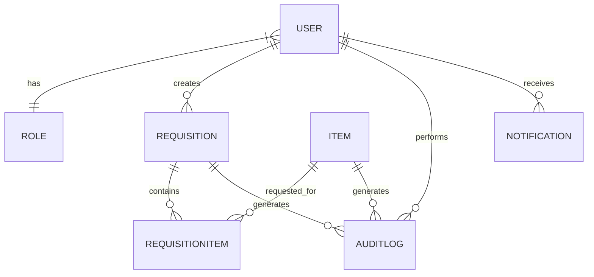

# Data Model and Business Rules

## Core Entities

| Entity | Description | Key Fields |
|--------|-------------|------------|
| **User** | System user with authentication credentials and identity attributes. | `id` (PK), `fullName` (mandatory string; primary display identifier across UI and logs, Decision U-06), `email` (unique string; secondary identifier), `passwordHash`, `roleId` (FK→Role), `isActive` (bool, default `true`), `resetPasswordToken` (string, nullable), `resetPasswordExpires` (timestamp, nullable), `createdAt`, `updatedAt` (Decision U-13) |
| **Role** | Defines a set of permissions. | `id` (PK), `name` (e.g., Admin, InventoryClerk, Manager, FinanceOfficer) |
| **Item** | Inventory SKU record. | `id` (PK), `sku` (unique string; system auto-generated, Decision U-07), `name`, `description`, `quantity`, `location`, `unitPrice`, `reorderThreshold` (per‑SKU low‑stock threshold), `isActive` (bool, default `true`; soft-deleted when false, Decision U-08), `createdAt`, `updatedAt` |
| **Requisition** | Purchase request created by a Clerk. | `id` (PK), `creatorId` (FK→User), `status` (enum – see Enumerations), `totalAmount` (computed – see Business Rules), `createdAt`, `updatedAt` (Decision U-01) |
| **RequisitionItem** | Line‑item linking a Requisition to an Item with requested, approved, and received quantities. | `id` (PK), `requisitionId` (FK→Requisition), `itemId` (FK→Item), `requestedQty`, `approvedQty` (defaults to `requestedQty`; modified via "Approve with Changes" dialog, Decision U-04), `receivedQty` (integer, nullable; actual delivered quantity confirmed at goods receipt by Clerk, Decision U-05), `snapshotUnitPrice` (captured from `Item.unitPrice` at requisition creation – see Price Snapshot Rule) |
| **AuditLog** | Immutable record of important actions. | `id` (PK), `entity` (e.g., `Item`, `Requisition`), `entityId`, `action` (CREATE, UPDATE, DELETE, APPROVE, REJECT, RECEIVE, CANCEL, ADJUST), `performedBy` (FK→User; full name displayed as primary identifier, Decision U-06), `timestamp`, `details` (JSON – includes before/after snapshots, `rejectionReason`, quantity modifications) |
| **Notification** | In‑app toast / email placeholder with destination navigation context. | `id` (PK), `userId` (FK→User), `type` (enum), `message`, `entityType` (string, e.g. `'Requisition' \| 'Item'`; destination context, Decision U-10), `entityId` (UUID; destination record ID, Decision U-10), `read` (bool), `createdAt` |

## Relationships (ER diagram)

## Enumerations & Business Rules

* **Requisition.status** – `Pending`, `ManagerApproved`, `FinanceApproved`, `ExcessPendingManager`, `ExcessPendingFinance`, `ExcessApproved`, `Rejected`, `Received`, `Cancelled`.
* **Notification.type** – `LowStockAlert`, `RequisitionUpdate`, `ApprovalResult`.
* **Approval & Procurement Flow** (industry‑standard, **mandatory**):
  1. **Immediate Submission**: Clerk creates a requisition → status `Pending` upon confirmation. `approvedQty` defaults to `requestedQty`. `totalAmount` computed as `Σ(requestedQty × snapshotUnitPrice)`. There is no `Draft` state or Save Draft functionality (Decision U-01).
  2. **Manager Review**: Manager reviews; can `Approve` (status → `ManagerApproved`) or `Reject` (status → `Rejected`). When modifying approved quantities, Manager uses the dedicated "Approve with Changes" dialog (Decision U-04); if modified, `totalAmount` is recalculated as `Σ(approvedQty × snapshotUnitPrice)`. *(Note: Whether quantity modification is restricted strictly to reductions or allows upward adjustment is an unresolved business rule).*
  3. **Finance Review**: Finance Officer reviews; can `Approve` (status → `FinanceApproved`) or `Reject` (status → `Rejected`). Quantity modifications also use the "Approve with Changes" dialog (Decision U-04). *(Note: Scope of permitted quantity adjustments is subject to product-owner clarification).*
  4. **Rejection & Resubmission**: On rejection at either level, the creator is notified with a mandatory rejection reason (stored in `AuditLog.details.rejectionReason` and preserved in requisition timeline history) and may edit and resubmit via `PATCH /requisitions/:id/resubmit` (status → `Pending`), capturing fresh `snapshotUnitPrice` values and restarting the full approval flow from Manager.
  5. **Physical Goods Receipt & Delivery Variations**: Once Finance approves, the Inventory Clerk conducts physical verification upon dock delivery and enters actual received quantities (`receivedQty`) and confirms receipt (Decision U-05):
     - *Partial Delivery*: Clerk records fewer units than approved (`receivedQty < approvedQty`), which is accepted directly and increments inventory by actual received units (Decision U-05.1).
     - *Full Delivery*: Clerk records exact approved quantity (`receivedQty == approvedQty`), incrementing inventory accordingly.
     - *Excess Delivery*: If delivered quantity exceeds approved quantity (`receivedQty > approvedQty`), excess units cannot be accepted into inventory without a distinct four-step authorization workflow (Decisions U-05.1, U-05.2):
       1. Step 1: Inventory Clerk records delivered counts and submits an excess-delivery authorization request via `POST /requisitions/:id/excess-request` (status → `ExcessPendingManager`).
       2. Step 2: Manager authorizes the operational need for the excess quantity via `PATCH /requisitions/:id/excess-authorize` (status → `ExcessPendingFinance`).
       3. Step 3: Finance Officer authorizes the additional financial commitment via `PATCH /requisitions/:id/excess-authorize` (status → `ExcessApproved`).
       4. Step 4: Inventory Clerk completes goods receipt after both approvals via `PATCH /requisitions/:id/receive` (status → `Received`), executing atomic stock increment for confirmed quantities.
       Excess stock is never committed to inventory before both approvals are secured. *(Unresolved Decision: System handling if either reviewer rejects the excess delivery is an open product-owner decision).*
  6. **Cancellation**: The creator may **Cancel** their own `Pending` requisition → status `Cancelled` (terminal state; no draft state exists, Decision U-01).
* **Price snapshot rule** – When a requisition is created or resubmitted after rejection, `Item.unitPrice` is captured into `RequisitionItem.snapshotUnitPrice`. All `totalAmount` calculations use the snapshotted price, not the current `Item.unitPrice`. Subsequent price changes in the item catalog never alter existing requisition totals.
* **Low‑stock alert rule** – When an `Item.quantity` **transitions from ≥ `reorderThreshold` to < `reorderThreshold`** (threshold‑crossing), a `LowStockAlert` notification is generated for users with roles **Manager** and **FinanceOfficer**, and a mock email is sent. The alert fires **once per crossing**; subsequent operations while the item remains below threshold do not create duplicate alerts.
* **Automatic SKU Generation** – The system automatically generates a unique SKU (`Item.sku`) when an item is created. Users cannot manually choose or enter the SKU (Decision U-07).
* **Stock integrity** – Stock quantity must never become negative. All quantity updates (receiving goods via `PATCH /requisitions/:id/receive`, manual adjustments via `PATCH /items/:id/adjust`) are performed inside a database transaction. Catalog item updates (`PATCH /items/:id`) cannot modify `Item.quantity`. Adjustments that would result in a negative quantity are rejected (HTTP 422).
* **Stock status evaluation** – The inventory query filter `stockStatus` evaluates dynamically against `Item.reorderThreshold`: `'low'` indicates `Item.quantity < Item.reorderThreshold`; `'normal'` indicates `Item.quantity >= Item.reorderThreshold`. It is a runtime query evaluation, not a stored database column.
* **User Identification** – Full name is the primary human identifier across all user interfaces, requisition records, approval histories, and audit logs; email address serves as secondary information (Decision U-06).
* **Item deletion** – Catalog deletion executes soft deletion (`isActive = false`) and requires a confirmation dialog in the UI (Decision U-08). Deleted items disappear from normal catalog browsing. An Item referenced by any existing `RequisitionItem` cannot be hard‑deleted (HTTP 409 `ItemInUse`), preserving historical requisition references and audit trails.
* **Notification Deep-Linking** – `Notification` entities store destination context (`entityType`, `entityId`). Clicking a notification navigates directly to the target record and highlights the relevant information or section deterministically derived from `entityType`, `entityId`, and `type` without redundant schema complexity (Decision U-10).
* **Password Recovery** – System supports both self-service password recovery via email reset tokens (with expiry tracked on `User`) and Admin assistance via temporary credential generation (Decision U-13). In accordance with NFR-009, temporary credentials and passwords must never be written to application logs or console output; the exact secure credential handoff mechanism for Admin assistance is an unresolved implementation detail.
* **Requisition timeline and rejection history** – Requisition inspection aggregates lifecycle events and rejection records from `AuditLog` and `RequisitionItem`:
  - `currentRejectionReason` (`string | null`): Populated strictly when `Requisition.status === 'Rejected'`.
  - `rejectionHistory`: Array of `{ stage: 'Manager' | 'Finance', rejectedBy: { id, email, name, role }, rejectedAt, rejectionReason, cycleNumber: number }`.
  - `timeline`: Chronological array of `{ id, eventType, previousStatus, newStatus, actor: { id, email, name, role }, timestamp, rejectionReason?, quantityModifications? }`.
* **Audit logging** – Every state‑changing operation on `Item` or `Requisition` creates an immutable `AuditLog` entry capturing `performedBy`, `timestamp`, and a JSON `details` snapshot of before/after values.
* **Authentication** – JWT access token (15 min) + refresh token (stored in HttpOnly cookie, 7‑day expiry, rotated on each use). Passwords stored as bcrypt hash.
* **Concurrency control** – Use PostgreSQL `SELECT … FOR UPDATE` when adjusting `Item.quantity` **and** when transitioning `Requisition.status` to prevent race conditions.
* **User deactivation** – Setting `User.isActive = false` immediately invalidates all refresh tokens for that user. Deactivated users receive HTTP 403 `AccountDeactivated` on any authenticated request. Pending requisitions created by the deactivated user remain in their current state.
* **Admin self‑deactivation guard** – An Admin cannot deactivate their own account. The system must maintain at least one active Admin at all times; if only one active Admin exists, a deactivation request targeting that Admin returns HTTP 409 `LastAdminAccount`.

---

*This document is referenced by the SRS and the functional requirements.*
