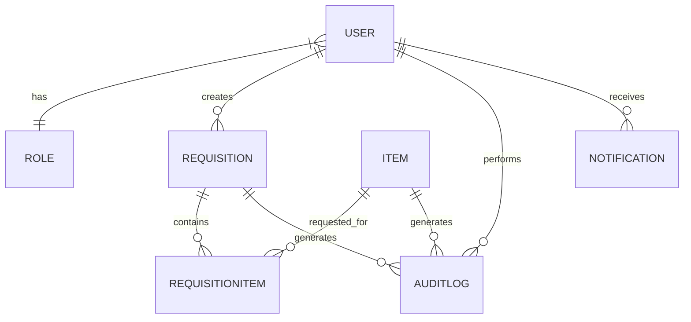

# Data Model and Business Rules

## Core Entities

| Entity | Description | Key Fields |
|--------|-------------|------------|
| **User** | System user with authentication credentials. | `id` (PK), `email`, `passwordHash`, `roleId` (FK→Role), `isActive` (bool, default `true`), `createdAt`, `updatedAt` |
| **Role** | Defines a set of permissions. | `id` (PK), `name` (e.g., Admin, InventoryClerk, Manager, FinanceOfficer) |
| **Item** | Inventory SKU record. | `id` (PK), `sku`, `name`, `description`, `quantity`, `location`, `unitPrice`, `reorderThreshold` (per‑SKU low‑stock threshold), `isActive` (bool, default `true`), `createdAt`, `updatedAt` |
| **Requisition** | Purchase request created by a Clerk. | `id` (PK), `creatorId` (FK→User), `status` (enum), `totalAmount` (computed – see Business Rules), `createdAt`, `updatedAt` |
| **RequisitionItem** | Line‑item linking a Requisition to an Item with requested quantity. | `id` (PK), `requisitionId` (FK→Requisition), `itemId` (FK→Item), `requestedQty`, `approvedQty` (defaults to `requestedQty`; may be modified during approval), `snapshotUnitPrice` (captured from `Item.unitPrice` at requisition creation – see Price Snapshot Rule) |
| **AuditLog** | Immutable record of important actions. | `id` (PK), `entity` (e.g., `Item`, `Requisition`), `entityId`, `action` (CREATE, UPDATE, DELETE, APPROVE, REJECT, RECEIVE, CANCEL, ADJUST), `performedBy` (FK→User), `timestamp`, `details` (JSON – includes `rejectionReason` when applicable) |
| **Notification** | In‑app toast / email placeholder. | `id` (PK), `userId` (FK→User), `type` (enum), `message`, `read` (bool), `createdAt` |

## Relationships (ER diagram)

## Enumerations & Business Rules

* **Requisition.status** – `Pending`, `ManagerApproved`, `FinanceApproved`, `Rejected`, `Received`, `Cancelled`.
* **Notification.type** – `LowStockAlert`, `RequisitionUpdate`, `ApprovalResult`.
* **Approval Flow** (industry‑standard, **mandatory**):
  1. Clerk creates a requisition → status `Pending`. `approvedQty` defaults to `requestedQty`. `totalAmount` computed as `Σ(requestedQty × snapshotUnitPrice)`.
  2. Manager reviews; can `Approve` (status → `ManagerApproved`) or `Reject` (status → `Rejected`). Manager may modify `approvedQty` (partial approval); if modified, `totalAmount` is recalculated as `Σ(approvedQty × snapshotUnitPrice)`.
  3. Finance Officer reviews; can `Approve` (status → `FinanceApproved`) or `Reject` (status → `Rejected`). Finance may also modify `approvedQty`.
  4. On rejection at either level, the creator is notified with a rejection reason (stored in `AuditLog.details.rejectionReason` and preserved in requisition timeline history) and may edit and resubmit the requisition via `PATCH /requisitions/:id/resubmit` (status → `Pending`), capturing fresh `snapshotUnitPrice` values and restarting the full approval flow.
  5. Once Finance approves, they mark the requisition as **Received** → status `Received`; stock quantities are increased by `approvedQty` accordingly.
  6. The creator may **Cancel** a `Pending` requisition → status `Cancelled` (terminal state).
* **Price snapshot rule** – When a requisition is created or resubmitted after rejection, `Item.unitPrice` is captured into `RequisitionItem.snapshotUnitPrice`. All `totalAmount` calculations use the snapshotted price, not the current `Item.unitPrice`. This ensures that subsequent price changes to the Item do not retroactively alter existing requisition amounts while under review.
* **Low‑stock alert rule** – When an `Item.quantity` **transitions from ≥ `reorderThreshold` to < `reorderThreshold`** (threshold‑crossing), a `LowStockAlert` notification is generated for users with roles **Manager** and **FinanceOfficer**, and a mock email is sent. The alert fires **once per crossing**; subsequent operations while the item remains below threshold do not create duplicate alerts.
* **Stock integrity** – Stock quantity must never become negative. All quantity updates (receiving goods via `PATCH /requisitions/:id/receive`, manual adjustments via `PATCH /items/:id/adjust`) are performed inside a database transaction. Catalog item updates (`PATCH /items/:id`) cannot modify `Item.quantity`. Adjustments that would result in a negative quantity are rejected (HTTP 422).
* **Stock status evaluation** – The inventory query filter `stockStatus` evaluates dynamically against `Item.reorderThreshold`: `'low'` indicates `Item.quantity < Item.reorderThreshold`; `'normal'` indicates `Item.quantity >= Item.reorderThreshold`. It is a runtime query evaluation, not a stored database column.
* **Requisition timeline and rejection history** – Requisition inspection aggregates lifecycle events and rejection records from `AuditLog` and `RequisitionItem`:
  - `currentRejectionReason` (`string | null`): Populated strictly when `Requisition.status === 'Rejected'`.
  - `rejectionHistory`: Array of `{ stage: 'Manager' | 'Finance', rejectedBy: { id, email, name, role }, rejectedAt, rejectionReason, cycleNumber: number }`.
  - `timeline`: Chronological array of `{ id, eventType, previousStatus, newStatus, actor: { id, email, name, role }, timestamp, rejectionReason?, quantityModifications? }` where `eventType` is one of `SUBMITTED`, `MANAGER_APPROVED`, `MANAGER_REJECTED`, `FINANCE_APPROVED`, `FINANCE_REJECTED`, `RESUBMITTED`, `RECEIVED`, `CANCELLED`.
* **Audit logging** – Every state‑changing operation on `Item` or `Requisition` (create, update, delete, approval, rejection, receipt, cancellation, stock adjustment) creates an immutable `AuditLog` entry capturing `performedBy`, `timestamp`, and a JSON `details` snapshot of before/after values.
* **Authentication** – JWT access token (15 min) + refresh token (stored in HttpOnly cookie, 7‑day expiry, rotated on each use). Passwords stored as bcrypt hash.
* **Concurrency control** – Use PostgreSQL `SELECT … FOR UPDATE` when adjusting `Item.quantity` **and** when transitioning `Requisition.status` to prevent race conditions (e.g., simultaneous approve and cancel on the same requisition).
* **Item deletion** – An Item referenced by any existing `RequisitionItem` cannot be hard‑deleted (HTTP 409 `ItemInUse`). Soft‑delete via `isActive = false` may be used for archival.
* **User deactivation** – Setting `User.isActive = false` immediately invalidates all refresh tokens for that user. Deactivated users receive HTTP 403 `AccountDeactivated` on any authenticated request. Pending requisitions created by the deactivated user remain in their current state.
* **Admin self‑deactivation guard** – An Admin cannot deactivate their own account. The system must maintain at least one active Admin at all times; if only one active Admin exists, a deactivation request targeting that Admin returns HTTP 409 `LastAdminAccount`.

---

*This document is referenced by the SRS and the functional requirements.*
