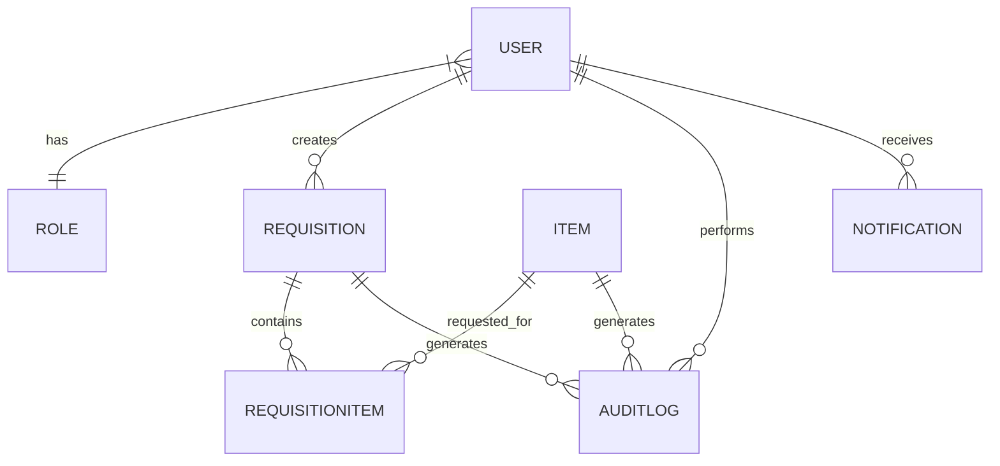

# Data Model and Business Rules

**Document Version:** 1.5 – Active  
**Date:** 2026-11-16  
**Aligned With:** SRS v1.5, Decisions U-01–U-13, UD-01–UD-04, SAD v1.0

## Core Entities

| Entity | Description | Key Fields |
|--------|-------------|------------|
| **User** | System user with authentication credentials and identity attributes. | `id` (PK), `fullName` (mandatory string; primary display identifier across UI and logs, Decision U-06), `email` (unique string; secondary identifier), `passwordHash`, `roleId` (FK→Role), `isActive` (bool, default `true`), `mustChangePassword` (bool, default `false`, Decision UD-02), `temporaryPasswordHash` (string, nullable, Decision UD-02), `temporaryPasswordExpires` (timestamp, nullable; 24-hour expiry from generation, Decision UD-02), `resetPasswordToken` (string, nullable), `resetPasswordExpires` (timestamp, nullable), `createdAt`, `updatedAt` (Decisions U-13, UD-02) |
| **Role** | Defines a set of permissions. | `id` (PK), `name` (e.g., Admin, InventoryClerk, Manager, FinanceOfficer) |
| **Item** | Inventory SKU record. | `id` (PK), `sku` (unique string; system auto-generated, Decision U-07), `name`, `description`, `quantity`, `location`, `unitPrice`, `reorderThreshold` (per‑SKU low‑stock threshold), `isActive` (bool, default `true`; soft-deleted when false, Decision U-08), `createdAt`, `updatedAt` |
| **Requisition** | Purchase request created by a Clerk. | `id` (PK), `creatorId` (FK→User), `status` (enum – see Enumerations), `totalAmount` (computed – see Business Rules), `createdAt`, `updatedAt` (Decision U-01) |
| **RequisitionItem** | Line‑item linking a Requisition to an Item with requested, approved, and received quantities. | `id` (PK), `requisitionId` (FK→Requisition), `itemId` (FK→Item), `requestedQty`, `approvedQty` (integer; equals `requestedQty` at creation; reviewers cannot modify quantities, Decision UD-03), `receivedQty` (integer, nullable; actual delivered quantity confirmed at goods receipt by Clerk; single receipt event per requisition in MVP, Decisions U-05, U-05.1), `snapshotUnitPrice` (captured from `Item.unitPrice` at requisition creation – see Price Snapshot Rule) |
| **AuditLog** | Immutable record of important actions. | `id` (PK), `entity` (e.g., `Item`, `Requisition`), `entityId`, `action` (`CREATE`, `UPDATE`, `DELETE`, `APPROVE`, `REJECT`, `RECEIVE`, `CANCEL`, `ADJUST`, `EXCESS_REQUEST`, `EXCESS_APPROVE`, `EXCESS_REJECT`, `RESET_PASSWORD`), `performedBy` (FK→User; full name displayed as primary identifier, Decision U-06), `timestamp`, `details` (JSON – includes before/after snapshots, `eventType`, `rejectionReason`, line-item counts; credentials never stored) |
| **Notification** | In‑app toast / email placeholder with destination navigation context. | `id` (PK), `userId` (FK→User), `type` (enum), `message`, `entityType` (string, e.g. `'Requisition' \| 'Item'`; destination context, Decision U-10), `entityId` (UUID; destination record ID, Decision U-10), `read` (bool), `createdAt` |

## Relationships (ER diagram)

## Enumerations & Business Rules

* **Requisition.status** – `Pending`, `ManagerApproved`, `FinanceApproved`, `ExcessPendingManager`, `ExcessPendingFinance`, `ExcessApproved`, `ExcessRejected`, `Rejected`, `Received`, `Cancelled`.
* **Notification.type** – `LowStockAlert`, `RequisitionUpdate`, `ApprovalResult`.
* **Approval & Procurement Flow** (industry‑standard, **mandatory**):
  1. **Immediate Submission**: Clerk creates a requisition → status `Pending` upon confirmation. `approvedQty` defaults to `requestedQty`. `totalAmount` computed as `Σ(requestedQty × snapshotUnitPrice)`. There is no `Draft` state or Save Draft functionality (Decision U-01).
  2. **Manager Review**: Manager reviews; can `Approve` (status → `ManagerApproved`) or `Reject` (status → `Rejected`). Reviewers cannot modify quantities (Decision UD-03, superseding U-04). If changes are required, Manager must reject with mandatory non-empty `rejectionReason`.
  3. **Finance Review**: Finance Officer reviews; can `Approve` (status → `FinanceApproved`) or `Reject` (status → `Rejected`). Reviewers cannot modify quantities (Decision UD-03, superseding U-04). If changes are required, Finance Officer must reject with mandatory non-empty `rejectionReason`.
  4. **Rejection & New Requisition Submission**: On rejection at either level, the requisition transitions to `Rejected` (terminal state), preserving original requested quantities, reviewer identity, timestamp, and non-empty rejection reason in immutable audit history (Decision UD-03). The requester receives the rejection explanation and must submit a new requisition with corrected quantities via `POST /requisitions`.
  5. **Physical Goods Receipt & Delivery Variations**: Once Finance approves, the Inventory Clerk conducts physical verification upon dock delivery and enters actual received quantities (`receivedQty`) and confirms receipt (Decision U-05):
     - *Partial Delivery (MVP Limitation)*: Clerk records fewer units than approved (`receivedQty < approvedQty`), which is accepted directly and increments inventory by actual received units, transitioning status to `Received` (Decision U-05.1). Each requisition supports exactly one receipt event; remaining undelivered quantity is not tracked as outstanding, and additional deliveries against the same requisition are not supported in the MVP.
     - *Full Delivery*: Clerk records exact approved quantity (`receivedQty == approvedQty`), incrementing inventory accordingly and transitioning status to `Received`.
     - *Excess Delivery Workflow & Rejection Handling*: If delivered quantity exceeds approved quantity (`receivedQty > approvedQty`), a discrete four-step authorization workflow executes (Decisions U-05.1, U-05.2, UD-01):
       1. Step 1: Inventory Clerk records delivered counts and submits an excess-delivery authorization request via `POST /requisitions/:id/excess-requests` (status → `ExcessPendingManager`). Stock is not incremented.
       2. Step 2: Manager authorizes operational need (`POST /requisitions/:id/excess-authorizations` with `action: 'approve'`) (status → `ExcessPendingFinance`) or rejects excess (`action: 'reject'`) (status → `ExcessRejected`, Decision UD-01).
       3. Step 3: Finance Officer authorizes financial commitment (`POST /requisitions/:id/excess-authorizations` with `action: 'approve'`) (status → `ExcessApproved`) or rejects excess (`action: 'reject'`) (status → `ExcessRejected`, Decision UD-01).
       4. Step 4: Receipt Completion:
          - After dual approval (`ExcessApproved`), Inventory Clerk completes goods receipt via `POST /requisitions/:id/receipts` (status → `Received`), atomically incrementing inventory by confirmed quantities including authorized excess.
          - On excess rejection (`ExcessRejected`), only the excess quantity is rejected; the originally approved quantity remains eligible for receipt. Clerk completes goods receipt for up to the originally approved quantity via `POST /requisitions/:id/receipts` (status → `Received`), with excess units refused at the loading dock. Only accepted units enter inventory (Decision UD-01). Rejection details (approver, timestamp, reason) are permanently logged in audit history (`EXCESS_REJECTED`).
  6. **Cancellation**: The creator may **Cancel** their own `Pending` requisition → status `Cancelled` (terminal state; no draft state exists, Decision U-01).
* **Price snapshot rule** – When a requisition is created, `Item.unitPrice` is captured into `RequisitionItem.snapshotUnitPrice`. All `totalAmount` calculations use the snapshotted price, not the current `Item.unitPrice`. Subsequent price changes in the item catalog never alter existing requisition totals.
* **Low‑stock alert rule** – When an `Item.quantity` **transitions from ≥ `reorderThreshold` to < `reorderThreshold`** (threshold‑crossing), a `LowStockAlert` notification is generated for users with roles **Manager** and **FinanceOfficer**, and a mock email is sent. The alert fires **once per crossing**; subsequent operations while the item remains below threshold do not create duplicate alerts.
* **Automatic SKU Generation** – The system automatically generates a unique SKU (`Item.sku`) when an item is created. Users cannot manually choose or enter the SKU (Decision U-07).
* **Stock integrity** – Stock quantity must never become negative. All quantity updates (receiving goods via `POST /requisitions/:id/receipts`, manual adjustments via `POST /items/:id/adjustments`) are performed inside a database transaction. Catalog item updates (`PATCH /items/:id`) cannot modify `Item.quantity`. Adjustments that would result in a negative quantity are rejected (HTTP 422).
* **Stock status evaluation** – The inventory query filter `stockStatus` evaluates dynamically against `Item.reorderThreshold`: `'low'` indicates `Item.quantity < Item.reorderThreshold`; `'normal'` indicates `Item.quantity >= Item.reorderThreshold`. It is a runtime query evaluation, not a stored database column.
* **User Identification** – Full name is the primary human identifier across all user interfaces, requisition records, approval histories, and audit logs; email address serves as secondary information (Decision U-06).
* **Item deletion** – Catalog deletion executes soft deletion (`isActive = false`) and requires a confirmation dialog in the UI (Decision U-08). Deleted items disappear from normal catalog browsing. An Item referenced by any existing `RequisitionItem` cannot be hard‑deleted (HTTP 409 `ItemInUse`), preserving historical requisition references and audit trails.
* **Notification Deep-Linking** – `Notification` entities store destination context (`entityType`, `entityId`). Clicking a notification navigates directly to the target record and highlights the relevant information or section deterministically derived from `entityType`, `entityId`, and `type` without redundant schema complexity (Decision U-10).
* **Password Recovery** – System supports both self-service password recovery via email reset tokens (with expiry tracked on `User`; in dev, routed to secure in-memory mailbox without console logging per NFR-009) and Admin assistance via temporary credential generation (Decisions U-13, UD-02). For Admin assistance, Admin initiates reset after internal identity verification; system generates single-use temporary password (expires after 24 hours); Admin communicates it out-of-band (registered email not required; Admin cannot view user's existing or permanent password); user must change password at next login before accessing application (`mustChangePassword: true`); temporary credentials never appear in application or audit logs; reset action recorded in audit history without exposing credentials (Decision UD-02).
* **Requisition timeline and rejection history** – Requisition inspection aggregates lifecycle events and rejection records from `AuditLog` and `RequisitionItem`:
  - `currentRejectionReason` (`string | null`): Populated strictly when `Requisition.status === 'Rejected'`.
  - `rejectionHistory`: Array of `{ stage: 'Manager' | 'Finance', rejectedBy: { id, email, name, role }, rejectedAt, rejectionReason }` capturing rejection records for the requisition.
  - `timeline`: Chronological array of `{ id, eventType, previousStatus, newStatus, actor: { id, email, name, role }, timestamp, rejectionReason? }` where `eventType` is one of `SUBMITTED`, `MANAGER_APPROVED`, `MANAGER_REJECTED`, `FINANCE_APPROVED`, `FINANCE_REJECTED`, `EXCESS_REQUESTED`, `EXCESS_MANAGER_APPROVED`, `EXCESS_FINANCE_APPROVED`, `EXCESS_REJECTED`, `RECEIVED`, `CANCELLED`.
* **Audit logging** – Every state‑changing operation on `Item` or `Requisition` creates an immutable `AuditLog` entry capturing `entity`, `entityId`, `action` (`CREATE`, `UPDATE`, `DELETE`, `APPROVE`, `REJECT`, `RECEIVE`, `CANCEL`, `ADJUST`, `EXCESS_REQUEST`, `EXCESS_APPROVE`, `EXCESS_REJECT`, `RESET_PASSWORD`), `performedBy`, `timestamp`, and a JSON `details` snapshot recording structured `eventType`, before/after values, and `rejectionReason` (when rejected). The requisition `timeline[]` projection directly maps from these audit records. Credentials and secret tokens are strictly excluded from audit details per NFR-009.
* **Authentication** – JWT access token (15 min) + refresh token (stored in HttpOnly cookie, 7‑day expiry, rotated on each use). Passwords stored as bcrypt hash.
* **Concurrency control** – Use PostgreSQL `SELECT … FOR UPDATE` when adjusting `Item.quantity` **and** when transitioning `Requisition.status` to prevent race conditions.
* **User deactivation** – Setting `User.isActive = false` immediately invalidates all refresh tokens for that user. Deactivated users receive HTTP 403 `AccountDeactivated` on any authenticated request. Pending requisitions created by the deactivated user remain in their current state.
* **Admin self‑deactivation guard** – An Admin cannot deactivate their own account. The system must maintain at least one active Admin at all times; if only one active Admin exists, a deactivation request targeting that Admin returns HTTP 409 `LastAdminAccount`.

---

*This document is referenced by the SRS and the functional requirements.*
