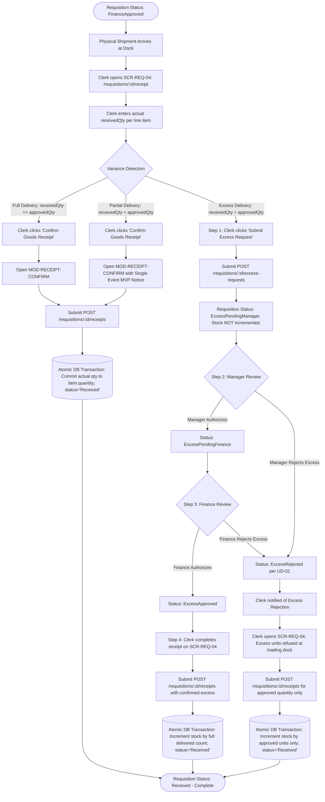
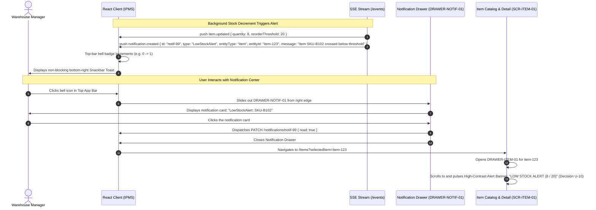
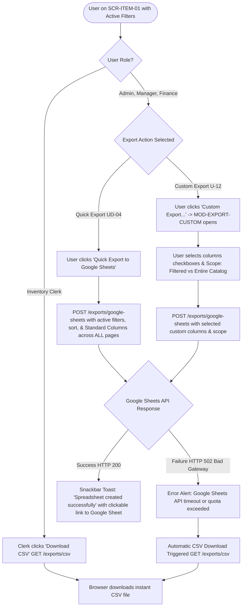

# Screen Architecture Document (SAD)
## Inventory & Procurement Management System (IPMS)

**Document Version:** 1.0 – Official Architecture Baseline  
**Date:** 2026-11-16  
**Status:** Draft – Awaiting Review  
**Aligned With:** SRS v1.5, DecisionLog v1.5, DataModel v1.5, RequirementsRegister v1.5, IPMS Documentation Consolidation Report v1.4  
**Target Architecture Stack:** React 18, TypeScript, Material UI (MUI) v5, Vite, Server-Sent Events (SSE)

---

## Table of Contents
1. [Section A: Document Overview](#section-a-document-overview)
   - [1.1 Purpose and Scope](#11-purpose-and-scope)
   - [1.2 Authoritative Source Documents](#12-authoritative-source-documents)
   - [1.3 Relationship to SRS, Wireframes, and Implementation](#13-relationship-to-srs-wireframes-and-implementation)
   - [1.4 Assumptions and Limitations](#14-assumptions-and-limitations)
2. [Section B: Application Structure & Layout Architecture](#section-b-application-structure--layout-architecture)
   - [2.1 Overall Layout Architecture](#21-overall-layout-architecture)
   - [2.2 Global App Shell Specification](#22-global-app-shell-specification)
   - [2.3 Top Application Bar](#23-top-application-bar)
   - [2.4 Side Navigation Drawer](#24-side-navigation-drawer)
   - [2.5 Role-Based Navigation Differences](#25-role-based-navigation-differences)
   - [2.6 Global Shared UI Components](#26-global-shared-ui-components)
   - [2.7 Responsive Breakpoint Grid](#27-responsive-breakpoint-grid)
3. [Section C: Screen Inventory](#section-c-screen-inventory)
   - [3.1 Complete Screen Register](#31-complete-screen-register)
   - [3.2 Contextual Drawers & Modals Register](#32-contextual-drawers--modals-register)
4. [Section D: Detailed Screen Specifications](#section-d-detailed-screen-specifications)
   - [4.1 SCR-AUTH-01: User Login](#41-scr-auth-01-user-login)
   - [4.2 SCR-AUTH-02: User Registration](#42-scr-auth-02-user-registration)
   - [4.3 SCR-AUTH-03: Self-Service Password Recovery Request](#43-scr-auth-03-self-service-password-recovery-request)
   - [4.4 SCR-AUTH-04: Password Reset Confirmation](#44-scr-auth-04-password-reset-confirmation)
   - [4.5 SCR-AUTH-05: Mandatory Temporary Password Change](#45-scr-auth-05-mandatory-temporary-password-change)
   - [4.6 SCR-DASH-01: Real-Time Operational Dashboard](#46-scr-dash-01-real-time-operational-dashboard)
   - [4.7 SCR-ITEM-01: Item Catalog & Stock Management](#47-scr-item-01-item-catalog--stock-management)
   - [4.8 DRAWER-ITEM-01: Contextual Item Detail Drawer](#48-drawer-item-01-contextual-item-detail-drawer)
   - [4.9 SCR-REQ-01: Shared Requisition List](#49-scr-req-01-shared-requisition-list)
   - [4.10 SCR-REQ-02: Purchase Requisition Creation](#410-scr-req-02-purchase-requisition-creation)
   - [4.11 SCR-REQ-03: Requisition Detail, Timeline & Approval Review](#411-scr-req-03-requisition-detail-timeline--approval-review)
   - [4.12 SCR-REQ-04: Goods Receipt & Physical Quantity Verification](#412-scr-req-04-goods-receipt--physical-quantity-verification)
   - [4.13 SCR-USER-01: User Lifecycle & Governance Management](#413-scr-user-01-user-lifecycle--governance-management)
   - [4.14 SCR-AUDIT-01: System Audit Trail Inspection](#414-scr-audit-01-system-audit-trail-inspection)
   - [4.15 DRAWER-NOTIF-01: Global Notification Slide-Out Panel](#415-drawer-notif-01-global-notification-slide-out-panel)
   - [4.16 Core Supporting Modal Dialog Specifications](#416-core-supporting-modal-dialog-specifications)
5. [Section E: Navigation and User Flows](#section-e-navigation-and-user-flows)
   - [5.1 Flow 1: Authentication & Dual Password Recovery](#51-flow-1-authentication--dual-password-recovery)
   - [5.2 Flow 2: Catalog Browsing & Controlled Stock Adjustment](#52-flow-2-catalog-browsing--controlled-stock-adjustment)
   - [5.3 Flow 3: Requisition Lifecycle & Two-Level Approval](#53-flow-3-requisition-lifecycle--two-level-approval)
   - [5.4 Flow 4: Goods Receipt, Partial Delivery & Four-Step Excess Authorization](#54-flow-4-goods-receipt-partial-delivery--four-step-excess-authorization)
   - [5.5 Flow 5: Real-Time Alerting, Notification Deep-Linking & Highlighting](#55-flow-5-real-time-alerting-notification-deep-linking--highlighting)
   - [5.6 Flow 6: Google Sheets Direct Quick Export & Custom Export Modal](#56-flow-6-google-sheets-direct-quick-export--custom-export-modal)
   - [5.7 Flow 7: Administrative User Governance & Security Management](#57-flow-7-administrative-user-governance--security-management)
6. [Section F: Role-Based Access Control and UI Behavior](#section-f-role-based-access-control-and-ui-behavior)
   - [6.1 Role Architectural Responsibilities](#61-role-architectural-responsibilities)
   - [6.2 Comprehensive RBAC Screen & Action Permissions Matrix](#62-comprehensive-rbac-screen--action-permissions-matrix)
   - [6.3 Frontend Routing Guards vs Backend Authorization](#63-frontend-routing-guards-vs-backend-authorization)
7. [Section G: Shared UI Patterns & Design System Conventions](#section-g-shared-ui-patterns--design-system-conventions)
   - [7.1 Data Tables & DataGrid Standard Patterns](#71-data-tables--datagrid-standard-patterns)
   - [7.2 Predefined Standard Columns for Google Sheets Quick Export](#72-predefined-standard-columns-for-google-sheets-quick-export)
   - [7.3 Search & Multi-Criteria Filtering Patterns](#73-search--multi-criteria-filtering-patterns)
   - [7.4 Standardized List Pagination Controls](#74-standardized-list-pagination-controls)
   - [7.5 Form Validation & Input Controls](#75-form-validation--input-controls)
   - [7.6 Drawers, Side Panels & Context Preservation](#76-drawers-side-panels--context-preservation)
   - [7.7 Modal Dialogs & Action Confirmations](#77-modal-dialogs--action-confirmations)
   - [7.8 Toast Notifications & Persistent Slide-Out Center](#78-toast-notifications--persistent-slide-out-center)
   - [7.9 Status Indicators, Badges & Visual Chips](#79-status-indicators-badges--visual-chips)
   - [7.10 UI State Management: Loading, Empty, Error & Offline States](#710-ui-state-management-loading-empty-error--offline-states)
8. [Section H: Requirements Traceability Matrix](#section-h-requirements-traceability-matrix)
   - [8.1 Full Bidirectional Traceability Matrix](#81-full-bidirectional-traceability-matrix)
   - [8.2 Non-UI Functional Requirements Coverage](#82-non-ui-functional-requirements-coverage)
9. [Section I: Open Questions and Architecture Risks](#section-i-open-questions-and-architecture-risks)
   - [9.1 Genuine Open Questions Requiring Business Confirmation](#91-genuine-open-questions-requiring-business-confirmation)
   - [9.2 Architectural Risks & Mitigation Strategies](#92-architectural-risks--mitigation-strategies)

---

# Section A: Document Overview

### 1.1 Purpose and Scope
The **Screen Architecture Document (SAD)** defines the complete user interface architecture, structural layout, screen inventory, component hierarchies, visual states, and interaction workflows for the **Inventory & Procurement Management System (IPMS)** Minimum Viable Product (MVP).

The primary purpose of this document is to bridge approved requirements, database constraints, and business decisions into concrete, unambiguous UI specifications. It serves as the direct technical and architectural foundation for UI/UX designers creating low-fidelity wireframes and high-fidelity mockups, and for frontend engineers developing the React 18 single-page application (SPA).

The scope encompasses:
- The full MVP application lifecycle across Desktop, Tablet, and Mobile viewport breakpoints.
- Complete navigation architecture, global shell elements, contextual drawers, and modal workflows.
- Strict enforcement of Role-Based Access Control (RBAC) across four enterprise roles: `Admin`, `Inventory Clerk`, `Manager`, and `Finance Officer`.
- Detailed screen specifications detailing data presentation, user actions, validation rules, state handling, and component mapping conforming to Material UI (MUI) v5.

### 1.2 Authoritative Source Documents
This document strictly adheres to the approved specifications and decisions recorded in the IPMS project repository. No business rules, permissions, or system capabilities have been invented or altered.

| Document Title | File Path | Version / Status | Role in Screen Architecture |
|:---------------|:----------|:-----------------|:----------------------------|
| **Software Requirements Specification (SRS)** | `docs/specs/SRS.md` | v1.5 – Official Baseline | Primary authority for functional requirements (FR-001–FR-030), non-functional requirements (NFRs), API contracts, and RBAC matrix. |
| **Architectural Decision Log** | `docs/decisions/DecisionLog.md` | v1.5 – Active | Authoritative record of architectural decisions D-001–D-015, approved UI/UX decisions U-01–U-13, and post-UX resolved decisions UD-01–UD-04. |
| **Data Model & Business Rules** | `docs/specs/DataModel.md` | v1.5 – Active | Defines underlying entity schemas, foreign keys, lifecycle enumerations, price snapshot rules, and database constraints. |
| **Requirements Register** | `docs/specs/RequirementsRegister.md` | v1.5 – Active | Requirements traceability baseline mapping business requirements to functional verification gates. |
| **Documentation Consolidation Report** | `docs/archive/IPMS_Documentation_Consolidation_Report.md` | v1.4 – Active | Validates cross-document consistency, superseding of legacy decisions, and official readiness for SAD authoring. |

### 1.3 Relationship to SRS, Wireframes, and Implementation
The SAD serves as the authoritative UI/UX architectural layer positioned between the functional specification and visual design:

```
+-----------------------------------------------------------+
|  Authoritative Requirements (SRS v1.5, DecisionLog v1.5)  |
+-----------------------------------------------------------+
                            |
                            v
+-----------------------------------------------------------+
|          Screen Architecture Document (SAD v1.0)          |
|  - Layout Hierarchy, Navigation Routes & Role Shells      |
|  - Screen Inventory, Drawers, Modals & UI States          |
|  - MUI v5 Component Mappings & Granular RBAC Behaviors    |
+-----------------------------------------------------------+
                            |
                            v
+-----------------------------------------------------------+
|                 UI/UX Wireframes & Mockups                |
|  - Visual Design, Typography, Spatial Layout, Colors      |
+-----------------------------------------------------------+
                            |
                            v
+-----------------------------------------------------------+
|            Frontend Implementation (React 18 SPA)         |
|  - Vite, TypeScript, MUI v5, React Router v6, SSE Client  |
+-----------------------------------------------------------+
```

### 1.4 Assumptions and Limitations
1. **Frontend Framework**: The client is implemented as a single-page application using React 18, TypeScript, and Material UI (MUI) v5. All UI patterns, components, and layout behaviors specified herein conform to MUI design standards.
2. **Real-Time Data Transport**: Server-Sent Events (SSE) provide unidirectional push updates (`/events`) for catalog changes, requisition state transitions, user notifications, and dashboard metric recalculations (Decision D-005, FR-009).
3. **Authentication Mechanism**: Session state is maintained via JWT access tokens (15-minute lifespan) and HttpOnly, SameSite=Strict rotating refresh tokens (7-day lifespan). Cross-Site Request Forgery (CSRF) protection is enforced via double-submit cookies (`X-CSRF-Token` header) (FR-001, FR-019, FR-027).
4. **MVP Goods Receipt Limitation**: Each requisition supports exactly one physical receipt event. Single partial delivery is accepted directly into inventory, transitioning the requisition to `Received` without tracking remaining backorders (Decision U-05.1). Excess delivery requires sequential two-stage authorization (Manager then Finance) prior to stock receipt (Decision U-05.2, UD-01).
5. **No Requisition Drafts**: Requisitions are submitted immediately upon creation with `Pending` status. No draft workflow or draft storage exists (Decision U-01).
6. **No Reviewer Quantity Modification**: Reviewers cannot alter requisition quantities during review. Modifying quantities requires rejection with a mandatory reason, prompting the requester to submit a brand-new requisition (Decision UD-03, superseding U-04).
7. **Single-Organization Scope**: Multi-tenant isolation and external supplier portals are out of scope for the MVP baseline (SRS §2.6).

---

# Section B: Application Structure & Layout Architecture

### 2.1 Overall Layout Architecture
The application is structured into two fundamental layout shells:
1. **Public Authentication Layout (`AUTH-LAYOUT`)**: Clean, focused, centered card layout used for unauthenticated authentication routes (`/login`, `/register`, `/forgot-password`, `/reset-password`).
2. **Authenticated Application Shell (`APP-SHELL`)**: Modern enterprise dashboard layout featuring a fixed top application bar, a collapsible role-aware side navigation drawer, a breadcrumb hierarchy, a contextual notification slide-out drawer, and a main content viewport canvas.

```
+---------------------------------------------------------------------------------------------------+
|  TOP APP BAR (SCR-TOPBAR)                                                                         |
|  [Menu Toggle] [IPMS Logo / Brand]    [Breadcrumbs]        [SSE Indicator] [Notif Bell (3)] [User Menu] |
+--------------------------------------+------------------------------------------------------------+
|  SIDEBAR DRAWER (SCR-NAV)            |  MAIN CONTENT VIEWPORT CANVAS                              |
|                                      |                                                            |
|  - Dashboard                         |  Page Title / Contextual Action Bar                        |
|  - Item Catalog                      |  +-------------------------------------------------------+ |
|  - Requisitions                      |  |                                                       | |
|  - Users (Admin)                     |  |  Data Grid / Main Content Area                        | |
|  - Audit Logs (Admin)                |  |                                                       | |
|                                      |  |                                                       | |
|  ----------------------------------- |  +-------------------------------------------------------+ |
|  [System Version v1.0] [CollapseBtn] |  (Right-Side Contextual Drawer opens over content)       | |
+--------------------------------------+------------------------------------------------------------+
```

### 2.2 Global App Shell Specification
The Authenticated App Shell wraps all secure operational routes. It is responsible for initializing the Server-Sent Events (SSE) listener (`GET /events`), maintaining global toast notifications, tracking real-time unread notification counts, and rendering contextual side drawers without discarding page state.

**Key Technical Layout Properties (MUI v5):**
- Layout Container: MUI `Box` with flexbox layout (`display: 'flex'`, `minHeight: '100vh'`).
- Content Area: MUI `Box` (`component: 'main'`, `flexGrow: 1`, `p: 3`, `overflow: 'auto'`).
- Elevation: App Bar uses elevation 1 with border-bottom divider; Drawer uses elevation 0 with standard right border.
- Background: Theme surface background (`theme.palette.background.default`, e.g., `#F8FAFC`).

### 2.3 Top Application Bar
The Top App Bar (`AppBar` component) is fixed to the top of the viewport (`position: 'fixed'`), spanning the full window width with an elevated `z-index` higher than the sidebar in mobile viewports.

**Layout Regions & Elements (Left to Right):**
1. **Navigation Toggle Icon (`IconButton`)**: Hamburger icon triggering sidebar collapse/expand on desktop, or drawer open/close on mobile viewports.
2. **Brand Identifier**: IPMS logo mark paired with bold title text ("IPMS | Inventory & Procurement").
3. **Breadcrumb Trail (`Breadcrumbs`)**: Dynamic route hierarchy reflecting current location (e.g., `Home / Requisitions / REQ-2026-0042`).
4. **SSE Connection Health Pill (`Chip`)**: Compact indicator showing real-time server connectivity:
   - *Connected*: Green dot pulse, "Live".
   - *Reconnecting*: Amber dot, "Reconnecting...".
   - *Disconnected*: Red dot, "Offline".
5. **Notification Inbox Trigger (`IconButton` with `Badge`)**: Bell icon displaying a numerical badge representing the user's unread notification count. Clicking opens the Notification Slide-Out Panel (`DRAWER-NOTIF-01`).
6. **User Identity & Profile Menu (`Menu`)**:
   - Visual Avatar containing the user's initials.
   - Text display showing the user's **Full Name** as the primary identifier (Decision U-06) and a secondary chip displaying their assigned role (`Admin`, `Clerk`, `Manager`, `Finance`).
   - Dropdown options: "My Profile" (email, account metadata), "Change Password", and "Sign Out" (`DELETE /auth/sessions` (alias `POST /auth/logout`)).

### 2.4 Side Navigation Drawer
The Side Navigation Drawer (`Drawer` component) provides persistent primary navigation. On desktop viewports ($\ge 1200\text{px}$), it is docked in a persistent 260px wide container (collapsible to a 68px mini-drawer). On tablet and mobile viewports, it transitions to a temporary slide-in drawer.

**Navigation Menu Items Structure:**
- Group 1: **Operational Overview**
  - **Dashboard** (`/dashboard`): Accessible to all authenticated roles.
- Group 2: **Inventory Management**
  - **Item Catalog** (`/items`): Accessible to all authenticated roles.
- Group 3: **Procurement Workflow**
  - **Requisitions** (`/requisitions`): Accessible to all authenticated roles, displaying role-tailored view presets (Decision U-09).
- Group 4: **Administration & Compliance** *(Restricted to Admin)*
  - **User Management** (`/users`): Admin role only.
  - **Audit Logs** (`/audit-logs`): Admin role only.

### 2.5 Role-Based Navigation Differences
The navigation drawer conditionally renders navigation destinations based on the authenticated user's assigned role:

| Navigation Item | Admin | Inventory Clerk | Manager | Finance Officer | Badge / Indicator |
|:----------------|:-----:|:---------------:|:-------:|:---------------:|:------------------|
| **Dashboard** | Visible | Visible | Visible | Visible | — |
| **Item Catalog** | Visible | Visible | Visible | Visible | Low Stock count chip (when count > 0) |
| **Requisitions** | Visible | Visible | Visible | Visible | Actionable pending count badge (role-dependent) |
| **User Management** | Visible | **Hidden** | **Hidden** | **Hidden** | — |
| **Audit Logs** | Visible | **Hidden** | **Hidden** | **Hidden** | — |

*Actionable Pending Count Badge Behavior:*
- For `Manager`: Badge displays count of requisitions in `Pending` state awaiting Manager approval.
- For `Finance Officer`: Badge displays count of requisitions in `ManagerApproved` state awaiting Finance approval.
- For `Inventory Clerk`: Badge displays count of requisitions in `FinanceApproved`, `ExcessApproved`, or `ExcessRejected` state awaiting physical dock receipt.
- For `Admin`: No badge displayed.

### 2.6 Global Shared UI Components
1. **Snackbar Toast System (`Snackbar`, `Alert`)**: Non-blocking notification toasts appearing in the bottom-right corner for system event feedback (API errors, export generation alerts, stock threshold crossings).
2. **Global Confirmation Dialog (`Dialog`)**: Reusable modal for destructive and critical lifecycle confirmations (item soft deletion, requisition cancellation, goods receipt finalization).
3. **Session Expiry Warning Modal**: Prompts the user 60 seconds before access token expiration, offering a silent refresh trigger (`POST /auth/tokens/refresh` (alias `POST /auth/refresh`)) or logout.
4. **Mandatory Password Change Modal / Overlay**: Blocks access for users with `mustChangePassword === true` until a new password is established (Decision UD-02).

### 2.7 Responsive Breakpoint Grid
The application enforces strict responsiveness using MUI standard breakpoints:
- **Desktop ($\ge 1200\text{px}$)**: Full persistent 260px navigation drawer, full-width DataGrid tables, contextual drawers open side-by-side with main content without covering data tables.
- **Tablet ($768\text{px} - 1199\text{px}$)**: Mini-variant docked sidebar (icons only) or temporary overlay drawer; DataGrids collapse non-critical columns; contextual drawers open as full-height 480px overlay drawers.
- **Mobile ($< 768\text{px}$)**: Temporary hidden drawer accessed via top-bar hamburger icon; DataGrids switch to card-based list layout; contextual drawers take 100% viewport width; top-bar breadcrumbs condense to parent page link.

---

# Section C: Screen Inventory

### 3.1 Complete Screen Register
The inventory comprises 13 distinct top-level functional screens (`SCR-*`) and 2 persistent contextual drawers (`DRAWER-*`). Shared screens with role-tailored view presets are utilized to maintain architectural cohesion and component reuse.

| Screen ID | Screen Name | Route Path | Target Roles | Primary Purpose | Related Requirements | Approved Decisions |
|:----------|:------------|:-----------|:-------------|:----------------|:---------------------|:-------------------|
| **SCR-AUTH-01** | User Login | `/login` | Public | Authenticate registered users; issue JWT cookies and CSRF tokens. | FR-001, FR-018, FR-019 | D-001, U-06 |
| **SCR-AUTH-02** | User Registration | `/register` | Public | Self-registration capturing full name; assigns default Inventory Clerk role. | FR-001 | U-06 |
| **SCR-AUTH-03** | Forgot Password Request | `/forgot-password` | Public | Self-service password reset request via registered email address. | FR-001, FR-029 | U-13, NFR-009 |
| **SCR-AUTH-04** | Reset Password Confirmation | `/reset-password` | Public | Password reset entry via secure, time-bound token from email. | FR-001, FR-029 | U-13, NFR-009 |
| **SCR-AUTH-05** | Mandatory Password Change | `/change-password` | Authenticated (`mustChangePassword: true`) | Enforce mandatory permanent password creation upon login with temporary password. | FR-001, FR-029 | UD-02 |
| **SCR-DASH-01** | Operational Dashboard | `/dashboard` | All Roles | Real-time aggregated inventory metrics, low-stock count, recent requisitions, and role-specific activity feed. | FR-010, FR-030, FR-009 | D-005, U-11 |
| **SCR-ITEM-01** | Item Catalog & Inventory | `/items` | All Roles | Complete SKU catalog browsing, filtering, search, stock adjustments, and Google Sheets/CSV export. | FR-003, FR-011, FR-021, FR-025, FR-026 | D-004, D-006, D-011, D-013, D-015, U-07, U-08, U-12, UD-04 |
| **DRAWER-ITEM-01** | Item Detail Drawer | `/items?selectedItem=:id` | All Roles | Right-side contextual drawer displaying SKU specifications, stock status, and role actions. | FR-003, FR-025 | U-02, U-07, U-08, D-015 |
| **SCR-REQ-01** | Shared Requisition List | `/requisitions` | All Roles | Unified requisition data grid with role-specific tab presets (All, My Requisitions, Pending Review, Reviewed). | FR-004, FR-021 | D-012, U-03, U-09 |
| **SCR-REQ-02** | Create Purchase Requisition | `/requisitions/new` | Inventory Clerk | Multi-item purchase request creation with price snapshotting and immediate submission (no draft). | FR-004 | U-01 |
| **SCR-REQ-03** | Requisition Detail & Review | `/requisitions/:id` | All Roles | Inspect requisition items, snapshot prices, audit timeline, rejection history, and execute approvals/rejections. | FR-005, FR-006, FR-024 | D-008, D-009, D-014, UD-03 |
| **SCR-REQ-04** | Goods Receipt Verification | `/requisitions/:id/receipt` | Inventory Clerk | Physical goods receipt entry recording actual quantities, partial delivery, and excess authorization triggers. | FR-007 | U-05, U-05.1, U-05.2, UD-01 |
| **SCR-USER-01** | User Management | `/users` | Admin | Staff user directory, role assignment, account deactivation/reactivation, and temporary password reset. | FR-023, FR-029 | U-06, UD-02 |
| **SCR-AUDIT-01** | System Audit Logs | `/audit-logs` | Admin | Chronological immutable system audit trail inspection with before/after delta analysis. | FR-014 | U-06, U-08, NFR-009, NFR-012 |
| **DRAWER-NOTIF-01** | Global Notification Panel | Contextual Slide-Out | All Roles | Paginated notification history with read/unread filtering, bulk mark-as-read, and record deep linking. | FR-017 | D-010, U-10 |

### 3.2 Contextual Drawers & Modals Register
Supporting modal dialogs and slide-out panels are formalized to ensure standard user interactions:

| Component ID | Component Name | Trigger Screen | Target Roles | Purpose | Related Decisions |
|:-------------|:---------------|:---------------|:-------------|:--------|:------------------|
| **MOD-ITEM-CREATE** | Create Item Modal | `SCR-ITEM-01` | Admin | Input item metadata and initial stock; SKU is auto-generated upon creation. | U-07 |
| **MOD-ITEM-EDIT** | Edit Item Metadata Modal | `DRAWER-ITEM-01` | Admin | Edit non-quantity metadata (name, description, location, unit price, threshold). | D-015 |
| **MOD-ITEM-ADJUST** | Manual Stock Adjustment Modal | `DRAWER-ITEM-01` | Admin, Clerk | Record physical count correction with signed integer and mandatory reason. | D-015, FR-025 |
| **MOD-ITEM-DELETE** | Soft-Delete Confirmation Dialog | `DRAWER-ITEM-01` | Admin | Confirmation dialog required before setting `isActive = false`. | U-08 |
| **MOD-EXPORT-CUSTOM** | Google Sheets Custom Export Modal | `SCR-ITEM-01` | Admin, Manager, Finance | Configure column selection and export scope (all vs filtered) for Google Sheets export. | U-12 |
| **MOD-REQ-REJECT** | Requisition Rejection Modal | `SCR-REQ-03` | Manager, Finance | Mandatory non-empty rejection reason entry; explains terminal state and new submission. | UD-03 |
| **MOD-REQ-CANCEL** | Cancel Requisition Dialog | `SCR-REQ-03` | Clerk (Creator) | Confirm permanent cancellation of own `Pending` requisition. | U-01, FR-024 |
| **MOD-EXCESS-AUTHORIZE** | Excess Authorization Modal | `SCR-REQ-03` | Manager, Finance | Review excess line quantities; authorize operational/financial commitment or reject. | U-05.2, UD-01 |
| **MOD-RECEIPT-CONFIRM** | Goods Receipt Confirmation Dialog | `SCR-REQ-04` | Clerk | Final verification of actual received counts before atomic inventory increment. | U-05, U-05.1 |
| **MOD-USER-ROLE** | Change User Role Dialog | `SCR-USER-01` | Admin | Select and update staff role permissions. | FR-023 |
| **MOD-USER-DEACTIVATE** | User Deactivation Dialog | `SCR-USER-01` | Admin | Confirm account deactivation; guards against self-deactivation and last Admin. | FR-023 |
| **MOD-USER-RESET-PWD** | Admin Password Reset Modal | `SCR-USER-01` | Admin | Verify staff identity; generate 24h temporary credentials displayed once out-of-band. | U-13, UD-02, NFR-009 |
| **MOD-AUDIT-DETAIL** | Audit Event JSON Inspector | `SCR-AUDIT-01` | Admin | Formatted JSON viewer for entity before/after mutation details. | FR-014 |

---

# Section D: Detailed Screen Specifications

### 4.1 SCR-AUTH-01: User Login
- **Screen ID:** `SCR-AUTH-01`
- **Screen Name:** User Login
- **Route:** `/login`
- **Target Roles & Permissions:** Public (Unauthenticated users). If already authenticated, redirect to `/dashboard`.
- **Purpose:** Provide secure credential entry, authenticate staff, issue JWT cookies and CSRF tokens, and enforce brute-force rate-limiting defenses.
- **Layout Regions & Information Hierarchy:**
  - Centered elevated card (`Paper`, `maxWidth="xs"`, `elevation={3}`).
  - Header: IPMS brand logo, system title, and welcoming subtitle ("Sign in to your account").
  - Form Body: Email input, Password input with visibility toggle, "Forgot Password?" link right-aligned above submit button.
  - Form Footer: Primary "Sign In" button; divider with registration prompt ("Don't have an account? Register here").
- **Main UI Components (MUI v5):** `Container`, `Paper`, `Box`, `Typography`, `TextField`, `InputAdornment`, `IconButton`, `Button`, `Link`, `Alert`, `CircularProgress`.
- **Data Displayed:** None (static auth prompt).
- **Available User Actions:**
  1. Input email address and password.
  2. Toggle password visibility (show/hide eye icon).
  3. Click "Sign In" $\to$ submit credentials via `POST /auth/sessions` (alias `POST /auth/login`).
  4. Click "Forgot password?" $\to$ navigate to `SCR-AUTH-03` (`/forgot-password`).
  5. Click "Register here" $\to$ navigate to `SCR-AUTH-02` (`/register`).
- **Navigation Destinations:**
  - On Successful Login (where `mustChangePassword === false`): Redirect to `/dashboard` (`SCR-DASH-01`).
  - On Successful Login (where `mustChangePassword === true`): Redirect immediately to `/change-password` (`SCR-AUTH-05`) (Decision UD-02).
  - "Forgot Password?" $\to$ `/forgot-password`.
  - "Register" $\to$ `/register`.
- **Validation & Business-Rule Behavior:**
  - Email: Required, valid email format regex.
  - Password: Required, minimum 8 characters.
  - Brute-Force Rate Limiting (FR-018): 5 failed attempts per rolling 60-second window per IP. On 6th attempt, return HTTP 429 Too Many Requests; UI displays persistent error alert: *"Too many login attempts. Please wait 60 seconds before trying again."*
  - Deactivated Account Guard (FR-023): If account is deactivated (`isActive: false`), response returns HTTP 403 `AccountDeactivated`. UI displays alert: *"This account has been deactivated. Please contact your system administrator."*
- **UI States:**
  - *Initial*: Clean form with empty inputs, submit button enabled.
  - *Loading*: Inputs disabled, submit button displays centered `CircularProgress`, text changes to "Signing in...".
  - *Error*: Red `Alert` banner above form displaying server error message; invalid fields highlighted with red outline and helper text.
  - *Rate-Limited*: Form inputs disabled, submit button locked with 60-second countdown timer.
- **Supporting Elements:** Snackbar error toast if network drops.
- **Traceability:** FR-001, FR-018, FR-019, FR-023; Decisions D-001, U-06, UD-02.

---

### 4.2 SCR-AUTH-02: User Registration
- **Screen ID:** `SCR-AUTH-02`
- **Screen Name:** User Registration
- **Route:** `/register`
- **Target Roles & Permissions:** Public (Unauthenticated users).
- **Purpose:** Enable new warehouse staff self-registration, capturing full name as primary identifier and assigning default Inventory Clerk privileges.
- **Layout Regions & Information Hierarchy:**
  - Centered card (`maxWidth="sm"`).
  - Header: Brand logo, "Create Staff Account" heading, explanatory note: *"Newly registered accounts are granted Inventory Clerk permissions by default."*
  - Form Fields:
    - Full Name (`fullName`): Mandatory string (Decision U-06).
    - Email Address (`email`): Mandatory unique corporate email.
    - Password (`password`): Minimum 8 characters with strength indicator bar.
    - Confirm Password (`confirmPassword`): Must match password.
  - Actions: "Register Account" primary button; "Already have an account? Sign In" link.
- **Main UI Components (MUI v5):** `Paper`, `TextField`, `LinearProgress` (password strength meter), `Button`, `Typography`, `Alert`, `Link`.
- **Data Displayed:** None.
- **Available User Actions:**
  1. Input full name, email, password, confirm password.
  2. Click "Register Account" $\to$ submits `POST /auth/register`.
  3. Click "Sign In" $\to$ navigate to `SCR-AUTH-01`.
- **Navigation Destinations:**
  - On Successful Registration: Display success confirmation screen or auto-login redirecting to `/dashboard` (`SCR-DASH-01`).
  - "Sign In" link $\to$ `/login`.
- **Validation & Business-Rule Behavior:**
  - Full Name: Required, trim whitespace, minimum 2 characters. Stored as `User.fullName` and serves as primary identifier throughout system (Decision U-06).
  - Email: Required, standard email validation, case-insensitive uniqueness check. If email exists, returns HTTP 409 `EmailAlreadyExists` $\to$ display error: *"An account with this email already exists."*
  - Password: Minimum 8 characters, at least 1 uppercase, 1 lowercase, 1 digit.
  - Confirm Password: Exact character match with Password.
  - Role Assignment: System automatically binds newly created account to `Inventory Clerk` role (FR-001).
- **UI States:**
  - *Default*: Clean inputs, registration button enabled once all fields are valid.
  - *Submitting*: Inputs read-only, button shows loading spinner.
  - *Success*: Replaces form with green success banner: *"Registration successful! Redirecting to dashboard..."*
  - *Error*: Field-level error text underneath invalid inputs; top-level Alert for conflict errors.
- **Supporting Elements:** None.
- **Traceability:** FR-001; Decisions D-001, U-06.

---

### 4.3 SCR-AUTH-03: Self-Service Password Recovery Request
- **Screen ID:** `SCR-AUTH-03`
- **Screen Name:** Self-Service Password Recovery Request
- **Route:** `/forgot-password`
- **Target Roles & Permissions:** Public.
- **Purpose:** Allow users who have forgotten their credentials to request a secure password-reset link dispatched to their registered email address.
- **Layout Regions & Information Hierarchy:**
  - Centered card (`maxWidth="xs"`).
  - Header: Lock icon graphic, "Reset Your Password" title, explanatory text: *"Enter your registered email address and we'll send you a time-bound link to reset your password."*
  - Form: Email input field, "Send Reset Link" button.
  - Footer: "Back to Login" text link with arrow icon.
- **Main UI Components (MUI v5):** `Paper`, `TextField`, `Button`, `Typography`, `Alert`, `Link`.
- **Data Displayed:** None.
- **Available User Actions:**
  1. Enter registered email address.
  2. Click "Send Reset Link" $\to$ submits `POST /auth/password-reset-requests` (alias `POST /auth/forgot-password`).
  3. Click "Back to Login" $\to$ navigate to `/login`.
- **Navigation Destinations:**
  - On Submit Success: Form transitions to confirmation view with "Return to Login" button.
  - "Back to Login" $\to$ `/login`.
- **Validation & Business-Rule Behavior:**
  - Email format validation.
  - Privacy & Security (NFR-009): The system returns generic HTTP 200 success regardless of whether the email exists in the database to prevent user enumeration attacks.
  - Development Safe Mailer (NFR-009): Reset tokens are routed to in-memory development mock mailboxes and are never output to application logs or console.
- **UI States:**
  - *Default*: Form with email input and submit button.
  - *Submitted / Success*: Form content replaced with instruction text: *"If an account exists for [email], a password reset link has been sent. The link expires in 24 hours."*
  - *Error*: Alert banner for network failures.
- **Supporting Elements:** None.
- **Traceability:** FR-001, FR-029; Decisions U-13, NFR-009.

---

### 4.4 SCR-AUTH-04: Password Reset Confirmation
- **Screen ID:** `SCR-AUTH-04`
- **Screen Name:** Password Reset Confirmation
- **Route:** `/reset-password?token=:token`
- **Target Roles & Permissions:** Public (Requires valid URL token parameter).
- **Purpose:** Enable users to establish a new password using the time-bound token received via email.
- **Layout Regions & Information Hierarchy:**
  - Centered card (`maxWidth="xs"`).
  - Header: Key icon graphic, "Set New Password" title.
  - Form: New Password field, Confirm New Password field, Password complexity guidelines checklist.
  - Action: "Save New Password" button.
- **Main UI Components (MUI v5):** `Paper`, `TextField`, `Button`, `Typography`, `List`, `ListItem`, `ListItemIcon`, `ListItemText`, `Alert`.
- **Data Displayed:** Token extracted from URL query parameter.
- **Available User Actions:**
  1. Input new password and confirmation.
  2. Click "Save New Password" $\to$ submits `POST /auth/password-resets` (alias `POST /auth/reset-password`) with `{ token, newPassword }`.
- **Navigation Destinations:**
  - On Success: Redirect to `/login` with success alert toast: *"Password reset successful. Please sign in with your new password."*
  - Invalid / Expired Token: Display error state with button linking to `/forgot-password`.
- **Validation & Business-Rule Behavior:**
  - Token Validation: Must be present in URL. If expired or invalid, server returns HTTP 400 `InvalidOrExpiredToken`.
  - Password: Minimum 8 characters, must meet complexity rules.
  - Passwords must match.
- **UI States:**
  - *Valid Token*: Active form inputs and password strength meter.
  - *Invalid/Expired Token*: Red error card: *"This password reset link is invalid or has expired. Please request a new link."* with action button "Request New Reset Link".
  - *Submitting*: Button displays spinner.
- **Supporting Elements:** None.
- **Traceability:** FR-001, FR-029; Decisions U-13, NFR-009.

---

### 4.5 SCR-AUTH-05: Mandatory Temporary Password Change
- **Screen ID:** `SCR-AUTH-05`
- **Screen Name:** Mandatory Temporary Password Change
- **Route:** `/change-password`
- **Target Roles & Permissions:** Authenticated users whose account has `mustChangePassword === true` (following Admin-assisted password reset via Decision UD-02). All other application routes are inaccessible until this flow is completed.
- **Purpose:** Enforce immediate creation of a permanent personal password before granting system access to staff logging in with an Admin-generated temporary password.
- **Layout Regions & Information Hierarchy:**
  - Elevated modal or standalone full-page view (`maxWidth="sm"`).
  - Header: Security Shield graphic, "Password Change Required" title, informative banner: *"You logged in using a temporary password. For security compliance, you must establish a permanent password before continuing."*
  - Form Fields:
    - Temporary Password (`currentPassword`): Input field with visibility toggle.
    - New Permanent Password (`newPassword`): Minimum 8 characters with strength bar.
    - Confirm Permanent Password (`confirmPassword`): Match verification.
  - Actions: "Update Password & Continue" button; "Sign Out" alternative button.
- **Main UI Components (MUI v5):** `Paper`, `TextField`, `Button`, `Alert`, `LinearProgress`, `Typography`.
- **Data Displayed:** Staff member's Full Name (Decision U-06).
- **Available User Actions:**
  1. Input temporary password and new permanent credentials.
  2. Click "Update Password & Continue" $\to$ submits `POST /auth/change-password` with `{ currentPassword, newPassword }`.
  3. Click "Sign Out" $\to$ invokes `DELETE /auth/sessions` (alias `POST /auth/logout`) and redirects to `/login`.
- **Navigation Destinations:**
  - On Success: `User.mustChangePassword` transitions to `false`. User is redirected directly to `/dashboard` (`SCR-DASH-01`) with success toast: *"Password updated successfully. Welcome to IPMS!"*
- **Validation & Business-Rule Behavior:**
  - Temporary Password Verification: Must match the bcrypt hash of the active temporary password generated within the last 24 hours (Decision UD-02).
  - New password must differ from temporary password.
  - Zero Log Emission (NFR-009): Passwords are never logged to console or stored in plaintext.
- **UI States:**
  - *Active*: Required inputs with validation indicators.
  - *Submitting*: Inputs locked, button spinner active.
  - *Mismatch Error*: Inline validation error: *"Passwords do not match."*
  - *Expired Temporary Password*: Error message: *"Your temporary password has expired (24-hour limit). Please request an administrator to issue a new temporary password."*
- **Supporting Elements:** Snackbar error notifications.
- **Traceability:** FR-001, FR-029; Decisions U-13, UD-02, NFR-009.

---

### 4.6 SCR-DASH-01: Real-Time Operational Dashboard
- **Screen ID:** `SCR-DASH-01`
- **Screen Name:** Real-Time Operational Dashboard
- **Route:** `/dashboard`
- **Target Roles & Permissions:** All Authenticated Roles (`Admin`, `Inventory Clerk`, `Manager`, `Finance Officer`).
- **Purpose:** Serve as the unified homepage delivering real-time aggregated inventory metrics, low-stock alerts, recent requisitions, and a role-tailored activity feed driven by Server-Sent Events (SSE).
- **Layout Regions & Information Hierarchy:**
  1. **Top Metric Cards Grid (Row 1)**: 4 responsive metric summary cards:
     - Card 1: **Total Active SKUs** (`totalItems`) - Total catalog count.
     - Card 2: **Low Stock Alerts** (`lowStockCount`) - Count of items where `quantity < reorderThreshold`. High-contrast amber/red alert styling with link to filtered catalog view.
     - Card 3: **Active Requisitions** - Count of non-terminal requisitions currently in flight.
     - Card 4: **Pending Action Item** - Role-tailored callout:
       - *Manager*: Pending Manager Reviews count.
       - *Finance*: Pending Finance Reviews count.
       - *Clerk*: Ready for Goods Receipt count.
       - *Admin*: Total System Users count.
  2. **Main Workspace Layout (Row 2, 2-Column Split Desktop 8:4)**:
     - **Left Column (8/12 Desktop): Recent Requisitions Table (`recentRequisitions[]`)**:
       - Displays the 5 latest requisitions across the organization.
       - Columns: Requisition ID, Creator Full Name (Decision U-06), Created Date, Total Amount, Status Chip, Action ("View Details" link).
       - Card Header includes "View All Requisitions" text button linking to `SCR-REQ-01`.
     - **Right Column (4/12 Desktop): Role-Tailored Activity Feed (`recentActivities[]`)** (Decision U-11):
       - Chronological stream of recent operational events tailored to the caller's role:
         - *Inventory Clerk*: Stock level changes, manual adjustments, submitted requisitions, and completed goods receipts.
         - *Manager*: Requisition submissions, Manager approvals, Manager rejections, and excess delivery requests.
         - *Finance Officer*: Finance approvals, Finance rejections, excess authorizations, and requisition state changes.
         - *Admin*: Complete system audit events (user lifecycle changes, catalog additions/deletions, password resets, system exports).
       - Each feed entry displays: Actor Full Name, Action icon, Event description, relative timestamp (e.g., "12 mins ago").
- **Main UI Components (MUI v5):** `Grid`, `Card`, `CardContent`, `CardHeader`, `Typography`, `Chip`, `Table`, `TableHead`, `TableRow`, `TableCell`, `TableBody`, `IconButton`, `Button`, `Timeline`, `TimelineItem`, `TimelineSeparator`, `TimelineDot`, `TimelineConnector`, `TimelineContent`.
- **Data Displayed:**
  - `totalItems`: Integer.
  - `lowStockCount`: Integer.
  - `recentRequisitions`: Array of `{ id, creator: { name }, createdAt, totalAmount, status }`.
  - `recentActivities`: Array of `{ id, actor: { name }, action, details, timestamp }`.
- **Available User Actions:**
  1. Click "Low Stock Alerts" card $\to$ navigates to `SCR-ITEM-01` with `stockStatus=low` filter pre-applied.
  2. Click any row in Recent Requisitions $\to$ navigates to `SCR-REQ-03` (`/requisitions/:id`).
  3. Click "View All Requisitions" $\to$ navigates to `SCR-REQ-01`.
  4. Click an activity feed entry $\to$ deep links to the target record (Requisition or Item).
- **Navigation Destinations:**
  - Low Stock Card $\to$ `/items?stockStatus=low`.
  - Requisition Row $\to$ `/requisitions/:id`.
  - Requisition List $\to$ `/requisitions`.
  - Activity Feed Target $\to$ Target Entity Route.
- **Validation & Business-Rule Behavior:**
  - Data Aggregation (FR-010, FR-030): Computed atomically on-demand via `GET /dashboard`.
  - Real-Time SSE Push (FR-009): The frontend listens for `dashboard.updated` SSE events. Upon event receipt, the dashboard state updates smoothly without full page reloads or layout shift.
- **UI States:**
  - *Loading*: Metric cards and table display MUI `Skeleton` placeholders.
  - *Loaded*: Rendered metrics and live activity feed.
  - *Empty Table*: Centered empty state graphic with message: *"No requisitions created yet."*
  - *Empty Feed*: Text placeholder: *"No recent activity for your role."*
  - *Error*: Red alert banner with "Retry" button.
- **Supporting Elements:** Toast notification on background metric updates.
- **Traceability:** FR-009, FR-010, FR-030; Decisions D-005, U-06, U-11.

---

### 4.7 SCR-ITEM-01: Item Catalog & Stock Management
- **Screen ID:** `SCR-ITEM-01`
- **Screen Name:** Item Catalog & Stock Management
- **Route:** `/items`
- **Target Roles & Permissions:** All Authenticated Roles (`Admin`, `Inventory Clerk`, `Manager`, `Finance Officer`). Role-specific capabilities apply:
  - *Admin*: Full catalog authoring, soft deletion, manual adjustments, Google Sheets & CSV export, inactive item visibility.
  - *Inventory Clerk*: Catalog browsing, manual stock adjustment, CSV export.
  - *Manager & Finance Officer*: Catalog browsing, Google Sheets & CSV export.
- **Purpose:** Provide centralized inventory catalog management, search, multi-criteria filtering, stock status inspection, controlled adjustments, and reporting export.
- **Layout Regions & Information Hierarchy:**
  1. **Page Header Bar**:
     - Title ("Item Catalog") and total item count indicator.
     - Top Action Controls (Right-aligned):
       - "Add New Item" primary button (Admin only, opens `MOD-ITEM-CREATE`).
       - "Export to Google Sheets" split/menu button (Admin, Manager, Finance):
         - Option A: "Quick Export" (one-click, exports all filtered records across pages per Decisions U-12, UD-04).
         - Option B: "Custom Export..." (opens `MOD-EXPORT-CUSTOM` configuration dialog).
       - "Download CSV" text button (All roles per Decision D-006, FR-026).
  2. **Filter & Search Toolbar (`Paper` container)**:
     - Search input (`TextField` with search icon): Case-insensitive match on SKU or Item Name with 300ms debounce.
     - Location Dropdown (`Select`): Filter by warehouse aisle/shelf location (e.g., "Aisle A-01", "Shelf B-04").
     - Stock Status Dropdown (`Select`): `All Items`, `Low Stock Only` (`quantity < reorderThreshold`), `Normal Stock` (`quantity >= reorderThreshold`) (Decision D-013).
     - Catalog Status Filter (Admin only per Decision D-011): Toggle/Select `Active Items Only` (default), `Inactive (Deleted) Items`, `All Items`.
     - Reset Filters button (`IconButton` with tooltip).
  3. **Main Data Grid (`DataGrid` component)**:
     - Standard table displaying paginated items.
     - Clicking any row opens the contextual right-side Item Detail Drawer (`DRAWER-ITEM-01`) without leaving the catalog page (Decision U-02).
- **Main UI Components (MUI v5):** `Box`, `Typography`, `Button`, `ButtonGroup`, `TextField`, `Select`, `MenuItem`, `FormControl`, `InputLabel`, `DataGrid`, `Chip`, `Tooltip`, `IconButton`, `Menu`.
- **Data Displayed (Table Columns):**
  1. `sku`: System auto-generated unique string (e.g., `SKU-A1098`) (Decision U-07).
  2. `name`: Item display name.
  3. `location`: Warehouse physical storage location.
  4. `quantity`: Current on-hand physical stock quantity (integer $\ge 0$).
  5. `unitPrice`: Standard unit cost formatted as currency (`$XX.XX`).
  6. `reorderThreshold`: Per-SKU low-stock alert threshold (integer $\ge 0$) (Decision D-004).
  7. `stockStatus`: Runtime evaluated chip:
     - **Low Stock**: Red/Amber chip if `quantity < reorderThreshold`.
     - **Normal**: Green/Subtle chip if `quantity >= reorderThreshold`.
  8. `status` (Admin only): Active (Green) or Inactive / Soft-Deleted (Gray) (Decision U-08).
  9. `actions`: Row action buttons:
     - "View Details" icon button (opens `DRAWER-ITEM-01`).
     - "Adjust Stock" icon button (Admin and Clerk, opens `MOD-ITEM-ADJUST`).
     - "Soft Delete" icon button (Admin only, opens `MOD-ITEM-DELETE`).
- **Available User Actions:**
  1. Search items by keyword (SKU or name).
  2. Filter by location, stock status, and active/inactive status.
  3. Click table row $\to$ opens right-side `DRAWER-ITEM-01` (catalog remains visible in background, Decision U-02).
  4. Admin clicks "Add New Item" $\to$ opens `MOD-ITEM-CREATE`.
  5. Admin or Clerk clicks "Adjust Stock" $\to$ opens `MOD-ITEM-ADJUST`.
  6. Admin clicks "Delete Item" $\to$ opens `MOD-ITEM-DELETE`.
  7. Admin, Manager, or Finance clicks "Quick Export" $\to$ triggers direct Google Sheets export via `POST /exports/google-sheets` with active filters and standard columns (Decision UD-04).
  8. Admin, Manager, or Finance clicks "Custom Export..." $\to$ opens `MOD-EXPORT-CUSTOM`.
  9. Any user clicks "Download CSV" $\to$ triggers direct browser file download via `GET /exports/csv`.
- **Navigation Destinations:**
  - Row Selection $\to$ updates URL query parameter `/items?selectedItem=:id` and opens `DRAWER-ITEM-01`.
- **Validation & Business-Rule Behavior:**
  - Automatic SKU Generation (Decision U-07): Users cannot manually input or modify the SKU.
  - Stock Non-Negativity (DataModel Rule 1): Physical stock can never be adjusted below 0.
  - Inactive Item Hiding (Decision D-011): Inactive (soft-deleted) items are hidden from non-Admin users. Non-Admin query defaults to `status=active`.
  - Pagination Standardization (Decision D-012): Standardized page controls (`page`, `limit` 50 or 100).
- **UI States:**
  - *Loading*: DataGrid shows MUI skeleton rows.
  - *Empty Results*: DataGrid displays informative empty state: *"No inventory items match your search or filter criteria."* with a "Clear Filters" button.
  - *Exporting*: Top export button shows circular spinner and tooltip *"Generating spreadsheet..."*.
  - *Export Success*: Snackbar with clickable link: *"Export complete. Open in Google Sheets"*.
  - *Export Failure*: Snackbar alert: *"Google Sheets sync failed. Direct CSV download initiated."* (Automatic CSV fallback per FR-011, FR-026).
- **Supporting Elements:** `DRAWER-ITEM-01`, `MOD-ITEM-CREATE`, `MOD-ITEM-EDIT`, `MOD-ITEM-ADJUST`, `MOD-ITEM-DELETE`, `MOD-EXPORT-CUSTOM`.
- **Traceability:** FR-003, FR-011, FR-021, FR-025, FR-026; Decisions D-004, D-006, D-011, D-012, D-013, D-015, U-02, U-07, U-08, U-12, UD-04.

---

### 4.8 DRAWER-ITEM-01: Contextual Item Detail Drawer
- **Component ID:** `DRAWER-ITEM-01`
- **Component Name:** Contextual Item Detail Drawer
- **Route / Presentation:** Right-side overlay drawer (`/items?selectedItem=:id`) docked over `SCR-ITEM-01` (Decision U-02). Width: 460px on desktop, 100% on mobile.
- **Target Roles & Permissions:** All Authenticated Roles. Role-dependent actions displayed.
- **Purpose:** Present comprehensive SKU attributes, live inventory levels, reorder threshold settings, and audit metadata without navigating away from or discarding the catalog data grid context (Decision U-02).
- **Layout Regions & Information Hierarchy:**
  1. **Drawer Header**:
     - System SKU chip (prominently styled, e.g., `SKU-A1098`) (Decision U-07).
     - Item display name (`Typography variant="h6"`).
     - Close button (`IconButton` with 'X' icon).
  2. **Status Banner**:
     - Stock Status Banner:
       - If `quantity < reorderThreshold`: High-contrast amber/red alert box: *"LOW STOCK ALERT: On-hand quantity (12) is below reorder threshold (25)."*
       - If `quantity >= reorderThreshold`: Clean green surface box: *"STOCK LEVEL NORMAL: On-hand quantity (50) meets operational buffer."*
     - Catalog Active Status Chip: Active (Green) or Inactive / Soft-Deleted (Gray).
  3. **Item Specification Property List (`List` / Key-Value Grid)**:
     - Warehouse Location (e.g., `Aisle 3, Bin B-12`).
     - Current On-Hand Quantity (`Item.quantity`).
     - Reorder Trigger Threshold (`Item.reorderThreshold`).
     - Standard Unit Price (`$XX.XX`).
     - Total Asset Value (`quantity * unitPrice`).
     - Description text block (`Item.description`).
     - Created Date & Last Updated Date.
  4. **Drawer Action Footer (Role-Dependent)**:
     - *Admin*:
       - "Edit Metadata" secondary button (opens `MOD-ITEM-EDIT`).
       - "Adjust Stock" secondary button (opens `MOD-ITEM-ADJUST`).
       - "Delete Item" destructive button (red outline, opens `MOD-ITEM-DELETE`).
     - *Inventory Clerk*:
       - "Adjust Stock" primary button (opens `MOD-ITEM-ADJUST`).
     - *Manager & Finance Officer*:
       - Action buttons omitted (read-only view).
- **Main UI Components (MUI v5):** `Drawer`, `Box`, `Typography`, `Divider`, `Chip`, `Alert`, `Grid`, `Button`, `IconButton`, `Skeleton`.
- **Data Displayed:** Complete attributes of selected `Item` entity.
- **Available User Actions:**
  1. Close drawer (click 'X', click outside backdrop, or press Escape) $\to$ removes `selectedItem` from URL.
  2. Click "Edit Metadata" $\to$ opens `MOD-ITEM-EDIT`.
  3. Click "Adjust Stock" $\to$ opens `MOD-ITEM-ADJUST`.
  4. Click "Delete Item" $\to$ opens `MOD-ITEM-DELETE`.
- **Validation & Business-Rule Behavior:**
  - Prohibition on Direct Quantity Edits (Decision D-015): The "Edit Metadata" action strictly prohibits modifying the `quantity` field. Stock adjustments must exclusively execute via `MOD-ITEM-ADJUST` with an audit reason.
  - Soft Deletion Protection (Decision U-08): Deleting an item marks `isActive = false`; historical requisitions referencing this item remain intact.
- **UI States:**
  - *Loading*: Drawer displays skeleton lines for attributes.
  - *Loaded*: Rendered item details and active action buttons.
  - *Error*: "Failed to load item details" with retry button.
- **Supporting Elements:** `MOD-ITEM-EDIT`, `MOD-ITEM-ADJUST`, `MOD-ITEM-DELETE`.
- **Traceability:** FR-003, FR-025; Decisions D-004, D-015, U-02, U-07, U-08.

---

### 4.9 SCR-REQ-01: Shared Requisition List
- **Screen ID:** `SCR-REQ-01`
- **Screen Name:** Shared Requisition List
- **Route:** `/requisitions`
- **Target Roles & Permissions:** All Authenticated Roles. Role-specific predefined view tabs apply (Decisions U-03, U-09):
  - *Inventory Clerk*: `My Requisitions` (default preset), `All Requisitions`.
  - *Manager*: `Pending Manager Approval` (default preset), `Reviewed Requisitions`, `All Requisitions`.
  - *Finance Officer*: `Pending Finance Approval` (default preset), `Reviewed Requisitions`, `All Requisitions`.
  - *Admin*: `All Requisitions` (default preset).
- **Purpose:** Serve as the unified procurement management portal where users browse, track, filter, and access requisitions according to their operational responsibilities (Decision U-09).
- **Layout Regions & Information Hierarchy:**
  1. **Page Header Bar**:
     - Title ("Purchase Requisitions").
     - Right Action: "Create Requisition" primary button (`Button variant="contained"` with '+' icon), visible strictly to **Inventory Clerk** (FR-004).
  2. **Role-Specific Navigation Tabs (`Tabs` component)** (Decision U-09):
     - Displays role-tailored view presets with numerical count badges:
       - *Inventory Clerk Tabs*:
         - Tab 1: "My Requisitions" (`creatorId = currentUserId`, default).
         - Tab 2: "All Requisitions" (system-wide visibility per Decision U-03).
       - *Manager Tabs*:
         - Tab 1: "Pending Manager Approval" (`status = Pending`, default).
         - Tab 2: "Reviewed Requisitions" (`status IN [ManagerApproved, FinanceApproved, Received, Excess..., Rejected]`).
         - Tab 3: "All Requisitions".
       - *Finance Officer Tabs*:
         - Tab 1: "Pending Finance Approval" (`status = ManagerApproved`, default).
         - Tab 2: "Reviewed Requisitions" (`status IN [FinanceApproved, Received, Excess..., Rejected]`).
         - Tab 3: "All Requisitions".
       - *Admin Tabs*:
         - Tab 1: "All Requisitions" (default).
  3. **Filter & Search Bar**:
     - Search input: Case-insensitive search by Requisition ID or Creator Full Name (Decision U-06).
     - Status Filter Dropdown (`Select`): Filter by specific status (`Pending`, `ManagerApproved`, `FinanceApproved`, `Received`, `Excess...`, `Rejected`, `Cancelled`).
     - Date Range Picker (`DatePicker`): Filter by creation date range.
  4. **Requisition Data Grid (`DataGrid` component)**:
     - Standard columns: Requisition ID, Creator Full Name (Decision U-06), Creation Date, Total Line Items, Total Amount, Status Chip, Contextual Action column.
- **Main UI Components (MUI v5):** `Box`, `Typography`, `Button`, `Tabs`, `Tab`, `Badge`, `TextField`, `Select`, `MenuItem`, `DataGrid`, `Chip`, `IconButton`, `Tooltip`.
- **Data Displayed (Table Columns):**
  1. `id`: Formatted requisition identifier (e.g., `REQ-2026-0104`).
  2. `creator.name`: Requester's **Full Name** as primary identifier (Decision U-06).
  3. `createdAt`: Submission date and time formatted locally.
  4. `itemCount`: Integer count of distinct line items.
  5. `totalAmount`: Currency formatted grand total (`$X,XXX.XX`).
  6. `status`: Standardized status chip (see Section G for color conventions).
  7. `actions`: Contextual action buttons based on status and user role:
     - "View Details" button (all roles, navigates to `SCR-REQ-03`).
     - "Review" button (Manager for `Pending`; Finance for `ManagerApproved`, navigates to `SCR-REQ-03`).
     - "Receive Goods" button (Clerk for `FinanceApproved`, `ExcessApproved`, `ExcessRejected`, navigates to `SCR-REQ-04`).
     - "Cancel" button (Clerk for own `Pending` requisitions, opens `MOD-REQ-CANCEL`).
- **Available User Actions:**
  1. Switch view tabs (triggers query with pre-configured status/creator parameters).
  2. Filter by status, search by creator name or requisition ID.
  3. Click any row or "View Details" $\to$ navigates to `SCR-REQ-03` (`/requisitions/:id`).
  4. Inventory Clerk clicks "Create Requisition" $\to$ navigates to `SCR-REQ-02` (`/requisitions/new`).
  5. Inventory Clerk clicks "Receive Goods" $\to$ navigates to `SCR-REQ-04` (`/requisitions/:id/receipt`).
  6. Inventory Clerk clicks "Cancel" on own `Pending` requisition $\to$ opens `MOD-REQ-CANCEL`.
- **Navigation Destinations:**
  - Create Requisition $\to$ `/requisitions/new`.
  - Requisition Row Selection $\to$ `/requisitions/:id`.
  - Receive Action $\to$ `/requisitions/:id/receipt`.
- **Validation & Business-Rule Behavior:**
  - System-Wide Visibility with Preset Filter (Decision U-03): Inventory Clerks have access to view all organization requisitions to prevent duplicate purchasing, with "My Requisitions" defaulted for focus.
  - Standardized List Pagination (Decision D-012): 1-indexed pagination (`page`, `limit` 50).
- **UI States:**
  - *Loading*: DataGrid skeleton placeholders.
  - *Loaded*: Rendered list of requisitions.
  - *Empty State*: Centered graphic with text: *"No requisitions found for this view."* (If Clerk on My Requisitions, includes button: "Create Your First Requisition").
  - *Error*: Alert with retry button.
- **Supporting Elements:** `MOD-REQ-CANCEL`.
- **Traceability:** FR-004, FR-021; Decisions D-012, U-01, U-03, U-06, U-09.

---

### 4.10 SCR-REQ-02: Purchase Requisition Creation
- **Screen ID:** `SCR-REQ-02`
- **Screen Name:** Purchase Requisition Creation
- **Route:** `/requisitions/new`
- **Target Roles & Permissions:** Inventory Clerk role only (FR-004). Unauthorized roles receive HTTP 403 and are redirected to `/requisitions`.
- **Purpose:** Provide an intuitive multi-item purchase requisition creation interface with catalog item selection, real-time total computation, snapshotted unit prices, and immediate submission (Decision U-01).
- **Layout Regions & Information Hierarchy:**
  1. **Page Header Bar**:
     - Back navigation button (`IconButton` with left arrow) linking to `/requisitions`.
     - Title ("New Purchase Requisition") and creation timestamp.
     - Requester info card: Displays Current User Full Name (Decision U-06) and assigned role (`Inventory Clerk`).
  2. **Item Addition Section (`Paper` card)**:
     - Searchable Autocomplete Dropdown (`Autocomplete`): Search active catalog items by SKU or Name.
       - Dropdown option displays: Item Name, SKU, Storage Location, Available On-Hand Stock, Unit Price.
     - Requested Quantity input (`TextField type="number"`, integer $\ge 1$).
     - "Add Line Item" button (`Button variant="contained"` with '+' icon).
  3. **Selected Line Items Table (`Table` container)**:
     - Displays all added requisition line items.
     - Columns: SKU, Item Name, Current Stock, Snapshot Unit Price, Requested Quantity (editable numeric input), Line Total, Actions (Remove line button).
  4. **Requisition Summary & Submission Footer (`Paper` sticky bar)**:
     - Total Distinct Items count.
     - Total Units count.
     - **Grand Total Amount**: Prominently displayed currency calculation ($\sum(\text{requestedQty} \times \text{snapshotUnitPrice})$).
     - Informative notice: *"Upon clicking Submit, this requisition will immediately enter the approval workflow with Pending status. Draft saving is not supported."* (Decision U-01).
     - Action Buttons (Right-aligned):
       - "Cancel" button (`Button variant="outlined"`) $\to$ confirms discard and returns to `/requisitions`.
       - "Submit Requisition" primary button (`Button variant="contained" color="primary"`).
- **Main UI Components (MUI v5):** `Box`, `Paper`, `Typography`, `Autocomplete`, `TextField`, `Button`, `Table`, `TableHead`, `TableRow`, `TableCell`, `TableBody`, `IconButton`, `Divider`, `Alert`, `Dialog`.
- **Data Displayed:**
  - Current User Full Name (Decision U-06).
  - Selected catalog items, snapshotted prices, real-time calculated line totals and grand total.
- **Available User Actions:**
  1. Search and select catalog item from autocomplete.
  2. Enter requested quantity and click "Add Line Item".
  3. Edit requested quantity directly in the line item table.
  4. Remove line item (trash icon button).
  5. Click "Submit Requisition" $\to$ opens confirmation prompt, then dispatches `POST /requisitions`.
  6. Click "Cancel" $\to$ prompts confirmation to discard unsaved items and navigates back to `/requisitions`.
- **Navigation Destinations:**
  - On Successful Submission: Redirects directly to the newly created requisition detail view `SCR-REQ-03` (`/requisitions/:id`) with success toast: *"Requisition submitted successfully with Pending status."*
  - Cancel $\to$ `/requisitions`.
- **Validation & Business-Rule Behavior:**
  - Immediate Submission / No Drafts (Decision U-01): There is no "Save Draft" option. Creation submits immediately into `Pending` state.
  - Mandatory Line Items: Minimum of 1 line item required before "Submit Requisition" is enabled.
  - Quantity Constraints: Requested quantity must be a positive integer ($> 0$). Zero or negative values are rejected.
  - Duplicate Item Prevention: Adding an item already present in the table increments its requested quantity rather than creating a duplicate row.
  - Price Snapshotting Rule (DataModel Rule 5, FR-004): `Item.unitPrice` is captured as `snapshotUnitPrice` at submission time. Future catalog price edits do not alter this requisition.
  - Inactive Items Guard: Soft-deleted items cannot be selected in the autocomplete.
- **UI States:**
  - *Empty Table*: Centered placeholder: *"No items added to this requisition yet. Select an item above to begin."*
  - *Submitting*: Submit button displays spinner, form inputs disabled to prevent double-submission.
  - *Validation Error*: Field highlight and error message if invalid quantity entered.
- **Supporting Elements:** Discard confirmation dialog if user navigates away with unsubmitted items.
- **Traceability:** FR-004; Decisions D-001, U-01, U-06.

---

### 4.11 SCR-REQ-03: Requisition Detail, Timeline & Approval Review
- **Screen ID:** `SCR-REQ-03`
- **Screen Name:** Requisition Detail, Timeline & Approval Review
- **Route:** `/requisitions/:id`
- **Target Roles & Permissions:** All Authenticated Roles (`Admin`, `Inventory Clerk`, `Manager`, `Finance Officer`). Action controls strictly governed by caller role and requisition status:
  - *Manager*: Approval/Rejection buttons enabled strictly when `status === 'Pending'`; Excess authorization buttons enabled strictly when `status === 'ExcessPendingManager'`.
  - *Finance Officer*: Approval/Rejection buttons enabled strictly when `status === 'ManagerApproved'`; Excess authorization buttons enabled strictly when `status === 'ExcessPendingFinance'`.
  - *Inventory Clerk*: "Receive Goods" button enabled when `status === 'FinanceApproved'`, `ExcessApproved`, or `ExcessRejected`; "Cancel" enabled when `status === 'Pending'` and caller is creator.
  - *Admin*: Read-only inspection.
- **Purpose:** Provide complete visibility into requisition specifications, snapshotted line items, audit timeline, and rejection history, and execute first/second level approval reviews or cancellations (Decisions D-008, D-009, D-014, UD-03).
- **Layout Regions & Information Hierarchy:**
  1. **Requisition Header Banner (`Paper` container)**:
     - Back button (`/requisitions`).
     - Left: Requisition ID (`Typography variant="h5"`), Status Badge (`Chip`), Submission Date & Time.
     - Center: Requester Full Name (Decision U-06), Requester Email, Department/Role.
     - Right: Grand Total Amount (`Typography variant="h4" color="primary"`).
  2. **Active Alert Banners (Conditional)**:
     - *Rejection Banner* (Visible strictly if `status === 'Rejected'`): High-contrast red alert box displaying current rejection reason, reviewer full name, review stage, and timestamp. Notice: *"This requisition has been rejected and is terminal. Reviewers cannot modify quantities. Requester must submit a new requisition with corrected quantities."* (Decision UD-03).
     - *Excess Delivery Banner* (Visible if `status` is `ExcessPendingManager`, `ExcessPendingFinance`, `ExcessApproved`, or `ExcessRejected`): Amber/Blue box detailing physical excess delivery recorded at the dock awaiting managerial/financial authorization.
  3. **Main Content Split (2-Column Desktop 8:4)**:
     - **Left Column (8/12 Desktop): Requisition Line Items & Totals**:
       - Line items data table:
         - Columns: SKU, Item Name, Snapshot Unit Price, Requested Qty, Approved Qty, Received Qty (if received), Line Total ($\text{requestedQty} \times \text{snapshotUnitPrice}$).
       - Note: Reviewers CANNOT modify quantities inline (Decision UD-03, superseding U-04). Quantity columns are read-only for all viewers.
     - **Right Column (4/12 Desktop): Chronological Audit Timeline & Rejection History (`timeline[]`, `rejectionHistory[]`)** (Decisions D-008, D-009, D-014):
       - Visual vertical timeline showing lifecycle milestone events:
         - Event 1: `SUBMITTED` (Creator Full Name, timestamp).
         - Event 2: `MANAGER_APPROVED` or `MANAGER_REJECTED` (Manager Full Name, timestamp, mandatory rejection reason if rejected).
         - Event 3: `FINANCE_APPROVED` or `FINANCE_REJECTED` (Finance Full Name, timestamp, mandatory rejection reason if rejected).
         - Event 4: `EXCESS_REQUESTED` (Clerk Full Name, delivered counts, timestamp).
         - Event 5: `EXCESS_MANAGER_APPROVED` or `EXCESS_REJECTED` (Manager Full Name, reason if rejected).
         - Event 6: `EXCESS_FINANCE_APPROVED` or `EXCESS_REJECTED` (Finance Full Name, reason if rejected).
         - Event 7: `RECEIVED` (Clerk Full Name, confirmed received counts, timestamp).
         - Event 8: `CANCELLED` (Creator Full Name, cancellation timestamp).
  4. **Sticky Action Control Bar (Bottom of Viewport)**:
     - Dynamically renders permitted actions based on role and state:
       - *Manager Review Actions* (`status === 'Pending'`):
         - "Approve Requisition" button (`Button color="success"`).
         - "Reject Requisition" button (`Button color="error"`, opens `MOD-REQ-REJECT`).
       - *Finance Review Actions* (`status === 'ManagerApproved'`):
         - "Approve Requisition" button (`Button color="success"`).
         - "Reject Requisition" button (`Button color="error"`, opens `MOD-REQ-REJECT`).
       - *Excess Authorization Actions* (Manager for `ExcessPendingManager`; Finance for `ExcessPendingFinance`):
         - "Authorize Excess" button (`Button color="primary"`, opens `MOD-EXCESS-AUTHORIZE`).
         - "Reject Excess" button (`Button color="error"`, opens `MOD-EXCESS-AUTHORIZE`).
       - *Inventory Clerk Actions*:
         - If `status === 'Pending'` and user is creator: "Cancel Requisition" button (opens `MOD-REQ-CANCEL`).
         - If `status === 'FinanceApproved'`, `ExcessApproved`, or `ExcessRejected`: "Proceed to Goods Receipt" button $\to$ navigates to `SCR-REQ-04`.
       - *Admin*: Action bar displays: *"System Administrator View (Audit Mode - Workflow Actions Restricted)"*.
- **Main UI Components (MUI v5):** `Box`, `Paper`, `Typography`, `Chip`, `Alert`, `Table`, `TableHead`, `TableRow`, `TableCell`, `TableBody`, `Timeline`, `TimelineItem`, `TimelineSeparator`, `TimelineDot`, `TimelineConnector`, `TimelineContent`, `Button`, `Divider`.
- **Data Displayed:** Complete payload from `GET /requisitions/:id` conforming to SRS §4.3.1 schema.
- **Available User Actions:**
  1. Review line items and timeline milestones.
  2. Manager/Finance clicks "Approve Requisition" $\to$ submits `POST /requisitions/:id/approvals` (reviewers cannot modify quantities per Decision UD-03).
  3. Manager/Finance clicks "Reject Requisition" $\to$ opens `MOD-REQ-REJECT` requiring non-empty explanation (Decision UD-03).
  4. Manager/Finance clicks "Authorize / Reject Excess" $\to$ opens `MOD-EXCESS-AUTHORIZE`.
  5. Clerk clicks "Proceed to Goods Receipt" $\to$ navigates to `SCR-REQ-04`.
  6. Clerk clicks "Cancel Requisition" $\to$ opens `MOD-REQ-CANCEL`.
- **Navigation Destinations:**
  - Back Button $\to$ `/requisitions`.
  - "Proceed to Goods Receipt" $\to$ `/requisitions/:id/receipt`.
- **Validation & Business-Rule Behavior:**
  - Strict Prohibition on Reviewer Quantity Edits (Decision UD-03, superseding U-04): The UI contains zero quantity input controls for reviewers. If changes are needed, reviewer must click "Reject Requisition".
  - Mandatory Rejection Reason (FR-005, FR-006): Rejection requires non-empty text string before submission is enabled.
  - Scoped Timeline Display (Decision D-008): Non-Admin users inspect the embedded `timeline[]` projection directly without requiring access to `GET /audit-logs`.
  - Terminal Rejection State (Decision UD-03): Rejected requisitions are immutable; resubmission of the same record is prohibited.
- **UI States:**
  - *Loading*: Skeleton layout for header, table, and timeline.
  - *Action Submitting*: Action buttons disabled with inline spinners.
  - *Terminal State (Received / Cancelled / Rejected)*: Action bar hidden, replaced with terminal status confirmation badge.
  - *Error*: Red alert banner if requisition ID not found (HTTP 404).
- **Supporting Elements:** `MOD-REQ-REJECT`, `MOD-REQ-CANCEL`, `MOD-EXCESS-AUTHORIZE`.
- **Traceability:** FR-005, FR-006, FR-024; Decisions D-008, D-009, D-014, U-01, U-06, UD-03.

---

### 4.12 SCR-REQ-04: Goods Receipt & Physical Quantity Verification
- **Screen ID:** `SCR-REQ-04`
- **Screen Name:** Goods Receipt & Physical Quantity Verification
- **Route:** `/requisitions/:id/receipt`
- **Target Roles & Permissions:** Inventory Clerk role only (FR-007, Decision U-05). Unauthorized roles receive HTTP 403.
- **Purpose:** Record actual physical counts delivered to the loading dock, support single partial receipt into active inventory, and trigger the four-step excess delivery authorization workflow or dockside rejection receipt (Decisions U-05, U-05.1, U-05.2, UD-01).
- **Layout Regions & Information Hierarchy:**
  1. **Page Header Bar**:
     - Back navigation to `SCR-REQ-03`.
     - Title ("Physical Goods Receipt Verification") and Requisition ID.
     - Requisition Summary Box: Approved Date, Approving Finance Officer Full Name, Total Approved Items.
  2. **Delivery Receipt Guidance Callout (`Alert` box)**:
     - Dynamic guidance based on current requisition status:
       - If `status === 'FinanceApproved'`: *"Physical dock verification: Enter actual delivered quantities. If shipment is partial, only delivered units will be received. If shipment exceeds approved quantities, excess authorization will be initiated."*
       - If `status === 'ExcessApproved'`: *"Dual authorization complete: Both Manager and Finance Officer have authorized the excess delivery. Confirm receipt to commit all units to active inventory."*
       - If `status === 'ExcessRejected'`: *"Excess quantity rejected: Manager or Finance Officer rejected the excess shipment. Under procurement rule UD-01, you may receive up to the originally approved quantity. Excess units must be refused at the dock."*
  3. **Goods Receipt Verification Data Grid (`Table` container)**:
     - Columns:
       1. SKU & Item Name.
       2. Warehouse Storage Location.
       3. Approved Quantity (`approvedQty`, read-only reference).
       4. Actual Received Quantity (`receivedQty` input field, numeric integer $\ge 0$).
       5. Variance / Status Indicator Chip:
          - *Match (Green)*: `receivedQty == approvedQty`.
          - *Partial (Amber)*: `receivedQty < approvedQty` (Notice: *"Single-event receipt: Remaining units will not be backordered in MVP."*, Decision U-05.1).
          - *Excess (Blue/Purple)*: `receivedQty > approvedQty` (Notice: *"Requires Manager & Finance authorization."*, Decision U-05.2).
  4. **Action Submission Footer (`Paper` container)**:
     - Summary counters: Approved Units vs Delivered Units.
     - Contextual Action Buttons:
       - *Standard / Partial Receipt Mode* (all line items `receivedQty <= approvedQty`):
         - "Confirm Goods Receipt" primary button (opens `MOD-RECEIPT-CONFIRM`).
       - *Excess Delivery Mode* (one or more line items `receivedQty > approvedQty`):
         - "Submit Excess Authorization Request" primary button (blue, opens confirmation dialog explaining Step 1 transition to `ExcessPendingManager`).
       - *Excess Rejected Mode* (`status === 'ExcessRejected'`):
         - "Confirm Receipt of Approved Units" primary button (disallows entering $> \text{approvedQty}$).
- **Main UI Components (MUI v5):** `Box`, `Paper`, `Typography`, `Alert`, `Table`, `TableHead`, `TableRow`, `TableCell`, `TableBody`, `TextField`, `Chip`, `Button`, `Dialog`.
- **Data Displayed:** Requisition snapshot data and editable actual delivered counts.
- **Available User Actions:**
  1. Input actual received quantity for each line item.
  2. Click "Confirm Goods Receipt" $\to$ opens `MOD-RECEIPT-CONFIRM`, then executes `POST /requisitions/:id/receipts` (status $\to$ `Received`).
  3. Click "Submit Excess Authorization Request" $\to$ executes `POST /requisitions/:id/excess-requests` (status $\to$ `ExcessPendingManager`).
  4. Click "Cancel" $\to$ return to `SCR-REQ-03` without modifying inventory.
- **Navigation Destinations:**
  - On Successful Goods Receipt: Redirects to `SCR-REQ-03` with success banner: *"Goods receipt confirmed. Inventory quantities updated atomically."*
  - On Excess Request Submission: Redirects to `SCR-REQ-03` with banner: *"Excess delivery request submitted. Awaiting Manager and Finance authorization."*
- **Validation & Business-Rule Behavior:**
  - Actual Quantity Verification (Decision U-05): System does not assume 100% receipt. Clerk must explicitly enter physical counts.
  - Non-Negativity: Received quantity cannot be negative ($< 0$).
  - Single Receipt Event MVP Limitation (Decision U-05.1): If `receivedQty < approvedQty`, only received units enter inventory; status transitions to `Received`. No outstanding balance is tracked in MVP.
  - Excess Authorization Separation (Decisions U-05.1, U-05.2): If any `receivedQty > approvedQty`, inventory is NOT incremented; status moves to `ExcessPendingManager`.
  - Excess Rejection Handling (Decision UD-01): If excess was rejected, Clerk can receive up to `approvedQty`. Entering $> \text{approvedQty}$ is locked/blocked.
- **UI States:**
  - *Default*: Inputs pre-populated with approved quantities for convenience, editable by Clerk.
  - *Submitting*: Buttons disabled with progress spinners.
  - *Error*: Validation alert if non-numeric or negative values supplied.
- **Supporting Elements:** `MOD-RECEIPT-CONFIRM`.
- **Traceability:** FR-007; Decisions U-05, U-05.1, U-05.2, UD-01.

---

### 4.13 SCR-USER-01: User Lifecycle & Governance Management
- **Screen ID:** `SCR-USER-01`
- **Screen Name:** User Lifecycle & Governance Management
- **Route:** `/users`
- **Target Roles & Permissions:** Admin role only (FR-023). All other roles receive HTTP 403.
- **Purpose:** Enable system administrators to oversee staff accounts, assign security roles, toggle account activation status, and initiate emergency temporary password resets (FR-023, FR-029, Decisions U-06, UD-02).
- **Layout Regions & Information Hierarchy:**
  1. **Page Header Bar**:
     - Title ("User Management & Access Control").
     - User Summary Stats: Total Users, Active Users, Deactivated Accounts.
  2. **Filter & Search Bar**:
     - Search input: Case-insensitive search by Full Name or Email.
     - Role Filter (`Select`): Filter by `All Roles`, `Inventory Clerk`, `Manager`, `Finance Officer`, `Admin`.
     - Status Filter (`Select`): `All Statuses`, `Active`, `Deactivated`.
  3. **User Directory Data Grid (`DataGrid` component)**:
     - Columns:
       1. `fullName`: Staff member's **Full Name** as primary identifier (Decision U-06).
       2. `email`: Corporate email address (secondary identifier).
       3. `role`: Security role chip (Admin, Clerk, Manager, Finance).
       4. `status`: Account status chip (Active [Green] or Deactivated [Red]).
       5. `mustChangePassword`: Chip showing if temporary credentials are active (`Temporary Password Active` [Amber]).
       6. `createdAt`: Account registration date.
       7. `actions`: Contextual menu button (`IconButton` with three vertical dots) offering:
          - "Change Role" (opens `MOD-USER-ROLE`).
          - "Deactivate Account" / "Reactivate Account" (opens `MOD-USER-DEACTIVATE`).
          - "Reset Password (Temporary)" (opens `MOD-USER-RESET-PWD`).
- **Main UI Components (MUI v5):** `Box`, `Typography`, `TextField`, `Select`, `MenuItem`, `DataGrid`, `Chip`, `IconButton`, `Menu`, `Dialog`, `Alert`.
- **Data Displayed:** Paginated user entities from `GET /users`.
- **Available User Actions:**
  1. Search and filter user directory.
  2. Click "Change Role" $\to$ opens `MOD-USER-ROLE` $\to$ submits `PATCH /users/:id/role`.
  3. Click "Deactivate Account" $\to$ opens `MOD-USER-DEACTIVATE` $\to$ submits `PATCH /users/:id` (with `{ isActive: false }`).
  4. Click "Reactivate Account" $\to$ submits `PATCH /users/:id` (with `{ isActive: true }`).
  5. Click "Reset Password (Temporary)" $\to$ opens `MOD-USER-RESET-PWD` $\to$ submits `POST /users/:id/temporary-passwords` (Decision UD-02).
- **Navigation Destinations:** Internal modal interactions on `/users`.
- **Validation & Business-Rule Behavior:**
  - Full Name Primary Display (Decision U-06): Table prominently showcases user full names.
  - Admin Self-Deactivation Guard (FR-023, DataModel Rule 14): The "Deactivate Account" action is disabled for the logged-in Admin's own row with tooltip: *"You cannot deactivate your own account."*
  - Last Admin Protection (FR-023, DataModel Rule 14): Server rejects deactivating the final active Admin with HTTP 409 `LastAdminAccount`. UI displays error alert.
  - Immediate Session Termination (FR-023): Deactivating an account immediately revokes active refresh tokens.
  - Zero Credential Logging (NFR-009, Decision UD-02): Temporary passwords generated via Admin reset are displayed once in the client modal and never emitted to logs or audit records.
- **UI States:**
  - *Loading*: DataGrid skeleton placeholders.
  - *Loaded*: Rendered user directory.
  - *Error*: Red alert banner on API failure.
- **Supporting Elements:** `MOD-USER-ROLE`, `MOD-USER-DEACTIVATE`, `MOD-USER-RESET-PWD`.
- **Traceability:** FR-001, FR-023, FR-029; Decisions U-06, UD-02, NFR-009.

---

### 4.14 SCR-AUDIT-01: System Audit Trail Inspection
- **Screen ID:** `SCR-AUDIT-01`
- **Screen Name:** System Audit Trail Inspection
- **Route:** `/audit-logs`
- **Target Roles & Permissions:** Admin role only (FR-014). Unauthorized roles receive HTTP 403.
- **Purpose:** Provide immutable chronological compliance auditing across all state-changing mutations, capturing actor identities, timestamps, and before/after deltas (FR-014, NFR-012).
- **Layout Regions & Information Hierarchy:**
  1. **Page Header Bar**:
     - Title ("System Audit Trail & Compliance Inspection").
     - Export / Refresh controls.
  2. **Multi-Criteria Filter Bar (`Paper` container)**:
     - Entity Filter (`Select`): `All Entities`, `Item`, `Requisition`, `User`.
     - Action Filter (`Select`): `All Actions`, `CREATE`, `UPDATE`, `DELETE`, `APPROVE`, `REJECT`, `RECEIVE`, `CANCEL`, `ADJUST`, `EXCESS_REQUEST`, `EXCESS_APPROVE`, `EXCESS_REJECT`, `RESET_PASSWORD`.
     - Date Range Picker (`DatePicker`): `startDate` and `endDate`.
     - Actor Search: Search by actor full name (Decision U-06).
  3. **Audit Log Data Grid (`DataGrid` component)**:
     - Columns:
       1. `timestamp`: ISO timestamp formatted locally (`YYYY-MM-DD HH:mm:ss`).
       2. `performedBy.name`: Actor's **Full Name** as primary identifier (Decision U-06).
       3. `entity`: Target entity type (`Item`, `Requisition`, `User`).
       4. `entityId`: UUID identifier of target record.
       5. `action`: Structured action chip (e.g., `APPROVE` [Green], `REJECT` [Red], `ADJUST` [Amber]).
       6. `detailsSummary`: Compact summary text (e.g., *"Status changed: Pending -> ManagerApproved"*).
       7. `view`: "Inspect" button (`IconButton` with code/eye icon) opening `MOD-AUDIT-DETAIL`.
- **Main UI Components (MUI v5):** `Box`, `Typography`, `Paper`, `Select`, `MenuItem`, `TextField`, `DataGrid`, `Chip`, `IconButton`, `Tooltip`, `Dialog`.
- **Data Displayed:** Chronological audit records from `GET /audit-logs`.
- **Available User Actions:**
  1. Filter audit trail by entity, action type, date range, or actor name.
  2. Click "Inspect" icon button $\to$ opens `MOD-AUDIT-DETAIL` to inspect complete JSON delta.
- **Navigation Destinations:** Internal modal inspection.
- **Validation & Business-Rule Behavior:**
  - Immutability Enforcement (NFR-012): Audit logs are append-only; UI contains zero edit or delete controls.
  - Credential Masking (NFR-009, Decision UD-02): Sensitive secrets (passwords, tokens, cookies) are strictly excluded from audit details.
  - Soft-Deleted Referential Preservation (Decision U-08): Deleting catalog items preserves historical audit trail references.
- **UI States:**
  - *Loading*: DataGrid skeleton lines.
  - *Loaded*: Rendered audit entries.
  - *Empty*: *"No audit log entries match the selected filters."*
- **Supporting Elements:** `MOD-AUDIT-DETAIL`.
- **Traceability:** FR-014; Decisions U-06, U-08, UD-02, NFR-009, NFR-012.

---

### 4.15 DRAWER-NOTIF-01: Global Notification Slide-Out Panel
- **Component ID:** `DRAWER-NOTIF-01`
- **Component Name:** Global Notification Slide-Out Panel
- **Presentation:** Right-side slide-out drawer triggered from the top application bar bell icon (`position: 'fixed'`).
- **Target Roles & Permissions:** All Authenticated Roles (FR-017).
- **Purpose:** Provide a centralized notification center where users review threshold-crossing low-stock alerts and requisition approval updates, perform bulk mark-as-read operations, and deep-link directly to relevant entity records with section highlighting (FR-017, Decisions D-010, U-10).
- **Layout Regions & Information Hierarchy:**
  1. **Panel Header Bar**:
     - Title ("Notifications") with unread count badge.
     - Action Controls:
       - "Mark all as read" button (`Button size="small"`), invoking `PATCH /notifications` with `{ all: true }` (Decision D-010).
       - Close 'X' button.
  2. **Filter Tabs (`Tabs`)**:
     - Tab 1: "All Notifications".
     - Tab 2: "Unread Only".
  3. **Notification Card List (`List` container)**:
     - Chronological list of user notifications:
       - *Notification Card*:
         - Left: Type Icon (`LowStockAlert` [Amber Warning Icon], `ApprovalResult` [Success Check / Red Ban], `RequisitionUpdate` [Info Icon]).
         - Center: Notification message text (`Typography variant="body2"`).
         - Right: Relative timestamp (e.g., "5m ago"), Unread indicator dot (Blue).
         - Hover Action: Individual "Mark as Read" checkmark button (`PATCH /notifications/:id` (with `{ read: true }`)).
  4. **Panel Footer**:
     - "Clear Read Notifications" button.
- **Main UI Components (MUI v5):** `Drawer`, `Box`, `Typography`, `Tabs`, `Tab`, `Badge`, `Button`, `IconButton`, `List`, `ListItem`, `ListItemAvatar`, `Avatar`, `ListItemText`, `Divider`.
- **Data Displayed:** Notification records from `GET /notifications`.
- **Available User Actions:**
  1. Click notification card $\to$ marks notification as read, closes panel, navigates directly to target screen, and highlights target section (Decision U-10).
  2. Click individual checkmark $\to$ marks single notification as read.
  3. Click "Mark all as read" $\to$ executes bulk update via `PATCH /notifications` (Decision D-010).
  4. Toggle between All and Unread filter tabs.
- **Navigation & Highlighting Behavior (Decision U-10, FR-017):**
  - **Requisition Notifications** (`entityType === 'Requisition'`):
    - Navigates to `SCR-REQ-03` (`/requisitions/:entityId`).
    - Highlighting logic:
      - If `type === 'ApprovalResult'` and status is `Rejected`: Scrolls to and highlights the Rejection Alert Banner.
      - If `type === 'ApprovalResult'` and status is `FinanceApproved` for Clerk: Scrolls to and highlights the "Proceed to Goods Receipt" action button.
      - If `type === 'RequisitionUpdate'` with excess delivery: Highlights the Excess Review section.
  - **Low-Stock Notifications** (`entityType === 'Item'`):
    - Navigates to `SCR-ITEM-01` (`/items?selectedItem=:entityId`).
    - Opens `DRAWER-ITEM-01` and highlights the Stock Status Alert Banner with a pulsing border effect.
- **UI States:**
  - *Empty State*: Centered graphic: *"You're all caught up! No unread notifications."*
  - *Loading*: Skeleton notification cards.
- **Supporting Elements:** None.
- **Traceability:** FR-008, FR-017; Decisions D-010, U-10.

---

### 4.16 Core Supporting Modal Dialog Specifications

#### MOD-ITEM-CREATE: Create Catalog Item Modal
- **Component ID:** `MOD-ITEM-CREATE` | **Trigger:** `SCR-ITEM-01` | **Roles:** Admin only.
- **Fields:** Item Name, Description, Storage Location, Unit Price ($\ge 0$), Initial Stock Quantity ($\ge 0$), Reorder Threshold ($\ge 0$). SKU input is omitted (auto-generated per Decision U-07).
- **Behavior:** Submits `POST /items`. On success, displays generated SKU (e.g. `SKU-B4021`) and refreshes catalog.
- **Traceability:** FR-003; Decisions U-07, D-004.

#### MOD-ITEM-EDIT: Edit Item Metadata Modal
- **Component ID:** `MOD-ITEM-EDIT` | **Trigger:** `DRAWER-ITEM-01` | **Roles:** Admin only.
- **Fields:** Name, Description, Storage Location, Unit Price, Reorder Threshold, Active Status.
- **Prohibition on Quantity (Decision D-015):** The `quantity` input is omitted / disabled. Quantity edits can only occur via `MOD-ITEM-ADJUST`.
- **Traceability:** FR-003; Decision D-015.

#### MOD-ITEM-ADJUST: Manual Stock Adjustment Modal
- **Component ID:** `MOD-ITEM-ADJUST` | **Trigger:** `DRAWER-ITEM-01` | **Roles:** Admin, Inventory Clerk.
- **Fields:** Current Quantity (read-only), Adjustment Value (signed integer, e.g., `+10` or `-5`), Resulting Quantity (real-time preview), Adjustment Reason (mandatory non-empty text, e.g., "Physical cycle count discrepancy").
- **Validation:** If `currentQuantity + adjustment < 0`, submission is blocked with error: *"Adjustment cannot result in negative inventory"* (FR-025). Submits `POST /items/:id/adjustments`.
- **Traceability:** FR-025; Decisions D-015.

#### MOD-ITEM-DELETE: Soft-Delete Confirmation Dialog
- **Component ID:** `MOD-ITEM-DELETE` | **Trigger:** `DRAWER-ITEM-01` | **Roles:** Admin only.
- **Behavior:** Explicit confirmation required before setting `isActive = false` (Decision U-08). Dialog explains that item will disappear from normal catalog views while historical requisitions and audit records remain intact. Submits `DELETE /items/:id`.
- **Traceability:** FR-003; Decision U-08.

#### MOD-EXPORT-CUSTOM: Google Sheets Custom Export Modal
- **Component ID:** `MOD-EXPORT-CUSTOM` | **Trigger:** `SCR-ITEM-01` | **Roles:** Admin, Manager, Finance.
- **Fields:**
  - Export Scope (Radio): `Export Filtered Records (XX items)` vs `Export Entire Catalog (YY items)`.
  - Column Selector (Checkboxes): SKU, Name, Description, Location, Current Stock, Unit Price, Total Value, Reorder Threshold, Stock Status, Status. "Select All" / "Deselect All" shortcuts.
- **Actions:** "Export to Google Sheets" button $\to$ dispatches `POST /exports/google-sheets`.
- **Fallback:** If API fails (HTTP 502), modal displays alert with direct "Download CSV Fallback" button (FR-011, FR-026).
- **Traceability:** FR-011, FR-026; Decisions U-12, UD-04.

#### MOD-REQ-REJECT: Requisition Rejection Modal
- **Component ID:** `MOD-REQ-REJECT` | **Trigger:** `SCR-REQ-03` | **Roles:** Manager, Finance Officer.
- **Fields:** Rejection Reason (`TextField multiline rows={4}`, mandatory, non-empty).
- **Notice:** Explains that reviewers cannot modify quantities. Rejecting the requisition transitions it to terminal `Rejected` state, and the requester must submit a new requisition with corrected quantities (Decision UD-03, superseding U-04). Submits `POST /requisitions/:id/rejections`.
- **Traceability:** FR-005, FR-006; Decisions D-009, UD-03.

#### MOD-REQ-CANCEL: Cancel Requisition Dialog
- **Component ID:** `MOD-REQ-CANCEL` | **Trigger:** `SCR-REQ-01`, `SCR-REQ-03` | **Roles:** Inventory Clerk (Creator only).
- **Behavior:** Destructive confirmation to permanently cancel own `Pending` requisition (FR-024, Decision U-01). Submits `POST /requisitions/:id/cancellations` (or `PATCH /requisitions/:id` with `{ status: 'Cancelled' }`).
- **Traceability:** FR-024; Decision U-01.

#### MOD-EXCESS-AUTHORIZE: Excess Delivery Authorization Modal
- **Component ID:** `MOD-EXCESS-AUTHORIZE` | **Trigger:** `SCR-REQ-03` | **Roles:** Manager (Step 2), Finance Officer (Step 3).
- **Display:** Compares Approved Quantity vs Physical Delivered Quantity and calculates excess financial commitment.
- **Actions:**
  - "Authorize Excess" $\to$ submits `POST /requisitions/:id/excess-authorizations` with `action: 'approve'`.
  - "Reject Excess" $\to$ requires non-empty rejection reason and submits `PATCH .../excess-authorize` with `action: 'reject'`.
- **Notice on Rejection (Decision UD-01):** Explains that rejecting excess rejects only the surplus units; the originally approved quantity remains eligible for receipt at the dock.
- **Traceability:** FR-007; Decisions U-05.1, U-05.2, UD-01.

#### MOD-RECEIPT-CONFIRM: Goods Receipt Confirmation Dialog
- **Component ID:** `MOD-RECEIPT-CONFIRM` | **Trigger:** `SCR-REQ-04` | **Roles:** Inventory Clerk.
- **Display:** Summary of line items and exact quantities about to be committed to active inventory.
- **Partial Delivery Notice (Decision U-05.1):** Highlights that partial delivery completes the single permitted receipt event for this requisition and no outstanding backorder is tracked in MVP.
- **Traceability:** FR-007; Decisions U-05, U-05.1.

#### MOD-USER-RESET-PWD: Admin Password Reset Modal
- **Component ID:** `MOD-USER-RESET-PWD` | **Trigger:** `SCR-USER-01` | **Roles:** Admin only.
- **Step 1:** Verification prompt: Checkbox *"I have verified this staff member's identity via company internal procedures"* (Decision UD-02). Action: "Generate Temporary Password".
- **Step 2 (Result):** Displays single-use temporary password in a secure, copyable text field with one-click copy button. Warning: *"This temporary password expires in 24 hours. Communicate it out-of-band to the user. They must establish a new password upon login. For security compliance, this password will not be shown again and is never logged."* (NFR-009, Decisions U-13, UD-02).
- **Traceability:** FR-023, FR-029; Decisions U-13, UD-02, NFR-009.


---

# Section E: Navigation and User Flows

### 5.1 Flow 1: Authentication & Dual Password Recovery
This workflow encompasses user self-registration, credential login, brute-force rate-limiting defenses, self-service email password recovery, and the Admin-assisted temporary credential handoff requiring mandatory password reset at next login (FR-001, FR-018, FR-029, Decisions U-06, U-13, UD-02).

```mermaid
sequenceDiagram
    autonumber
    actor User
    actor Admin
    participant UI as React Client (IPMS)
    participant AuthAPI as NestJS Auth Controller
    participant DB as PostgreSQL Database

    Note over User, UI: Scenario 1A: Self-Service Password Recovery
    User->>UI: Clicks "Forgot Password?" on /login
    UI->>User: Displays SCR-AUTH-03 (/forgot-password)
    User->>UI: Enters registered email and submits
    UI->>AuthAPI: POST /auth/password-reset-requests { email }
    AuthAPI->>DB: Lookup user, generate 24h reset token
    AuthAPI-->>UI: HTTP 200 OK (Generic success message)
    UI-->>User: "If account exists, reset link dispatched"
    User->>UI: Opens /reset-password?token=XYZ (SCR-AUTH-04)
    User->>UI: Enters new password & confirmation
    UI->>AuthAPI: POST /auth/password-resets { token, newPassword }
    AuthAPI->>DB: Verify token, hash new password (bcrypt), clear token
    AuthAPI-->>UI: HTTP 200 OK
    UI->>User: Redirects to /login with success toast

    Note over Admin, User: Scenario 1B: Admin-Assisted Temporary Password Recovery
    User->>Admin: Requests emergency password reset (Identity verified internally)
    Admin->>UI: Opens SCR-USER-01 (/users), selects user -> "Reset Password"
    UI->>Admin: Displays MOD-USER-RESET-PWD (Verification prompt)
    Admin->>UI: Confirms identity check and clicks "Generate"
    UI->>AuthAPI: POST /users/:id/temporary-passwords
    AuthAPI->>DB: Set temporaryPasswordHash (24h expiry), mustChangePassword=true
    AuthAPI-->>UI: HTTP 200 OK { temporaryPassword: "TempPassword123!" }
    UI->>Admin: Displays temporary password ONCE in copyable box (Not logged per NFR-009)
    Admin->>User: Communicates temporary password out-of-band
    User->>UI: Navigates to /login, enters email & temporary password
    UI->>AuthAPI: POST /auth/sessions
    AuthAPI-->>UI: HTTP 200 OK (JWT issued; User has mustChangePassword=true)
    UI->>User: Route Guard redirects immediately to SCR-AUTH-05 (/change-password)
    User->>UI: Inputs temporary password and sets new permanent password
    UI->>AuthAPI: POST /auth/change-password { currentPassword, newPassword }
    AuthAPI->>DB: Update passwordHash, clear temp fields, set mustChangePassword=false
    AuthAPI-->>UI: HTTP 200 OK
    UI->>User: Redirects to SCR-DASH-01 (/dashboard) with welcome toast
```

---

### 5.2 Flow 2: Catalog Browsing & Controlled Stock Adjustment
This workflow details how warehouse staff interact with the item catalog, browse inventory with right-side contextual detail preservation (Decision U-02), and how Admins and Clerks execute controlled stock adjustments with mandatory reason logging (Decision D-015, FR-025).

```mermaid
flowchart TD
    Start([User Navigates to /items SCR-ITEM-01]) --> Browse[Browse Paginated DataGrid Table]
    Browse --> SearchFilter{Apply Filters?}
    SearchFilter -- Yes --> Apply[Search keyword, filter location, stockStatus, status]
    Apply --> Browse
    SearchFilter -- No --> SelectRow[User clicks an Item Row]

    SelectRow --> OpenDrawer[Right-Side Drawer DRAWER-ITEM-01 opens over catalog]
    OpenDrawer --> CheckRole{User Role?}

    CheckRole -- Viewer Manager / Finance --> ViewOnly[Inspect SKU specs, threshold, value]
    ViewOnly --> CloseDrawer[User closes drawer]

    CheckRole -- Inventory Clerk --> ClerkActions{Clerk Action?}
    ClerkActions -- Adjust Stock --> OpenAdjustClerk[Open MOD-ITEM-ADJUST]

    CheckRole -- Admin --> AdminActions{Admin Action?}
    AdminActions -- Edit Metadata --> OpenEdit[Open MOD-ITEM-EDIT: Name, Location, Price, Threshold]
    OpenEdit --> SubmitEdit[Submit PATCH /items/:id - Quantity disabled]
    SubmitEdit --> RefreshCatalog[Refresh Catalog & Drawer]

    AdminActions -- Soft Delete --> OpenDelete[Open MOD-ITEM-DELETE Confirmation]
    OpenDelete --> ConfirmDelete[Submit DELETE /items/:id (isActive=false)]
    ConfirmDelete --> RefreshCatalog

    AdminActions -- Adjust Stock --> OpenAdjustAdmin[Open MOD-ITEM-ADJUST]

    OpenAdjustClerk --> InputAdjustment[Enter signed integer (+/- N) and mandatory reason]
    OpenAdjustAdmin --> InputAdjustment
    InputAdjustment --> CheckNegative{Resulting Qty < 0?}
    CheckNegative -- Yes --> ShowError[UI blocks submit: Negative inventory prohibited]
    ShowError --> InputAdjustment
    CheckNegative -- No --> SubmitAdjust[Submit POST /items/:id/adjustments]
    SubmitAdjust --> AuditDB[(DB records ADJUST in AuditLog)]
    AuditDB --> EvalThreshold{Crosses below threshold?}
    EvalThreshold -- Yes --> EmitAlert[Emit LowStockAlert SSE & Toast]
    EvalThreshold -- No --> RefreshCatalog
    EmitAlert --> RefreshCatalog
```

---

### 5.3 Flow 3: Requisition Lifecycle & Two-Level Approval
This workflow outlines the creation of purchase requisitions by Inventory Clerks with immediate submission (no draft state per Decision U-01), followed by sequential Manager and Finance review. It strictly reflects the approved prohibition on reviewer quantity modifications: if revisions are required, reviewers must reject with a mandatory reason, and the creator submits a brand-new requisition (Decision UD-03, superseding U-04).

```mermaid
sequenceDiagram
    autonumber
    actor Clerk as Inventory Clerk
    actor Manager as Operational Manager
    actor Finance as Finance Officer
    participant UI as React Client (IPMS)
    participant API as Requisitions Controller
    participant SSE as Real-Time Event Stream

    Note over Clerk, UI: Stage 1: Requisition Creation & Immediate Submission
    Clerk->>UI: Navigates to SCR-REQ-02 (/requisitions/new)
    Clerk->>UI: Selects catalog items, enters requested quantities
    UI->>UI: Real-time calculation: lineTotal & totalAmount (snapshot price)
    Clerk->>UI: Clicks "Submit Requisition" (No Save Draft exists per U-01)
    UI->>API: POST /requisitions { items: [...] }
    API->>API: Snapshot Item.unitPrice -> snapshotUnitPrice; status='Pending'
    API->>SSE: Broadcast requisition.created { id, status: 'Pending' }
    API-->>UI: HTTP 201 Created { id }
    UI->>Clerk: Redirects to SCR-REQ-03 (/requisitions/:id)

    Note over Manager, UI: Stage 2: First-Level Manager Review
    Manager->>UI: Receives SSE update; opens SCR-REQ-01 (Preset: "Pending Manager Approval")
    Manager->>UI: Selects requisition -> navigates to SCR-REQ-03
    UI->>Manager: Displays line items, snapshot prices, audit timeline
    alt Manager Approves
        Manager->>UI: Clicks "Approve Requisition" (Quantities cannot be edited per UD-03)
        UI->>API: POST /requisitions/:id/approvals
        API->>API: Transition status -> 'ManagerApproved'; record AuditLog
        API->>SSE: Broadcast requisition.updated { status: 'ManagerApproved' }
        API-->>UI: HTTP 200 OK
        UI->>Manager: Status badge updates to ManagerApproved
    else Manager Believes Quantities Need Changing or Rejects
        Manager->>UI: Clicks "Reject Requisition" -> MOD-REQ-REJECT opens
        Manager->>UI: Enters mandatory non-empty rejectionReason
        UI->>API: POST /requisitions/:id/rejections { rejectionReason }
        API->>API: Transition status -> 'Rejected' (Terminal); record in AuditLog & rejectionHistory
        API->>SSE: Broadcast requisition.updated { status: 'Rejected' }
        API-->>UI: HTTP 200 OK
        UI->>Clerk: Toast & Notification: Requisition Rejected (Deep-links to SCR-REQ-03)
        Note over Clerk: Requisition is terminal. Clerk reviews reason & submits new requisition via /requisitions/new (UD-03).
    end

    Note over Finance, UI: Stage 3: Second-Level Finance Review
    Finance->>UI: Receives SSE update; opens SCR-REQ-01 (Preset: "Pending Finance Approval")
    Finance->>UI: Selects requisition -> navigates to SCR-REQ-03
    alt Finance Approves
        Finance->>UI: Clicks "Approve Requisition" (Quantities cannot be edited per UD-03)
        UI->>API: POST /requisitions/:id/approvals
        API->>API: Transition status -> 'FinanceApproved'; record AuditLog
        API->>SSE: Broadcast requisition.updated { status: 'FinanceApproved' }
        API-->>UI: HTTP 200 OK
        UI->>Clerk: Toast: Requisition approved for goods receipt!
    else Finance Rejects
        Finance->>UI: Clicks "Reject Requisition" -> MOD-REQ-REJECT opens
        Finance->>UI: Enters mandatory non-empty rejectionReason
        UI->>API: POST /requisitions/:id/rejections { rejectionReason }
        API->>API: Transition status -> 'Rejected' (Terminal); record AuditLog
        API->>SSE: Broadcast requisition.updated { status: 'Rejected' }
        API-->>UI: HTTP 200 OK
        UI->>Clerk: Notification: Finance Rejected (Clerk submits new requisition if needed)
    end
```

---

### 5.4 Flow 4: Goods Receipt, Partial Delivery & Four-Step Excess Authorization
This workflow models dockside goods receipt entry by Inventory Clerks (Decision U-05). It incorporates the single-event partial delivery limitation (Decision U-05.1), the four-step excess quantity authorization workflow (Decision U-05.2), and dockside excess rejection handling where originally approved quantities remain eligible for receipt (Decision UD-01).



---

### 5.5 Flow 5: Real-Time Alerting, Notification Deep-Linking & Highlighting
This workflow illustrates threshold-crossing low-stock detection (FR-008), Server-Sent Events transmission (FR-009), slide-out notification inbox interactions, and deterministic record deep linking and section highlighting (Decision U-10, FR-017).



---

### 5.6 Flow 6: Google Sheets Direct Quick Export & Custom Export Modal
This workflow demonstrates tiered inventory data export (Decision D-006), contrasting the zero-friction direct Quick Export (exporting all matching filtered records across all pagination with standard columns, Decision UD-04) with the configurable Custom Export modal (Decision U-12), and showcasing automatic CSV stream fallback upon third-party API failure (FR-011, FR-026).



---

### 5.7 Flow 7: Administrative User Governance & Security Management
This workflow models administrative governance: user directory browsing, role reassignments, account deactivations with self-deactivation and last-Admin safeguards, and Admin-assisted temporary credential generation with mandatory first-login password updates (FR-023, FR-029, Decisions U-06, UD-02).

```mermaid
flowchart TD
    AdminNav([Admin navigates to /users SCR-USER-01]) --> BrowseUsers[Browse User Directory DataGrid]
    BrowseUsers --> ActionSelect{Select User Action Menu}

    ActionSelect -- Change Role --> OpenRoleModal[Open MOD-USER-ROLE]
    OpenRoleModal --> PickRole[Select Role: Clerk, Manager, Finance, Admin]
    PickRole --> SubmitRole[Submit PATCH /users/:id/role]
    SubmitRole --> RefreshUsers[Refresh User List & Emit AuditLog]

    ActionSelect -- Deactivate Account --> CheckSelf{Is Target Current Admin or Last Admin?}
    CheckSelf -- Yes --> BlockAction[Action Disabled in UI with Tooltip Guard]
    CheckSelf -- No --> OpenDeactModal[Open MOD-USER-DEACTIVATE Confirmation]
    OpenDeactModal --> ConfirmDeact[Submit PATCH /users/:id { isActive: false }]
    ConfirmDeact --> InvalidateTokens[(DB revokes refresh tokens immediately)]
    InvalidateTokens --> RefreshUsers

    ActionSelect -- Reset Password UD-02 --> OpenResetModal[Open MOD-USER-RESET-PWD]
    OpenResetModal --> VerifyIdentity[Check: 'I have verified staff identity via internal procedures']
    VerifyIdentity --> ClickGen[Click 'Generate Temporary Password']
    ClickGen --> SubmitReset[Submit POST /users/:id/temporary-passwords]
    SubmitReset --> GenTemp[(Server generates 24h temporary password; mustChangePassword=true; zero logs NFR-009)]
    GenTemp --> ShowModal[Modal displays single-use password in copyable field with 24h warning]
    ShowModal --> CopyOut[Admin copies and communicates out-of-band to staff member]
```

---

# Section F: Role-Based Access Control and UI Behavior

### 6.1 Role Architectural Responsibilities
The IPMS architecture defines four distinct enterprise roles, each mapped to specific operational responsibilities across the inventory and procurement lifecycle:

1. **System Administrator (`Admin`)**:
   - Manages user accounts, role privileges, and account activations.
   - Authors catalog items, updates specifications, and performs soft deletions.
   - Inspects immutable system-wide audit trails.
   - Executes administrative inventory data exports (Google Sheets and CSV) for compliance and backup.
   - *Governance Boundary*: System Admins do not participate in operational workflow approvals (rejection/approval of requisitions or excess goods receipts).
2. **Inventory Clerk (`Inventory Clerk`)**:
   - Manages warehouse physical stock and performs manual inventory count adjustments.
   - Creates and submits purchase requisitions (immediate submission; no drafts).
   - Cancels own pending requisitions when appropriate.
   - Maintains organization-wide requisition visibility with a defaulted "My Requisitions" filter.
   - Verifies physical loading dock deliveries, records actual received counts, confirms goods receipt, and initiates excess delivery authorization requests.
   - Exports CSV inventory snapshots for cycle counts and stocktaking.
3. **Operational Manager (`Manager`)**:
   - Reviews pending purchase requisitions as the first-level operational authority (approves or rejects with mandatory reason; cannot modify quantities).
   - Authorizes operational need for excess deliveries arriving at the loading dock (Step 2 of excess workflow).
   - Receives low-stock threshold crossing alerts.
   - Exports inventory data to Google Sheets and CSV for replenishment planning and departmental budgeting.
4. **Finance Officer (`Finance Officer`)**:
   - Reviews Manager-approved requisitions as the second-level fiscal authority (approves or rejects with mandatory reason; cannot modify quantities).
   - Authorizes additional financial commitments for excess deliveries arriving at the dock (Step 3 of excess workflow).
   - Oversees goods receipt completions and inventory asset valuations.
   - Receives low-stock threshold crossing alerts.
   - Exports inventory data to Google Sheets and CSV for corporate financial accounting.

---

### 6.2 Comprehensive RBAC Screen & Action Permissions Matrix
The following matrix details the precise permissions governing screen access, data visibility, and individual UI action availability for each role:

| Screen / UI Component | UI Action / Capability | Admin | Inventory Clerk | Manager | Finance Officer | Governance Rule & Behavior |
|:----------------------|:-----------------------|:-----:|:---------------:|:-------:|:---------------:|:---------------------------|
| **Global App Shell** | Access authenticated navigation | ✔ | ✔ | ✔ | ✔ | Requires valid JWT session cookie |
| | View real-time SSE health status | ✔ | ✔ | ✔ | ✔ | Green/Amber/Red indicator in Top Bar |
| | Receive in-app notifications | ✔ | ✔ | ✔ | ✔ | Filtered selectively to caller's `userId` |
| | View unread notification count badge | ✔ | ✔ | ✔ | ✔ | Real-time badge count updates |
| | Execute session logout | ✔ | ✔ | ✔ | ✔ | Invokes `DELETE /auth/sessions` (alias `POST /auth/logout`); purges cookies |
| **SCR-DASH-01** (Dashboard) | View aggregated stock metrics | ✔ | ✔ | ✔ | ✔ | Real-time counts via `GET /dashboard` |
| | View low-stock SKU count card | ✔ | ✔ | ✔ | ✔ | Click navigates to `/items?stockStatus=low` |
| | View recent requisitions table | ✔ | ✔ | ✔ | ✔ | Displays latest 5 organizational records |
| | View role-specific activity feed | All | Stock/Receipts | Submissions/Mgr | Finance/State | Tailored activity feed (Decision U-11) |
| **SCR-ITEM-01** (Catalog) | View active catalog items | ✔ | ✔ | ✔ | ✔ | Default `status=active` listing |
| | View inactive / soft-deleted items | ✔ | **Hidden** | **Hidden** | **Hidden** | Admin-only query `status=inactive\|all` (D-011) |
| | Search by SKU / Item Name | ✔ | ✔ | ✔ | ✔ | Case-insensitive debounced search |
| | Filter by location & stockStatus | ✔ | ✔ | ✔ | ✔ | Filter by location and threshold status (D-013) |
| | Trigger Quick Export (Google Sheets) | ✔ | **Hidden** | ✔ | ✔ | Direct export all filtered records (D-006, UD-04) |
| | Open Custom Export modal | ✔ | **Hidden** | ✔ | ✔ | Configurable export modal (D-006, U-12) |
| | Download CSV inventory stream | ✔ | ✔ | ✔ | ✔ | Available to all authenticated roles (D-006, FR-026) |
| | Add New Item button | ✔ | **Hidden** | **Hidden** | **Hidden** | Opens `MOD-ITEM-CREATE` (Admin only) |
| **DRAWER-ITEM-01** (Detail) | View item specifications | ✔ | ✔ | ✔ | ✔ | Right-side drawer over catalog (Decision U-02) |
| | Edit Item Metadata button | ✔ | **Hidden** | **Hidden** | **Hidden** | Opens `MOD-ITEM-EDIT` (Quantity disabled, D-015) |
| | Adjust Stock button | ✔ | ✔ | **Hidden** | **Hidden** | Opens `MOD-ITEM-ADJUST` (FR-025) |
| | Soft Delete Item button | ✔ | **Hidden** | **Hidden** | **Hidden** | Opens `MOD-ITEM-DELETE` (Decision U-08) |
| **SCR-REQ-01** (Req List) | View "My Requisitions" preset | **Hidden** | ✔ (Default) | **Hidden** | **Hidden** | Clerk default preset (`creatorId = currentUserId`) (Decision U-09) |
| | View "All Requisitions" preset | ✔ (Default) | ✔ | ✔ | ✔ | System-wide visibility (Decision U-03) |
| | View "Pending Manager" preset | **Hidden** | **Hidden** | ✔ (Default) | **Hidden** | Manager approval queue (Decision U-09) |
| | View "Pending Finance" preset | **Hidden** | **Hidden** | **Hidden** | ✔ (Default) | Finance approval queue (Decision U-09) |
| | View "Reviewed Requisitions" | **Hidden** | **Hidden** | ✔ | ✔ | History of reviewed items (Decision U-09) |
| | Create Requisition button | **Hidden** | ✔ | **Hidden** | **Hidden** | Navigates to `SCR-REQ-02` (Clerk only) |
| **SCR-REQ-02** (Create Req) | Access Requisition Creator | **Blocked** | ✔ | **Blocked** | **Blocked** | Unauthorized roles redirected with 403 |
| | Select catalog items & input quantities | — | ✔ | — | — | Quantity must be positive integer (> 0) |
| | Submit Requisition button | — | ✔ | — | — | Immediate submission to `Pending` (no draft, U-01) |
| **SCR-REQ-03** (Req Detail) | View line items & snapshot prices | ✔ | ✔ | ✔ | ✔ | Read-only line items table |
| | View chronological audit timeline | ✔ | ✔ | ✔ | ✔ | Embedded `timeline[]` projection (Decision D-008) |
| | View rejection history & reasons | ✔ | ✔ | ✔ | ✔ | Embedded `rejectionHistory[]` (Decision D-009) |
| | Manager Approval button | **Hidden** | **Hidden** | ✔ (`Pending` only) | **Hidden** | Reviewers cannot modify quantities (UD-03) |
| | Manager Rejection button | **Hidden** | **Hidden** | ✔ (`Pending` only) | **Hidden** | Mandatory rejection reason modal (UD-03) |
| | Finance Approval button | **Hidden** | **Hidden** | **Hidden** | ✔ (`ManagerApproved` only) | Reviewers cannot modify quantities (UD-03) |
| | Finance Rejection button | **Hidden** | **Hidden** | **Hidden** | ✔ (`ManagerApproved` only) | Mandatory rejection reason modal (UD-03) |
| | Cancel Requisition button | **Hidden** | ✔ (Own `Pending` only) | **Hidden** | **Hidden** | Creator only; terminal state (Decision U-01, FR-024) |
| | Authorize / Reject Excess button | **Hidden** | **Hidden** | ✔ (`ExcessPendingManager`) | ✔ (`ExcessPendingFinance`) | Dual excess authorization (U-05.2, UD-01) |
| | "Proceed to Goods Receipt" button | **Hidden** | ✔ (`FinanceApproved` / `ExcessApproved` / `ExcessRejected`) | **Hidden** | **Hidden** | Navigates to `SCR-REQ-04` (Clerk only) |
| **SCR-REQ-04** (Goods Receipt)| Access Goods Receipt screen | **Blocked** | ✔ | **Blocked** | **Blocked** | Clerk role only (Decision U-05) |
| | Enter actual received counts | — | ✔ | — | — | Clerk enters physical dock counts (Decision U-05) |
| | Confirm Standard / Partial Receipt | — | ✔ | — | — | Single-event receipt (Decision U-05.1) |
| | Submit Excess Authorization Request | — | ✔ | — | — | Triggered when `receivedQty > approvedQty` (U-05.2) |
| | Confirm Receipt after Excess Rejection | — | ✔ | — | — | Up to approved qty; excess refused at dock (UD-01) |
| **SCR-USER-01** (Users) | Access User Management screen | ✔ | **Blocked** | **Blocked** | **Blocked** | Admin role only (FR-023) |
| | Change Staff Role | ✔ | — | — | — | Opens `MOD-USER-ROLE` |
| | Deactivate / Reactivate User | ✔ | — | — | — | Guarded: cannot deactivate self or last Admin |
| | Initiate Temporary Password Reset | ✔ | — | — | — | 24h temp credentials; out-of-band delivery (UD-02) |
| **SCR-AUDIT-01** (Audit Logs) | Access System Audit Trail screen | ✔ | **Blocked** | **Blocked** | **Blocked** | Admin role only (FR-014) |
| | Filter audit events & inspect JSON | ✔ | — | — | — | View before/after mutation snapshots |

---

### 6.3 Frontend Routing Guards vs Backend Authorization
The frontend enforces a strict defense-in-depth routing and rendering strategy:
1. **Protected Route Wrapper (`ProtectedRoute`)**: Wraps all authenticated routes. Checks JWT session validity; if unauthenticated, redirects to `/login` preserving intended destination in route state (`location.state.from`).
2. **Role Authorization Guard (`RoleGuard`)**: Evaluates the user's role against route permissions:
   - Attempting to access unauthorized routes (e.g., Clerk navigating to `/users` or `/audit-logs`) renders an explicit `HTTP 403 Forbidden` error page with a "Return to Dashboard" action button.
3. **Mandatory Password Change Interceptor**: If the authenticated user's profile indicates `mustChangePassword === true`, all application routes intercept and force navigation to `/change-password` (`SCR-AUTH-05`) until a new permanent password is submitted.
4. **API Rejection Graceful Recovery**: In the event of a frontend/backend role desynchronization or expired session, NestJS guards return HTTP 401 or 403. The centralized API client interceptor captures these responses, displays an explanatory toast message, purges local session state, and redirects to `/login`.

---

# Section G: Shared UI Patterns & Design System Conventions

### 7.1 Data Tables & DataGrid Standard Patterns
All tabular records (Item Catalog, Requisition List, User Management, Audit Logs) utilize Material UI's `DataGrid` component, configured with enterprise standard behaviors:
- **Header Formatting**: Bold typography (`fontWeight: 600`), theme surface background, column sort indicators on hover.
- **Row Styling**: Alternating subtle zebra striping (`#FFFFFF` and `#F8FAFC`), 52px row height for optimal touch and mouse target density, row hover highlight.
- **Cell Content & Alignment**: Text left-aligned; numerical quantities, threshold values, and currency amounts strictly right-aligned; status chips centered.
- **Density Selector & Column Visibility**: Built-in toolbar controls allowing users to adjust table density (compact, standard, comfortable) and toggle column visibility.
- **Row Click Interaction**: For Item Catalog, clicking a row opens `DRAWER-ITEM-01`; for Requisitions, clicking a row navigates to `SCR-REQ-03`.

---

### 7.2 Predefined Standard Columns for Google Sheets Quick Export
In formal accordance with **Decision UD-04**, the specific predefined standard column list for Google Sheets Quick Export is officially established herein:

When an authorized user (`Admin`, `Manager`, `Finance Officer`) triggers "Quick Export", the system exports **all matching records across all pagination, preserving the active sorting order**, using the following ten standardized columns:

| Column Order | Column Header Name | Source Field | Format / Transformation | Business Justification |
|:------------:|:-------------------|:-------------|:------------------------|:-----------------------|
| **1** | **SKU** | `Item.sku` | String (e.g. `SKU-A1098`) | Unique system identifier; primary lookup key (Decision U-07). |
| **2** | **Item Name** | `Item.name` | String | Standard human-readable inventory item name. |
| **3** | **Description** | `Item.description` | String (Nullable) | Full item specification and usage details. |
| **4** | **Storage Location** | `Item.location` | String | Physical warehouse aisle/shelf location for cycle counts. |
| **5** | **On-Hand Quantity** | `Item.quantity` | Integer ($\ge 0$) | Current verified physical stock quantity. |
| **6** | **Unit Price** | `Item.unitPrice` | Currency (`$XX.XX`) | Standard catalog cost per unit. |
| **7** | **Total Asset Value** | Computed | Currency (`$X,XXX.XX`) | Real-time valuation (`quantity * unitPrice`) for financial audits. |
| **8** | **Reorder Threshold** | `Item.reorderThreshold` | Integer ($\ge 0$) | SKU-specific minimum operational buffer (Decision D-004). |
| **9** | **Stock Alert Status** | Computed | Text (`LOW STOCK` / `NORMAL`) | Evaluated threshold alert status (`quantity < reorderThreshold`). |
| **10** | **Catalog Status** | `Item.isActive` | Text (`ACTIVE` / `INACTIVE`) | Identifies active versus soft-deleted items (Decision U-08). |

*Quick Export Behavior Constraints:*
- Custom Export modal (`MOD-EXPORT-CUSTOM`) remains available for users requiring custom column subsets or explicit scope selections (Decision U-12).
- If Google Sheets API synchronization encounters network timeouts or quota exhaustion (HTTP 502), the system automatically triggers direct download of this identical dataset via the CSV export fallback (FR-011, FR-026).

---

### 7.3 Search & Multi-Criteria Filtering Patterns
1. **Search Debounce**: Text search inputs implement a 300ms debounce delay before triggering server queries, preventing excessive network traffic.
2. **Filter Chips & Clear All**: Active filters are represented as dismissible MUI `Chip` components above the table. A "Clear All Filters" button resets the view to default parameters.
3. **Persistent URL Synchronization**: Filter parameters, active tabs, and pagination indices are synchronized to URL query parameters (e.g., `/items?search=valve&stockStatus=low&page=2`), supporting browser bookmarking and refresh persistence.

---

### 7.4 Standardized List Pagination Controls
In compliance with **Decision D-012**, all list views implement standardized page-based pagination:
- **Controls Location**: Docked at the bottom-right of every DataGrid.
- **Controls Elements**:
  - Rows per page selector: Dropdown offering options `25`, `50` (default), and `100` (max limit per FR-021).
  - Page navigation: First page (`|<`), Previous page (`<`), Current Page Range text (e.g., "51–100 of 342"), Next page (`>`), Last page (`>|`).
- **Data Envelope Contract (Decision D-012)**: Consistently consumes the standardized API envelope:
  ```json
  {
    "data": [ ... ],
    "pagination": {
      "page": 1,
      "limit": 50,
      "totalCount": 342,
      "totalPages": 7
    }
  }
  ```

---

### 7.5 Form Validation & Input Controls
- **Validation Framework**: Client-side form schemas validate via `yup` or `zod` matching NestJS backend class-validator DTO constraints (FR-020).
- **Inline Error Feedback**: Form inputs render red borders with explicit descriptive helper text below the field upon validation failure.
- **Submit Button Lock**: Submit buttons are disabled until all mandatory fields are valid. During API submission, buttons transition to a loading state with a spinner, and all form controls become read-only to prevent duplicate submissions.

---

### 7.6 Drawers, Side Panels & Context Preservation
- **Contextual Right-Side Drawers (`MUI Drawer anchor="right"`)**: Used for Item Details (`DRAWER-ITEM-01`) and Notifications (`DRAWER-NOTIF-01`).
- **Context Preservation**: Opening a drawer dims the main content canvas with a transparent backdrop but does NOT unmount or reload the underlying data grid. On desktop viewports, the user can inspect item details while observing where the item sits in the broader catalog (Decision U-02).
- **Keyboard Dismissal**: Pressing the `Escape` key or clicking outside the drawer boundary closes the panel smoothly.

---

### 7.7 Modal Dialogs & Action Confirmations
- **Destructive Actions**: Soft deleting items (`MOD-ITEM-DELETE`) or cancelling requisitions (`MOD-REQ-CANCEL`) utilizes a red-themed confirmation dialog requiring explicit button confirmation.
- **Rejection Explanations**: Rejection dialogs (`MOD-REQ-REJECT`) enforce multiline text entry with a character counter, preventing blank submissions.
- **Single-Use Credential Presentation**: Admin password reset dialogs (`MOD-USER-RESET-PWD`) display generated temporary credentials with a high-visibility copy button, an explicit 24-hour expiration notice, and zero logging warnings (Decision UD-02, NFR-009).

---

### 7.8 Toast Notifications & Persistent Slide-Out Center
- **Non-Blocking Toasts (`Snackbar` + `Alert`)**: Displayed in the bottom-right viewport corner for 5 seconds for background event alerts (new requisitions submitted, approvals granted, export completion).
- **Persistent Notification Center (`DRAWER-NOTIF-01`)**: Accessible from the Top App Bar bell icon, maintaining unread badges, bulk mark-as-read controls, and deep links (Decision U-10).

---

### 7.9 Status Indicators, Badges & Visual Chips
Status values are visually represented across all tables and cards using standardized MUI `Chip` components with consistent color coding:

| Entity Status | Chip Color | Visual Styling | Icon | Meaning / Action Required |
|:--------------|:-----------|:---------------|:----:|:--------------------------|
| `Pending` | Amber / Warning | Solid Amber text on light amber surface | Clock Icon | Awaiting First-Level Manager Review |
| `ManagerApproved` | Blue / Info | Solid Blue text on light blue surface | UserCheck Icon | Awaiting Second-Level Finance Review |
| `FinanceApproved` | Purple / Info | Solid Purple text on light purple surface | CheckSquare Icon | Approved; Awaiting Physical Goods Receipt |
| `ExcessPendingManager`| Orange / Warning| Solid Orange text on light orange surface | AlertCircle Icon | Excess Delivery Awaiting Manager Authorization |
| `ExcessPendingFinance`| Deep Orange | Solid Deep Orange text | AlertCircle Icon | Excess Delivery Awaiting Finance Authorization |
| `ExcessApproved` | Teal / Info | Solid Teal text on light teal surface | CheckCircle Icon | Excess Authorized; Awaiting Goods Receipt |
| `ExcessRejected` | Red / Warning | Solid Red text with warning border | AlertTriangle Icon | Excess Rejected; Approved Qty Eligible for Receipt |
| `Received` | Green / Success | Solid Green text on light green surface | CheckCircle Icon | Terminal State: Goods verified & stock incremented |
| `Rejected` | Red / Error | Solid Red text on light red surface | XCircle Icon | Terminal State: Reviewer rejected; submit new request |
| `Cancelled` | Gray / Default | Solid Gray text on light gray surface | Slash Icon | Terminal State: Creator cancelled requisition |
| `Low Stock` (Item) | Red / Error | Solid Red text on high-contrast surface | AlertTriangle Icon | Current Quantity < Reorder Threshold |
| `Normal Stock` (Item)| Green / Success | Subtle Green border | Check Icon | Current Quantity >= Reorder Threshold |

---

### 7.10 UI State Management: Loading, Empty, Error & Offline States
1. **Loading State**: Content areas display animated MUI `Skeleton` components mirroring the layout of the target data grid, cards, or timeline. Generic fullscreen spinners are avoided to prevent layout shifts.
2. **Empty State**: When no data matches the applied query or view preset, the component renders a centered visual illustration, a clear explanation (e.g., *"No requisitions match your filter criteria"*), and a contextual call-to-action button (e.g., "Clear Filters" or "Create Requisition").
3. **Error State (RFC 7807 Format)**: API errors formatted as RFC 7807 Problem Details (`{ statusCode, message, error }`) are captured by global error boundaries and render inline user-friendly alert banners with a "Retry Action" trigger (NFR-010).
4. **Offline / SSE Disconnect State**: If the Server-Sent Events stream disconnects, the Top App Bar connection chip pulses amber ("Reconnecting..."). If offline for > 30 seconds, a top sticky banner informs the user: *"Live updates paused. Reconnecting to server..."* and provides an on-demand manual refresh button.

---

# Section H: Requirements Traceability Matrix

### 8.1 Full Bidirectional Traceability Matrix
The following matrix verifies 100% bidirectional coverage connecting Functional Requirements (SRS v1.5), Approved Decisions (DecisionLog v1.5), and the Screen Architecture Document specifications:

| Requirement ID | Requirement Summary | Related Screen(s) & Components | Specific UI Interaction & Behavior | Related Decision ID(s) |
|:---------------|:--------------------|:-------------------------------|:-----------------------------------|:-----------------------|
| **FR-001** | User Registration, Identification & Auth | `SCR-AUTH-01`, `SCR-AUTH-02`, `SCR-AUTH-03`, `SCR-AUTH-04`, `SCR-AUTH-05` | Self-registration capturing full name (default Clerk role); bcrypt login; dual password recovery; full name primary display identifier. | D-001, U-06, U-13, UD-02 |
| **FR-002** | Role-Based Access Control (RBAC) | `APP-SHELL`, `RoleGuard`, All Screens | Route guards enforce screen access; conditional menu items; contextual action buttons rendered strictly per RBAC matrix. | D-006, U-03, U-09 |
| **FR-003** | Item Catalog CRUD & Soft Deletion | `SCR-ITEM-01`, `DRAWER-ITEM-01`, `MOD-ITEM-CREATE`, `MOD-ITEM-EDIT`, `MOD-ITEM-DELETE` | System auto-generates SKU on creation; soft deletion via confirmation dialog; inactive items hidden from non-Admin; quantity edit prohibited in metadata modal. | D-004, D-011, D-015, U-07, U-08 |
| **FR-004** | Purchase Requisition Creation | `SCR-REQ-02`, `SCR-REQ-01` | Multi-item selection; snapshot unit price captured; immediate submission to `Pending` status; no draft workflow; totalAmount auto-calculated. | D-001, U-01 |
| **FR-005** | First-Level Manager Approval | `SCR-REQ-03`, `MOD-REQ-REJECT` | Manager reviews `Pending` requisitions; approve or reject with mandatory reason; reviewers cannot modify quantities; creator submits new requisition on rejection. | D-002, D-009, UD-03 |
| **FR-006** | Second-Level Finance Approval | `SCR-REQ-03`, `MOD-REQ-REJECT` | Finance reviews `ManagerApproved` requisitions; fiscal approval or rejection with mandatory reason; quantity modification prohibited; terminal rejection. | D-002, D-009, UD-03 |
| **FR-007** | Goods Receipt, Verification & Stock Increment | `SCR-REQ-04`, `MOD-RECEIPT-CONFIRM`, `MOD-EXCESS-AUTHORIZE` | Clerk enters actual delivered quantities; single-event partial receipt; 4-step excess authorization sequence; excess rejection allows receiving approved units. | U-05, U-05.1, U-05.2, UD-01 |
| **FR-008** | Threshold-Crossing Low-Stock Alerts | `SCR-DASH-01`, `SCR-ITEM-01`, `DRAWER-NOTIF-01`, Snackbar | Alert triggers when quantity crosses below threshold; in-app notification and toast dispatched to Manager/Finance; visual alert badges in catalog. | D-004, U-10 |
| **FR-009** | Server-Sent Events (SSE) Real-Time Stream | `APP-SHELL`, Top Bar, All Screens | Persistent SSE connection; live connection health indicator in top bar; automatic UI state updates on catalog/requisition events without polling. | D-005 |
| **FR-010** | Aggregated Dashboard Service | `SCR-DASH-01` | On-demand real-time metric cards, recent requisitions table, and role-tailored activity feed updated via SSE. | D-005, U-11 |
| **FR-011** | Google Sheets Inventory Export | `SCR-ITEM-01`, `MOD-EXPORT-CUSTOM` | Direct Quick Export across all filtered records/pages with standard columns; Custom Export modal for column selection; automatic CSV fallback on failure. | D-006, U-12, UD-04 |
| **FR-012** | OpenAPI (Swagger) Documentation | Non-UI Runtime Service (`/api/docs`) | Interactive Swagger UI served at `/api/docs` for developers. | — |
| **FR-014** | Immutable System Audit Logging | `SCR-AUDIT-01`, `MOD-AUDIT-DETAIL`, `SCR-REQ-03` | Admin audit log grid with before/after delta inspector; requisition embedded milestone timeline; full name primary display; credentials never logged. | D-008, D-009, D-014, U-06, NFR-009, NFR-012 |
| **FR-015** | SMA Forecasting *(Optional)* | `SCR-DASH-01` (Post-MVP Slot) | Placeholder in dashboard analytics view (deferred per D-003). | D-003 |
| **FR-016** | Interactive Data Visualizations *(Good-to-have)*| `SCR-DASH-01` (Post-MVP Slot) | Chart components for turnover and expenditure (deferred per D-001). | D-001 |
| **FR-017** | Notification History, Navigation & Highlighting | `DRAWER-NOTIF-01`, `APP-SHELL` | Slide-out inbox; unread badge; single & bulk mark-as-read; clicking notification navigates to entity and highlights relevant section deterministically. | D-010, U-10 |
| **FR-018** | Authentication Brute-Force Rate Limiting | `SCR-AUTH-01` | UI captures HTTP 429; disables submit button with 60-second countdown alert. | — |
| **FR-019** | CSRF Double-Submit Protection | API Client Interceptor | Client reads `csrfToken` cookie and echoes in `X-CSRF-Token` header on mutations. | — |
| **FR-020** | Payload Validation & Sanitization | All Form Components | Form validation schemas enforce valid inputs; field-level error messages displayed. | — |
| **FR-021** | List Pagination, Filtering & Predefined Views | `SCR-ITEM-01`, `SCR-REQ-01`, `SCR-USER-01`, `SCR-AUDIT-01` | Standardized page & limit pagination controls; domain filters; shared Requisition List with role-specific tab presets (Clerk, Manager, Finance, Admin). | D-012, D-013, U-03, U-09 |
| **FR-022** | SSE Connection Quotas | `APP-SHELL` | Manages single SSE stream per browser tab (max 3 per user). | — |
| **FR-023** | User Lifecycle & Governance API | `SCR-USER-01`, `MOD-USER-ROLE`, `MOD-USER-DEACTIVATE` | Admin user directory; change role; deactivate/reactivate accounts; guards against self-deactivation and last Admin deactivation. | U-06 |
| **FR-024** | Requisition Cancellation | `SCR-REQ-01`, `SCR-REQ-03`, `MOD-REQ-CANCEL` | Creator can cancel own `Pending` requisition; transitions to terminal `Cancelled` state; logs audit; notifies reviewers. | U-01 |
| **FR-025** | Controlled Inventory Stock Adjustments | `DRAWER-ITEM-01`, `MOD-ITEM-ADJUST` | Admin and Clerk record manual stock count correction with signed integer and mandatory reason; rejects negative inventory. | D-015 |
| **FR-026** | Standalone CSV Export & Fallback | `SCR-ITEM-01`, `MOD-EXPORT-CUSTOM` | "Download CSV" button available to all authenticated roles; automatic fallback download if Google Sheets fails. | D-006 |
| **FR-027** | Refresh Token Rotation & Session Maintenance | API Client Interceptor, Session Modal | Silent token refresh in background; prompt user before session expiry. | — |
| **FR-028** | Secure Session Logout | `APP-SHELL` User Menu | "Sign Out" button invalidates session, purges cookies, and redirects to `/login`. | — |
| **FR-029** | Password Recovery (Self-Service & Admin-Assisted) | `SCR-AUTH-03`, `SCR-AUTH-04`, `SCR-AUTH-05`, `MOD-USER-RESET-PWD` | Self-service reset via email; Admin-assisted temporary credential generation (24h expiry) with mandatory change at next login; zero credential logging. | U-13, UD-02, NFR-009 |
| **FR-030** | Dedicated Dashboard Aggregation Endpoint | `SCR-DASH-01` | Dashboard metrics computed atomically via dedicated aggregate service. | D-005, U-11 |

---

### 8.2 Non-UI Functional Requirements Coverage
Several functional and non-functional requirements operate primarily at the architectural, middleware, or backend service level. Their UI manifestations and considerations are formally documented below:

1. **FR-012 (OpenAPI / Swagger Documentation)**: Backend runtime documentation served at `/api/docs`. Does not require internal SPA screen architecture; developer-facing external link is provided in the Admin documentation footer.
2. **FR-018 (Brute-Force Rate Limiting)**: Backend security filter enforcing 5 attempts/minute. UI requirement: Frontend captures HTTP 429 responses and displays a locked countdown banner on `SCR-AUTH-01`.
3. **FR-019 (CSRF Protection)**: Handled transparently by the centralized Axios/Fetch API client interceptor, extracting the `csrfToken` cookie and injecting the `X-CSRF-Token` header on all `POST`, `PATCH`, and `DELETE` requests.
4. **FR-020 (Input Validation & Sanitization)**: Implemented on frontend forms via client-side validation libraries matching backend class-validator constraints, providing instant feedback before network dispatch.
5. **FR-022 (SSE Connection Quotas)**: Client manages a single shared EventSource connection instance in application state, preventing multiple duplicate connections across components.
6. **FR-027 (Refresh Token Rotation)**: Handled by Axios response interceptor capturing HTTP 401, issuing `POST /auth/tokens/refresh` (alias `POST /auth/refresh`), and retrying the failed request without user disruption.
7. **FR-028 (Secure Logout)**: Triggered from the top-bar user menu, invoking `DELETE /auth/sessions` (alias `POST /auth/logout`) and clearing local cache.
8. **NFR-009 (Credential & Secret Masking)**: Strict UI rule that temporary passwords, reset tokens, and auth secrets are never output to `console.log` or browser analytics, and Admin password reset modals display temporary credentials strictly once in memory.

---

# Section I: Open Questions and Architecture Risks

### 9.1 Genuine Open Questions Requiring Business Confirmation
In accordance with Source-of-Truth governance rules, no business rules or workflows have been invented. The following genuine edge cases and operational nuances have been identified during screen architecture design and require stakeholder confirmation prior to high-fidelity visual design:

| Question ID | Topic | Context & Architectural Impact | Impact on Screen Architecture | Decision / Information Needed from Stakeholder |
|:------------|:------|:-------------------------------|:------------------------------|:-----------------------------------------------|
| **Q-SAD-01** | Separation of Duties on Goods Receipt | In small warehouse teams, the Inventory Clerk who created a purchase requisition may also be on duty at the loading dock when goods arrive. The SRS and RBAC matrix grant `POST /requisitions/:id/receipts` to the `Inventory Clerk` role generally without explicitly prohibiting self-receipt. | On `SCR-REQ-04` (Goods Receipt Verification), should the system permit an Inventory Clerk to record and confirm goods receipt for a requisition that they personally created, or should the UI enforce a four-eyes principle (requiring a different Clerk to receive)? | Confirm whether self-receipt by the requisition creator is permitted for MVP warehouse operational flexibility, or if a separation-of-duties block should disable receipt for the creator. |
| **Q-SAD-03** | Google Sheets Target Spreadsheet Location | The Google Sheets export capability (FR-011, Decisions U-12, UD-04) creates or updates an external spreadsheet via service account credentials. | In `MOD-EXPORT-CUSTOM` and the Quick Export interaction on `SCR-ITEM-01`, the system returns `{ sheetUrl: string }`. Does the system create a new standalone spreadsheet on each export, or update an existing pre-configured organization master spreadsheet ID? | Confirm whether Quick Export generates a new unique timestamped spreadsheet per export or updates a designated master inventory sheet ID configured in system environment variables. |

---

### 9.2 Architectural Risks & Mitigation Strategies
1. **Risk: SSE Stream Disconnections on Unstable Warehouse Wi-Fi**:
   - *Impact*: Handheld tablet devices used by Inventory Clerks on warehouse docks may lose Wi-Fi signal, causing SSE streams to stall and leading to outdated requisition lists or delayed alert toasts.
   - *Mitigation*: The App Shell implements an automated exponential backoff reconnection algorithm (`retry: 5000` per FR-009) and displays an explicit "Reconnecting..." indicator in the Top App Bar. When connectivity restores, the client invalidates the query cache to fetch fresh state.
2. **Risk: Concurrent Receipt or Approval Race Conditions**:
   - *Impact*: Two managers reviewing simultaneously, or a manager rejecting while a creator attempts cancellation.
   - *Mitigation*: The backend enforces PostgreSQL row-level locks (`SELECT ... FOR UPDATE` per NFR-004). The frontend handles HTTP 409 Conflict gracefully by displaying an informative alert (*"This requisition was just updated by another user. Reloading latest state..."*) and refreshing `SCR-REQ-03` immediately.
3. **Risk: Accidental Navigation with Unsubmitted Requisitions**:
   - *Impact*: Since Decision U-01 prohibits draft storage, an Inventory Clerk who inadvertently clicks away from `SCR-REQ-02` could lose extensive line-item entries.
   - *Mitigation*: `SCR-REQ-02` implements a React Router `useBlocker` navigation guard that triggers a browser prompt: *"You have unsaved requisition line items. Leaving will discard this request. Are you sure you want to leave?"*
4. **Risk: High Catalog Volume Rendering Overhead**:
   - *Impact*: While MVP catalogs are estimated up to 5,000 SKUs, rendering dense lists could degrade mobile browser performance.
   - *Mitigation*: Strict 1-indexed pagination (`limit: 50`, max 100 per Decision D-012) ensures that the DOM never mounts more than 50–100 rows simultaneously, preserving smooth 60fps scrolling and meeting the NFR-001 sub-200ms rendering requirement.
