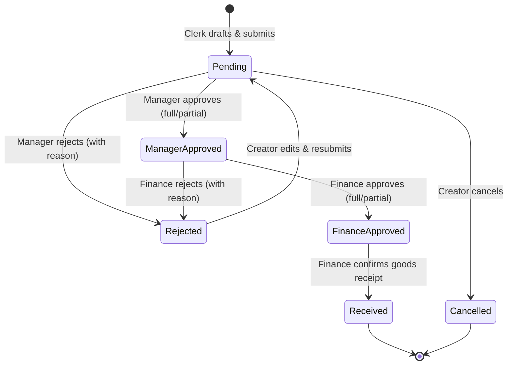

# Software Requirements Specification (SRS)

**Project:** Inventory & Procurement Management System (IPMS)  
**Document Version:** 1.2 – Official Baseline  
**Date:** 2026-11-15  
**Status:** Approved for Implementation  

---

### Revision History
| Version | Date | Status | Description |
|---------|------|--------|-------------|
| 0.1 | 2026-11-12 | Draft | Preliminary draft specification. |
| 0.9 | 2026-11-13 | Draft | Comprehensive draft with core requirements and workflows. |
| 0.9.1 | 2026-11-14 | Revised Draft | Addressed findings from Independent Audits Round 1 & 2: added FR‑023–FR‑030, RBAC matrix, typed SSE specification, refreshed NFRs, and synchronized Data Model. |
| 0.9.2 | 2026-11-14 | Revised Draft | Addressed Round 3 audit findings: changed Google Sheets export to POST (REST semantics), added concurrency controls for requisition transitions (`SELECT FOR UPDATE`), Admin self-deactivation guard, price snapshot rule, and concrete NFR verification methods. |
| 1.0 | 2026-11-14 | Approved | Official baseline approved for system design, sprint planning, and implementation. |
| 1.1 | 2026-11-14 | Approved | Enhanced export authorization: granted `GET /export/csv` to all authenticated roles for physical counts/planning and `POST /export/google-sheet` to Admin, Manager, and Finance Officer for management reporting. |
| 1.2 | 2026-11-15 | Approved | API & workflow alignment from UI/UX requirements review: added `PATCH /requisitions/:id/resubmit` (G01), embedded `timeline[]` in `GET /requisitions/:id` (G02), rejection history tracking (G03), bulk notification read `PATCH /notifications/read` (G04), and `status` filter on `GET /items` (G05). |

---

## 1. Introduction
### 1.1 Purpose
The purpose of this document is to specify the functional and non‑functional requirements for the **Inventory & Procurement Management System (IPMS)**. This specification serves as the authoritative contract and baseline for developers, architects, testers, and project stakeholders throughout implementation and verification.

### 1.2 Scope
The system enables multiple user roles to manage inventory items, create purchase requisitions, execute a two‑step approval workflow (Manager → Finance), receive goods, generate low‑stock alerts, view a real‑time dashboard, and export inventory data to Google Sheets.

The MVP focuses on the **internal requisition, approval, and stock management workflow**. External supplier interactions (supplier portals, formal purchase order EDI, delivery tracking) are deferred to post-MVP releases (see §2.6).

### 1.3 Definitions, Acronyms, Abbreviations
| Term | Definition |
|------|------------|
| **MVP** | Minimum Viable Product – mandatory features scheduled for the initial 4-week release box. |
| **SSE** | Server‑Sent Events – unidirectional HTTP push mechanism for real‑time state updates from back-end to front-end. |
| **JWT** | JSON Web Token – signed stateless token used for authentication (short-lived access token + rotating refresh token). |
| **CRUD** | Create, Read, Update, Delete operations. |
| **SMA** | Simple Moving Average – demand-forecasting heuristic (optional / post-MVP). |
| **NFR** | Non‑functional Requirement. |
| **FR** | Functional Requirement. |
| **RBAC** | Role‑Based Access Control. |
| **Clerk** | Shorthand for "Inventory Clerk" throughout this document. |
| **Finance** | Shorthand for "Finance Officer" throughout this document. |

### 1.4 References
In accordance with IEEE 29148 §9.5.4, the following documents form part of this specification to the extent cited herein. For internal project artifacts, paths are relative to the project repository.

| Ref ID | Document Title | Document Identifier / Source | Version / Date | Location |
|:------:|:---------------|:-----------------------------|:--------------:|:---------|
| [REF-01] | Project Brief | IPMS-DOC-BRIEF | v1.0 (2026-11) | [`docs/planning/ProjectBrief.md`](../planning/ProjectBrief.md) |
| [REF-02] | Data Model & Business Rules | IPMS-DOC-DATAMODEL | v1.2 (2026-11) | [`docs/specs/DataModel.md`](./DataModel.md) |
| [REF-03] | Functional Requirements Register | IPMS-DOC-REQREG | v1.0 (2026-11) | [`docs/specs/RequirementsRegister.md`](./RequirementsRegister.md) |
| [REF-04] | Architectural Decision Log | IPMS-DOC-DECISIONS | v1.0 (2026-11) | [`docs/decisions/DecisionLog.md`](../decisions/DecisionLog.md) |
| [REF-05] | Requirements Audit & Review Log | IPMS-DOC-AUDIT | v1.2 (2026-11) | [`docs/archive/SRS_Draft_Review.md`](../archive/SRS_Draft_Review.md) |
| [REF-06] | ISO/IEC/IEEE 29148:2018 | ISO/IEC/IEEE Standard | 2018-11 | Systems and software engineering — Life cycle processes — Requirements engineering |
| [REF-07] | RFC 7807 | IETF Standards Track | 2016-03 | Problem Details for HTTP APIs |
| [REF-08] | W3C Server-Sent Events | W3C / WHATWG Recommendation | Living Standard | HTML EventSource / text/event-stream specification |

### 1.5 Document Conventions
This document utilizes concise natural language. All functional requirements listed as **Mandatory** possess the contractual force of IEEE 29148 "shall" statements — mandatory for MVP completion and verified in test plans. Requirements marked **(Optional)** or **(Good‑to‑have)** denote discretionary post-MVP enhancements (IEEE "may").

Acceptance criteria are specified in imperative format to facilitate direct derivation of test suites and validation scripts.

---

## 2. Overall Description
### 2.1 Product Perspective
IPMS is a standalone multi-tier web application consisting of:
- **Client Tier**: React with TypeScript single-page application (SPA), built using Vite and styled with Material-UI (MUI).
- **Application Tier**: Modular NestJS REST API with guards, interceptors, pipes, and Server-Sent Events (SSE) streaming.
- **Data Tier**: PostgreSQL relational database accessed through Prisma ORM for type-safe schema definitions and automated migrations.

**Integrated External Services (MVP):**
- **SendGrid (Mock)**: Structured email notifications simulated via `ConsoleEmailService` implementing `EmailService`, enabling zero-cost mock logging without API quota consumption.
- **Google Sheets API v4**: Read/write service-account integration for one-way inventory export.
- **GitHub Actions**: Continuous integration pipeline running linting, type checks, unit tests, and container builds.

### 2.2 Product Functions (Summary)
1. **User Authentication & RBAC**: Self-registration with default clerk permissions, secure JWT session management, role guards, user deactivation, and admin password reset.
2. **Item Catalog**: Complete item CRUD, individual SKU reorder thresholds, inventory tracking, and controlled manual stock adjustments.
3. **Purchase Requisition Workflow**: Multi-item requisition creation, two-stage approval gate (Manager → Finance), partial quantity approval, structured rejection with creator resubmission, creator cancellation, and transactional goods receipt.
4. **Automated Alerting**: Threshold-crossing low-stock notifications delivered via in-app toast, persisted notification inbox, and logged emails.
5. **Real-Time Operational Dashboard**: Aggregated stock metrics, low-stock counts, and live requisition feeds driven by SSE push events.
6. **Data Export**: One-click Google Sheet generation/synchronization with instant CSV fallback on network or credential failures.

### 2.3 User Classes & Characteristics
| Role | Responsibilities & Capabilities |
|------|---------------------------------|
| **Admin** | System administration, user lifecycle management (role reassignment, account deactivation/reactivation, password resets), item catalog authoring/deletion, system audit log inspection, inventory data export (Google Sheets & CSV) for system audits and backups. Admin does not participate in workflow approvals. |
| **Inventory Clerk** | Physical inventory oversight, item catalog browsing, purchase requisition drafting and cancellation of own pending drafts, manual inventory adjustments (stock counts/corrections), on-demand CSV inventory export for warehouse stocktaking and cycle counts. |
| **Manager** | Operational department review; first-level requisition review (approval, partial item quantity modification, rejection with reason), low-stock alert recipient, inventory data export (Google Sheets & CSV) for replenishment planning and operational reviews. |
| **Finance Officer** | Fiscal gatekeeper; second-level requisition review, goods receipt confirmation (triggering inventory increment), inventory data export (Google Sheets & CSV) for asset valuation and accounting, low-stock alert recipient. |

### 2.4 Operating Environment
- **Client Platforms**: Modern evergreen browsers (Chromium-based, Firefox, Safari) across desktop and tablet/mobile viewports.
- **Runtime Environment**: Node.js 20+ LTS, NestJS 10, PostgreSQL 15+, Prisma ORM 5+.
- **Deployment Platform**: Dockerized container deployment with multi-stage builds (`Dockerfile` and `docker-compose.yml` for reproducible local and staging environments).

### 2.5 Design Constraints & Assumptions
- **Sprint Duration**: 4 calendar weeks for MVP baseline delivery.
- **Mock Notifications**: Production mail service accounts are avoided; SendGrid calls log formatted output to stdout.
- **Per-SKU Thresholds**: Reorder trigger thresholds are configured independently on each catalog item (Decision D-004).
- **Push Transport Mechanism**: Real-time updates utilize unidirectional SSE rather than WebSockets, reducing proxy and socket management overhead (Decision D-005, superseding legacy 5-second polling).
- **Two-Step Approval**: Two-tier hierarchical approval (Manager followed by Finance) is mandatory for procurement integrity (Decision D-002).
- **Separation of Duties Trade-off**: In the 4-role MVP model, Finance handles both fiscal authorization and goods receipt confirmation. Enterprise segregation (separating Receiving Dock Clerks from Purchasing Approvers) is identified as a future post-MVP expansion.

### 2.6 Out of Scope
The following capabilities are explicitly excluded from the MVP baseline:

| Excluded Capability | Rationale |
|---------------------|-----------|
| Self-service password reset via email tokens | External mail transport is mocked; Admin-assisted reset (`PATCH /users/:id/reset-password`) is provided instead. |
| Supplier catalog & formal Purchase Order (PO) dispatch | MVP manages internal requisitions and stock; vendor billing/ordering belongs to Phase 2 ERP integration. |
| Partial goods shipments / fragmented receipts | Line items are marked received in a single atomic transaction upon order arrival. |
| Bulk CSV catalog importing | Deferred to post-MVP utility enhancements. |
| Barcode / QR hardware scanning | High client complexity; deferred to mobile companion phase. |
| Multi-tenant organization isolation | Single-organization architecture for MVP. |
| Complex predictive / AI demand modeling | Post-MVP optional item (simple SMA forecasting scoped under FR-015). |

---

## 3. Functional Requirements

| ID | Requirement Summary | Detailed Acceptance Criteria |
|----|---------------------|------------------------------|
| **FR‑001** | User Registration & Login | 1. Registration endpoint accepts valid unique email and password (minimum 8 characters).<br>2. Newly registered users are assigned the `Inventory Clerk` role by default.<br>3. Passwords must be hashed using `bcrypt` (work factor ≥ 10).<br>4. Authentication issues a short-lived signed JWT access token (15-minute expiry) and an HttpOnly, SameSite refresh token cookie (7-day lifespan). |
| **FR‑002** | Role-Based Access Control (RBAC) | 1. Every API route enforces JWT validation and caller role verification via NestJS Guards.<br>2. Endpoint permissions strictly conform to the RBAC Permission Matrix (§9, Appendix A).<br>3. Unauthorized role access returns HTTP 403 Forbidden. |
| **FR‑003** | Item Catalog CRUD & Deletion Safeguards | 1. Admin can create, read, update, and soft/hard delete catalog items. Initial creation accepts `initialQuantity` ($\ge 0$). Item updates (`PATCH /items/:id`) allow modifying metadata (`name`, `description`, `location`, `unitPrice`, `reorderThreshold`, `isActive`) but strictly prohibit direct modification of `quantity`.<br>2. Direct manual stock quantity changes must exclusively use `PATCH /items/:id/adjust` (FR-025). Physical stock `quantity` is constrained to non-negative values (`quantity ≥ 0`).<br>3. If an Item is referenced by any historical or active `RequisitionItem`, hard deletion is prohibited and returns HTTP 409 `ItemInUse`.<br>4. Soft deletion is supported by toggling `Item.isActive = false`. |
| **FR‑004** | Purchase Requisition Creation | 1. Clerk can draft and submit a requisition with one or more catalog line items.<br>2. Created requisitions default to `Pending` status.<br>3. Line-item `approvedQty` initializes to `requestedQty`.<br>4. Requisition `totalAmount` is calculated as $\sum(\text{requestedQty} \times \text{snapshotUnitPrice})$ at creation time.<br>5. `unitPrice` is snapshotted into `RequisitionItem.snapshotUnitPrice` at creation; future catalog price changes do not modify historical requisition values. |
| **FR‑005** | First-Level Manager Approval | 1. Manager can approve (`ManagerApproved`) or reject (`Rejected`) pending requisitions.<br>2. Manager may modify line-item `approvedQty` (partial approval); `totalAmount` automatically recalculates as $\sum(\text{approvedQty} \times \text{snapshotUnitPrice})$.<br>3. On rejection, a non-empty `rejectionReason` string is mandatory and logged in the immutable audit record.<br>4. Creator receives an in-app rejection notification and retains permission to edit and resubmit (re-entering `Pending` state). |
| **FR‑006** | Second-Level Finance Approval | 1. Finance Officer can review `ManagerApproved` requisitions to approve (`FinanceApproved`) or reject (`Rejected`).<br>2. Finance may further adjust `approvedQty` (partial approval), updating `totalAmount`.<br>3. On rejection, `rejectionReason` is recorded in audit details, the creator is notified, and creator resubmission resets status to `Pending` (restarting full approval cycle). |
| **FR‑007** | Goods Receipt & Atomic Stock Update | 1. Finance Officer can mark `FinanceApproved` orders as `Received`.<br>2. Status updates to `Received` and each line item increases `Item.quantity` by `approvedQty`.<br>3. Status transition and quantity increments must execute within a single atomic database transaction utilizing row-level locks (`SELECT ... FOR UPDATE`).<br>4. Low-stock alert evaluations are re-triggered for all modified SKUs. |
| **FR‑008** | Threshold-Crossing Low-Stock Alerts | 1. Alert triggers exclusively when `Item.quantity` transitions from $\ge \text{reorderThreshold}$ to $< \text{reorderThreshold}$.<br>2. Alert fires once per downward threshold boundary crossing; subsequent modifications while remaining below threshold suppress duplicate alerts.<br>3. Evaluated across all stock-altering operations (receipts, manual adjustments, item catalog threshold updates).<br>4. Dispatches an in-app `LowStockAlert` notification to Managers and Finance Officers and emits a formatted log event. |
| **FR‑009** | Server-Sent Events (SSE) Real-Time Stream | 1. Authenticated clients connect via `GET /events` using HttpOnly cookie authentication.<br>2. Emits structured, typed JSON payloads (§4.4) within ≤ 1 second of database commit.<br>3. Transmits periodic heartbeat comments (`: heartbeat\n\n`) every 30 seconds to maintain persistent connections across proxies.<br>4. Client reconnect directive is established at 5000 ms (`retry: 5000`). |
| **FR‑010** | Aggregated Dashboard Service | 1. `GET /dashboard` delivers real-time aggregated metrics: `{ totalItems, lowStockCount, recentRequisitions[] }` (latest 5 records).<br>2. Metrics compute on demand without stale cache artifacts.<br>3. State changes broadcast a `dashboard.updated` SSE event to connected clients for instant UI refresh. |
| **FR‑011** | Google Sheets Inventory Export | 1. Authorized management and oversight roles (**Admin, Manager, Finance Officer**) can execute `POST /export/google-sheet` to create or update an external spreadsheet containing current inventory data.<br>2. Uses Google service account with `https://www.googleapis.com/auth/spreadsheets` scope (one-way write from IPMS to Sheet).<br>3. Success returns HTTP 200 with `{ sheetUrl: string }`.<br>4. Third-party failures (credential error, quota cap, network timeout) respond with HTTP 502 Bad Gateway and direct client to the CSV fallback. |
| **FR‑012** | OpenAPI Documentation | 1. Swagger UI is served at `/api/docs`, providing automated schemas, parameters, and authentication definitions derived from NestJS DTOs and decorators. |
| **FR‑014** | Immutable System Audit Logging | 1. System records immutable entries for all entity mutations (`CREATE`, `UPDATE`, `DELETE`, `APPROVE`, `REJECT`, `RECEIVE`, `CANCEL`, `ADJUST`).<br>2. Records capture `entity`, `entityId`, `action`, `performedBy`, `timestamp`, and JSON `details` (before/after delta and `rejectionReason`). |
| **FR‑015** | Simple Moving Average (SMA) Forecasting *(Optional)* | 1. Background service calculates 4-week historical consumption moving average per SKU.<br>2. Displays recommended replenishment orders on dashboard analytics view. |
| **FR‑016** | Interactive Data Visualizations *(Good-to-have)* | 1. Chart.js visual components illustrating monthly procurement expenditure, stock turnover lines, and low-stock SKU distributions. |
| **FR‑017** | Notification History & Read Status | 1. User notifications persist in `Notification` store (`LowStockAlert`, `RequisitionUpdate`, `ApprovalResult`).<br>2. Provides paginated inbox filtering by read/unread status with bulk or single mark-as-read capabilities restricted to notification owners. |
| **FR‑018** | Authentication Brute-Force Rate Limiting | 1. Login endpoint (`POST /auth/login`) permits a maximum of 5 attempts per originating IP within a rolling 60-second window.<br>2. Subsequent requests within the window receive HTTP 429 Too Many Requests. |
| **FR‑019** | CSRF Double-Submit Protection | 1. Successful authentication sets a client-accessible, non-HttpOnly cookie (`csrfToken`) and echoes the token in login response data.<br>2. State-changing requests (`POST`, `PATCH`, `DELETE`) require the token value echoed in the `X-CSRF-Token` header.<br>3. Mismatched or absent header returns HTTP 403 Forbidden. |
| **FR‑020** | Rigorous Payload Validation & Sanitization | 1. Inbound request bodies validate against strict class-validator DTOs with unexpected properties stripped (`whitelist: true`, `forbidNonWhitelisted: true`).<br>2. Invalid payloads return HTTP 400 Bad Request with field-level diagnostic messages; input strings are sanitized against injection attacks. |
| **FR‑021** | List Pagination & Filtering | 1. List endpoints (`GET /items`, `GET /requisitions`, `GET /notifications`, `GET /users`, `GET /audit-logs`) support standardized 1-indexed pagination query parameters: `page` (integer $\ge 1$, default 1) and `limit` (integer $\ge 1$, default 50, max 100).<br>2. List endpoints support domain filters: `GET /items` supports `search` (case-insensitive SKU/name match), `location`, `stockStatus` (`low` [$\text{quantity} < \text{reorderThreshold}$] \| `normal` [$\text{quantity} \ge \text{reorderThreshold}$]), and `status` (`active` \| `inactive` \| `all`, Admin-only); `GET /requisitions` supports query filtering by `status` (enum) and `creatorId` (UUID).<br>3. Output payload wraps items in standard pagination envelope: `{ data: [...], pagination: { page: number, limit: number, totalCount: number, totalPages: number } }`. |
| **FR‑022** | SSE Connection Quotas | 1. Concurrent active `/events` connections are capped at 3 per authenticated user.<br>2. Connection attempts exceeding threshold respond with HTTP 429 Too Many Requests. |
| **FR‑023** | User Lifecycle & Governance API | 1. Admin can list users (`GET /users`), update assigned roles (`PATCH /users/:id/role`), and toggle activation (`PATCH /users/:id/deactivate`, `PATCH /users/:id/reactivate`).<br>2. User deactivation immediately revokes active refresh tokens; subsequent requests from deactivated accounts return HTTP 403 `AccountDeactivated`.<br>3. Self-deactivation by an Admin is blocked.<br>4. Deactivation of the final remaining active Admin returns HTTP 409 `LastAdminAccount`. |
| **FR‑024** | Requisition Cancellation | 1. Requisition creator can cancel own `Pending` requisition via `PATCH /requisitions/:id/cancel`.<br>2. Status updates to `Cancelled` (terminal state), generating an audit log and notifying relevant Managers and Finance personnel. |
| **FR‑025** | Controlled Inventory Stock Adjustments | 1. Admin and Clerk can execute manual physical stock corrections via `PATCH /items/:id/adjust` supplying signed integer `adjustment` and non-empty `adjustmentReason`.<br>2. Requests resulting in negative inventory (`quantity + adjustment < 0`) are rejected with HTTP 422 `InsufficientStock`.<br>3. Operation executes under transactional lock, records audit trail, and evaluates threshold alert rules. |
| **FR‑026** | Standalone CSV Export & Fallback | 1. **All authenticated roles** (Admin, Inventory Clerk, Manager, Finance Officer) can trigger on-demand CSV stream export via `GET /export/csv` for warehouse cycle counts, inventory planning, and audits.<br>2. Automatically offered as a direct download alternative if Google Sheets synchronization fails. |
| **FR‑027** | Refresh Token Rotation & Session Maintenance | 1. `POST /auth/refresh` verifies existing refresh token cookie, invalidates the used token, and issues a fresh access token and rotated refresh token.<br>2. Stored refresh token hashes support strict one-time use detection. |
| **FR‑028** | Secure Session Logout | 1. `POST /auth/logout` invalidates the active refresh token record in database and clears authentication cookies with expired headers. |
| **FR‑029** | Admin-Assisted Password Reset | 1. Admin can invoke `PATCH /users/:id/reset-password` to generate an entropy-compliant temporary password.<br>2. Temporary credentials are logged to console (mock email delivery) for secure administrative handoff. |
| **FR‑030** | Dedicated Dashboard Aggregation Endpoint | 1. Serves atomic counts (`totalItems`, `lowStockCount`) and five latest requisition summaries via `GET /dashboard` to prevent heavy client-side join queries. |

*Note: FR‑013 (CI/CD Pipeline) is managed as an engineering process artifact rather than a runtime software capability.*

---

## 4. External Interface Requirements
### 4.1 User Interfaces
- Modern Responsive Web SPA built with React 18, TypeScript, and Material-UI v5.
- Layout adapts dynamically across Desktop (≥ 1200px), Tablet (768px – 1199px), and Mobile (< 768px) breakpoints.
- Visual state notifications delivered through non-blocking snackbars and a persistent slide-out notification drawer.

### 4.2 Software Interfaces
- **Database Engine**: PostgreSQL 15+ connected via Prisma client connection pooling.
- **Push Notification Stream**: HTTP/1.1 or HTTP/2 newline-delimited Server-Sent Events (`text/event-stream`).
- **Google Sheets API**: Google APIs Client Library using OAuth2 Service Account JSON credentials for scoped spreadsheet updates.
- **Mailer Adapter**: `ConsoleEmailService` mock abstraction conforming to standard mail dispatch interface contracts.

### 4.3 REST API Interface Directory
All API routes are prefixed with `/api/v1` (with exception of documentation and root health probes).

| HTTP Method | Route | Description | Authorization |
|:-----------:|:------|:------------|:--------------|
| `POST` | `/auth/register` | Register new user account (defaults to Clerk role) | Public |
| `POST` | `/auth/login` | Authenticate credentials; sets JWT cookies | Public |
| `POST` | `/auth/refresh` | Rotate refresh token and obtain fresh access token | Authenticated |
| `POST` | `/auth/logout` | Revoke session and purge auth cookies | Authenticated |
| `GET` | `/items` | Paginated catalog listing (`page`, `limit`, `search`, `location`, `stockStatus`, `status=active\|inactive\|all`) | All Authenticated (Inactive/All: Admin only) |
| `POST` | `/items` | Create new catalog SKU | Admin |
| `PATCH` | `/items/:id` | Update SKU specifications or reorder thresholds (stock quantity cannot be altered via this endpoint) | Admin |
| `PATCH` | `/items/:id/adjust` | Record manual physical count adjustment | Admin, Inventory Clerk |
| `DELETE` | `/items/:id` | Remove catalog item (enforces referential integrity) | Admin |
| `GET` | `/dashboard` | Fetch aggregated dashboard metrics | All Authenticated |
| `POST` | `/requisitions` | Submit purchase requisition | Inventory Clerk |
| `GET` | `/requisitions` | Query requisitions (`page`, `limit`, `status`, `creatorId`) | All Authenticated |
| `GET` | `/requisitions/:id` | Inspect requisition details, snapshotted lines, rejection history, and `timeline[]` | All Authenticated |
| `PATCH` | `/requisitions/:id/approve` | Submit managerial or financial approval | Manager, Finance Officer |
| `PATCH` | `/requisitions/:id/reject` | Reject requisition with required explanation | Manager, Finance Officer |
| `PATCH` | `/requisitions/:id/cancel` | Cancel unapproved draft requisition | Inventory Clerk (Creator only) |
| `PATCH` | `/requisitions/:id/resubmit`| Edit and resubmit rejected requisition; resets to Pending with fresh price snapshot | Inventory Clerk (Creator only) |
| `PATCH` | `/requisitions/:id/receive` | Confirm goods receipt and increment stock | Finance Officer |
| `GET` | `/notifications` | List user notification history (`page`, `limit`, `read`) | All Authenticated (Own items) |
| `PATCH` | `/notifications/:id/read` | Mark individual notification as read | All Authenticated (Owner only) |
| `PATCH` | `/notifications/read` | Bulk mark notifications as read (`{ ids?: string[], all?: boolean }`) | All Authenticated (Owner only) |
| `GET` | `/audit-logs` | Retrieve chronological audit trail entries (`page`, `limit`, `action`, `entityType`, `startDate`, `endDate`) | Admin |
| `GET` | `/users` | Paginated user registry list (`page`, `limit`, `role`, `status`) | Admin |
| `PATCH` | `/users/:id/role` | Modify assigned user security role | Admin |
| `PATCH` | `/users/:id/deactivate` | Deactivate account (with last-admin guard) | Admin |
| `PATCH` | `/users/:id/reactivate` | Reactivate dormant user account | Admin |
| `PATCH` | `/users/:id/reset-password` | Issue temporary administrative credentials | Admin |
| `POST` | `/export/google-sheet` | Generate/update Google Sheet inventory snapshot | Admin, Manager, Finance Officer |
| `GET` | `/export/csv` | Download direct CSV inventory report | All Authenticated |
| `GET` | `/events` | Subscribe to real-time SSE event pipeline | All Authenticated |
| `GET` | `/api/docs` | Interactive OpenAPI Swagger UI | Public (Dev) / Restricted (Prod) |
| `GET` | `/health` | Terminus system and database health probe | Public |

### 4.3.1 Requisition Detail Response Contract
The `GET /requisitions/:id` endpoint returns complete requisition details, snapshotted line items, current and historical rejection reasons, and a chronological milestone timeline:

```json
{
  "id": "uuid-string",
  "creatorId": "uuid-string",
  "creator": {
    "id": "uuid-string",
    "email": "clerk@ipms.internal",
    "name": "Jane Clerk",
    "role": "InventoryClerk"
  },
  "status": "Pending",
  "totalAmount": 1250.00,
  "currentRejectionReason": null,
  "items": [
    {
      "id": "line-id",
      "itemId": "item-id",
      "sku": "SKU-1001",
      "name": "Industrial Widget",
      "requestedQty": 50,
      "approvedQty": 50,
      "snapshotUnitPrice": 25.00,
      "lineTotal": 1250.00
    }
  ],
  "timeline": [
    {
      "id": "event-id",
      "eventType": "SUBMITTED",
      "previousStatus": null,
      "newStatus": "Pending",
      "actor": {
        "id": "uuid-string",
        "email": "clerk@ipms.internal",
        "name": "Jane Clerk",
        "role": "InventoryClerk"
      },
      "timestamp": "2026-11-15T08:00:00Z",
      "rejectionReason": null,
      "quantityModifications": null
    }
  ],
  "rejectionHistory": [
    {
      "stage": "Manager",
      "rejectedBy": {
        "id": "uuid-string",
        "email": "manager@ipms.internal",
        "name": "Bob Manager",
        "role": "Manager"
      },
      "rejectedAt": "2026-11-15T09:30:00Z",
      "rejectionReason": "Exceeds monthly department allocation",
      "cycleNumber": 1
    }
  ],
  "createdAt": "2026-11-15T08:00:00Z",
  "updatedAt": "2026-11-15T09:30:00Z"
}
```

*Field Specifications:*
- `currentRejectionReason`: Non-null string strictly when `status === 'Rejected'`; `null` otherwise.
- `timeline.eventType`: Enum with values `SUBMITTED`, `MANAGER_APPROVED`, `MANAGER_REJECTED`, `FINANCE_APPROVED`, `FINANCE_REJECTED`, `RESUBMITTED`, `RECEIVED`, `CANCELLED`.
- `timeline.quantityModifications`: Optional array of `{ itemId, sku, requestedQty, previousApprovedQty, newApprovedQty }` populated when approving authorities reduce item quantities.
- `rejectionHistory`: Array of historical rejection entries across review iterations, tracking `stage`, `rejectedBy`, `rejectedAt`, `rejectionReason`, and `cycleNumber` (1-based iteration counter).

### 4.4 SSE Event Specification
The `/events` endpoint streams continuous JSON events formatted in compliance with standard W3C EventSource specifications:

**Event Registry:**
| Event Name | Trigger Condition | Payload Schema |
|------------|-------------------|----------------|
| `item.created` | New catalog SKU inserted | `{ entityId: string, item: object, timestamp: string }` |
| `item.updated` | Item details or quantity changed | `{ entityId: string, changes: object, timestamp: string }` |
| `item.deleted` | SKU removed or soft-deleted | `{ entityId: string, timestamp: string }` |
| `requisition.created` | New purchase requisition submitted | `{ entityId: string, creatorId: string, status: string, timestamp: string }` |
| `requisition.updated` | State change (Approved, Rejected, Cancelled, Received) | `{ entityId: string, status: string, previousStatus: string, timestamp: string }` |
| `notification.created` | Direct user alert created | `{ notificationId: string, type: string, message: string, timestamp: string }` |
| `dashboard.updated` | Inventory or requisition aggregates modified | `{ totalItems: number, lowStockCount: number, timestamp: string }` |

**Distribution Rules:**
- Catalog, requisition, and dashboard events broadcast globally to all authenticated active streams.
- `notification.created` events filter selectively, dispatching strictly to the targeted `userId`.

---

## 5. Non‑Functional Requirements (NFR)

| ID | Category | Requirement Specification | Verification Method |
|----|----------|---------------------------|---------------------|
| **NFR‑001** | **Performance** | API p95 response time < 200 ms for catalog and workflow CRUD on datasets up to 5,000 items. SSE push latency ≤ 1.0 second. | Automated `k6` benchmark suite executed against Docker container; SSE delivery latency verified via end-to-end timestamp diff tests. |
| **NFR‑002** | **Security** | Passwords hashed using bcrypt (cost factor ≥ 10). Access tokens expire in 15 minutes; refresh tokens stored in HttpOnly, SameSite=Strict cookies. Role guards enforce authorization on every private route. | Automated security regression tests; static code analysis (SonarQube/Semgrep); runtime cookie inspection. |
| **NFR‑003** | **Scalability** | Application tier remains stateless for REST requests. Real-time SSE streams are bound to single application instances; multi-instance horizontal scaling is identified as post-MVP (requiring Redis Pub/Sub). | Architecture review verifying absence of local in-memory session stores; stateless service restart validation. |
| **NFR‑004** | **Data Integrity** | All stock quantity increments, decrements, and requisition status transitions must execute within PostgreSQL transactions guarded by row-level locking (`SELECT ... FOR UPDATE`). | Concurrency tests firing simultaneous conflicting approval, cancellation, and decrement operations; validation of zero race-condition anomalies. |
| **NFR‑005** | **Usability** | User interface complies with WCAG 2.1 Level A accessibility standards. Standard visual themes utilize Material-UI components with explicit ARIA tags. | Automated audits with `axe-core`; keyboard navigation testing covering complete requisition lifecycle. |
| **NFR‑006** | **Maintainability** | NestJS modular architecture with explicit domain separation (`/modules/*`). Strict TypeScript compilation (`strict: true`, `noImplicitAny: true`). Complete ESLint and Prettier conformance. | CI build validation pipeline enforcing zero linter warnings and clean compilation. |
| **NFR‑007** | **Cost & Quota** | Production architecture operates within free hosting tiers (Render/Railway free database and compute allowances, free Google Service Account quotas). | Monthly operational cost audit; runtime verification that zero billable external services are invoked. |
| **NFR‑008** | **Portability** | Multi-stage Dockerfiles for client and server. Complete local environment spin-up via single `docker-compose up` command. | Clean-host deployment test validating automated container boot and healthy container status. |
| **NFR‑009** | **Logging & Privacy** | Structured JSON logging to stdout with correlation IDs. Sensitive fields (passwords, auth cookies, JWT tokens, PII) are strictly masked. | Automated log scanner test asserting absence of raw credential strings across test execution runs. |
| **NFR‑010** | **Error Handling** | Global exception filters capture uncaught errors and format unified RFC 7807 problem details: `{ statusCode, message, error, timestamp, path }`. Stack traces suppressed in non-dev environments. | Unit and integration tests triggering 400, 401, 403, 404, 409, 422, and 500 error scenarios. |
| **NFR‑011** | **Health Monitoring** | Automated health check endpoint (`/health`) reports database connectivity, disk storage, and process uptime via NestJS Terminus. | Integration test verifying HTTP 200 during normal runtime and HTTP 503 during simulated DB connection drops. |
| **NFR‑012** | **Audit Immutability** | Audit log records are append-only. Application database credentials restrict SQL `UPDATE` and `DELETE` operations on `AuditLog` tables. | Database constraint tests asserting failure on attempted modifications or deletions of audit records. |
| **NFR‑013** | **Reliability** | Production containers run under explicit restart policies (`restart: unless-stopped`) with automated crash recovery. | Container process termination simulation verifying auto-recovery within 10 seconds. |
| **NFR‑014** | **Configuration** | Operational settings (JWT secrets, CORS origins, service URLs, database connection strings) managed exclusively via environment variables validated at boot. | Startup failure validation test when required environment parameters are omitted. |
| **NFR‑016** | **Network Security** | Strict Cross-Origin Resource Sharing (CORS) whitelist restricting requests to the designated SPA origin. HTTP responses supply strict Content-Security-Policy (CSP) headers. | Automated security header inspection (`helmet` test suite) verifying CSP and CORS response headers. |
| **NFR‑018** | **Database Indexing** | Optimized indexes established on `items.sku`, `items.reorderThreshold`, `items.isActive`, `requisitions.status`, `requisitions.creatorId`, and `users.email`. | Database `EXPLAIN ANALYZE` query plans demonstrating index scans on primary query filters. |
| **NFR‑019** | **Aggregation Efficiency** | Dashboard metric queries execute using optimized aggregation without unbounded table scans. | Query execution benchmarks ensuring aggregate retrieval executes in < 50 ms on 5,000 item datasets. |
| **NFR‑020** | **Resource Governance** | Container configurations enforce explicit resource limits (`mem_limit: 512m`, `cpus: 0.5`) to prevent runaway memory leaks. | Load test monitoring asserting memory utilization remains stable under sustained load. |

---

## 6. Data Requirements & Business Rules
Detailed schemas, foreign key mappings, and table indexes are formally specified in the Data Model & Business Rules document ([REF-02, `docs/specs/DataModel.md`](./DataModel.md)).

### 6.1 Core Business Rules Summary
1. **Inventory Non-Negativity**: Inventory quantity must never drop below 0. Any adjustment or operation yielding negative stock is rejected at the database level.
2. **Reorder Threshold Boundary Evaluation**: Low-stock alerts evaluate on state transition crossings ($\ge \text{threshold}$ to $< \text{threshold}$) to eliminate spam notifications.
3. **Price Snapshot Rule**: Line items record `snapshotUnitPrice` at the moment of requisition submission. Subsequent price updates in the item catalog never alter existing requisition totals.
4. **Approval Line Item Discretion**: Approving authorities (Manager, Finance) possess permission to adjust `approvedQty` downward during review. Requisition `totalAmount` recalculates to reflect authorized quantities.
5. **Rejection Resubmission**: Rejection terminates the immediate review sequence but permits the creator to modify quantities or line items and resubmit via `PATCH /requisitions/:id/resubmit`. Resubmission captures current catalog snapshot prices (`snapshotUnitPrice`), appends a resubmission event to the audit/timeline trail, and resets state to `Pending`, enforcing full re-approval starting at Level 1 (Manager).
6. **Administrative Governance Safety**: An Admin cannot deactivate their own user account. The system prohibits deactivation of the last remaining active Admin account.
7. **Referential Preservation**: Deleting items with linked requisition history is prohibited (HTTP 409). Historical auditability requires the use of soft deletion (`isActive = false`).

---

## 7. Operational Workflows & State Machines

### 7.1 Requisition Lifecycle State Machine


### 7.2 State Transition Matrix
| Source State | Destination State | Permitted Role | Preconditions & Actions |
|:-------------|:------------------|:---------------|:------------------------|
| *(None)* | `Pending` | Inventory Clerk | At least 1 item line; `snapshotUnitPrice` captured; `totalAmount` computed. |
| `Pending` | `ManagerApproved` | Manager | Validates quantities; optional downward `approvedQty` adjustment; logs audit. |
| `Pending` | `Rejected` | Manager | Non-empty `rejectionReason` supplied; creator notified; logs audit. |
| `Pending` | `Cancelled` | Inventory Clerk | Requisition creator only; terminal state; logs audit. |
| `ManagerApproved` | `FinanceApproved`| Finance Officer | Budget validation; optional downward `approvedQty` adjustment; logs audit. |
| `ManagerApproved` | `Rejected` | Finance Officer | Non-empty `rejectionReason` supplied; creator notified; logs audit. |
| `FinanceApproved` | `Received` | Finance Officer | Executed in atomic transaction: increments item inventory; evaluates stock alerts. |
| `Rejected` | `Pending` | Inventory Clerk | Creator edits quantities/items via `PATCH /requisitions/:id/resubmit`; fresh `snapshotUnitPrice` captured; restarts full approval cycle from Manager; logs audit. |

---

## 8. Verification & Acceptance Criteria
The release of IPMS Version 1.0 requires verification against the following acceptance gates:

1. **Functional Completeness**: All 27 mandatory functional requirements (FR‑001 through FR‑012, FR‑014, and FR‑017 through FR‑030) implemented, documented, and passing automated unit and integration tests.
2. **Performance Benchmark**: System passes `k6` benchmark suite (`perf-test.k6`) achieving median response latency ≤ 200 ms on a catalog dataset of 5,000 items under standard local containerized execution.
3. **Security Standards**: Clean vulnerability audit with zero high/critical vulnerabilities reported by `npm audit` or static code scanning; verification that credentials are cryptographically hashed and session cookies enforce `HttpOnly` and `SameSite`.
4. **Data Integrity & Concurrency**: Stress tests demonstrate that concurrent conflicting status updates and stock modifications maintain ACID guarantees without dirty reads or deadlocks.
5. **OpenAPI Documentation Quality**: Fully interactive Swagger documentation exposed at `/api/docs` with typed schemas matching all controller routes.

---

## 9. Appendices

### Appendix A – RBAC Permission Matrix

| API Endpoint | Admin | Inventory Clerk | Manager | Finance Officer | Governance Notes |
|:-------------|:-----:|:---------------:|:-------:|:---------------:|:-----------------|
| `POST /auth/register` | — | — | — | — | **Public access** (initial role: Clerk) |
| `POST /auth/login` | — | — | — | — | **Public access** |
| `POST /auth/refresh` | ✔ | ✔ | ✔ | ✔ | Requires valid refresh token cookie |
| `POST /auth/logout` | ✔ | ✔ | ✔ | ✔ | Revokes active session |
| `GET /items` | ✔ | ✔ | ✔ | ✔ | Catalog browsing. `status=inactive\|all` query restricted to Admin; others locked to active items. |
| `POST /items` | ✔ | — | — | — | Catalog authoring |
| `PATCH /items/:id` | ✔ | — | — | — | Catalog modification |
| `PATCH /items/:id/adjust` | ✔ | ✔ | — | — | Stock count adjustment (requires reason) |
| `DELETE /items/:id` | ✔ | — | — | — | Blocked if referenced by orders (HTTP 409) |
| `GET /dashboard` | ✔ | ✔ | ✔ | ✔ | Aggregated view metrics |
| `GET /requisitions` | ✔ | ✔ | ✔ | ✔ | Filterable by status & creator |
| `GET /requisitions/:id` | ✔ | ✔ | ✔ | ✔ | Detail view with embedded `timeline[]` and rejection history |
| `POST /requisitions` | — | ✔ | — | — | Requisition submission |
| `PATCH .../approve` | — | — | ✔ | ✔ | Manager: `Pending` only; Finance: `ManagerApproved` |
| `PATCH .../reject` | — | — | ✔ | ✔ | Requires mandatory rejection reason |
| `PATCH .../cancel` | — | ✔ | — | — | Creator only; unapproved drafts only |
| `PATCH .../resubmit`| — | ✔ | — | — | Creator only; `Rejected` requisitions only |
| `PATCH .../receive` | — | — | — | ✔ | `FinanceApproved` orders only |
| `GET /notifications` | ✔ | ✔ | ✔ | ✔ | Scoped strictly to authenticated caller |
| `PATCH /notifications/:id/read` | ✔ | ✔ | ✔ | ✔ | Scoped strictly to notification owner |
| `PATCH /notifications/read` | ✔ | ✔ | ✔ | ✔ | Bulk mark-as-read (`{ ids, all }`) for own notifications |
| `GET /audit-logs` | ✔ | — | — | — | System compliance inspection |
| `GET /users` | ✔ | — | — | — | User directory management |
| `PATCH /users/:id/role` | ✔ | — | — | — | Privilege assignment |
| `PATCH /users/:id/deactivate` | ✔ | — | — | — | Self-deactivation blocked; last Admin protected |
| `PATCH /users/:id/reactivate` | ✔ | — | — | — | Reactivates dormant account |
| `PATCH /users/:id/reset-password` | ✔ | — | — | — | Generates temporary password |
| `POST /export/google-sheet` | ✔ | — | ✔ | ✔ | Management & fiscal oversight; creates/syncs external spreadsheet |
| `GET /export/csv` | ✔ | ✔ | ✔ | ✔ | Tabular catalog export for stock counts, planning, and audits |
| `GET /events` | ✔ | ✔ | ✔ | ✔ | Real-time push stream (max 3 connections) |
| `GET /api/docs` | — | — | — | — | **Public** in development environments |
| `GET /health` | — | — | — | — | **Public** system uptime probe |

### Appendix B – Requirements Traceability Reference
The bidirectional relationship connecting Business Objectives, System Requirements, Database Entities, and Verification Suites is documented in the Functional Requirements Register ([REF-03, `docs/specs/RequirementsRegister.md`](./RequirementsRegister.md)).

---

**Document Approval:**  
*Prepared by:* Senior Requirements Analyst & System Architect  
*Approved by:* Product Owner & Technical Lead  
*Status:* Official Baseline — Ready for Implementation Planning
